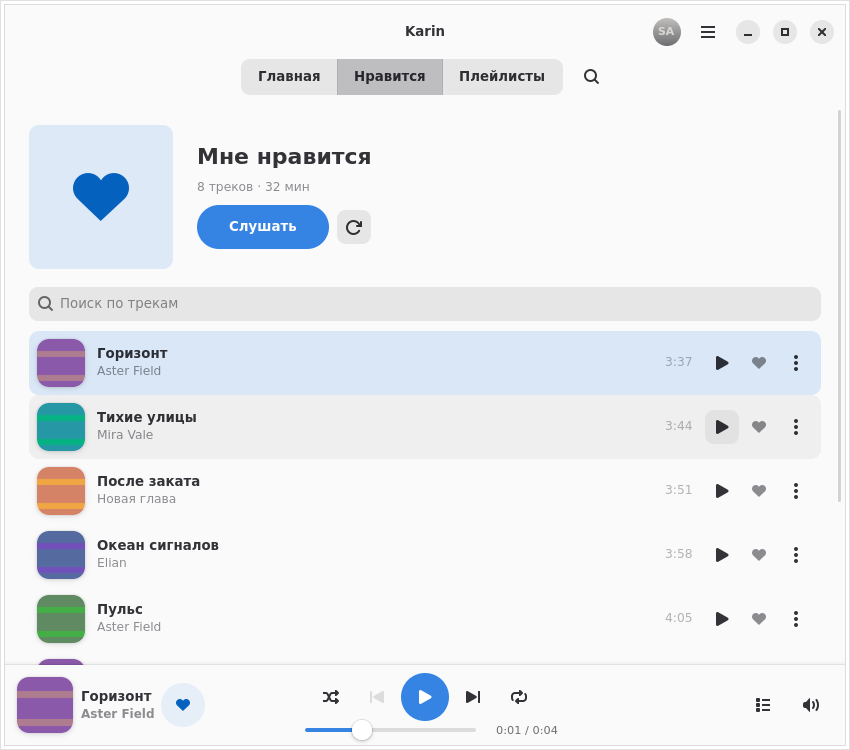
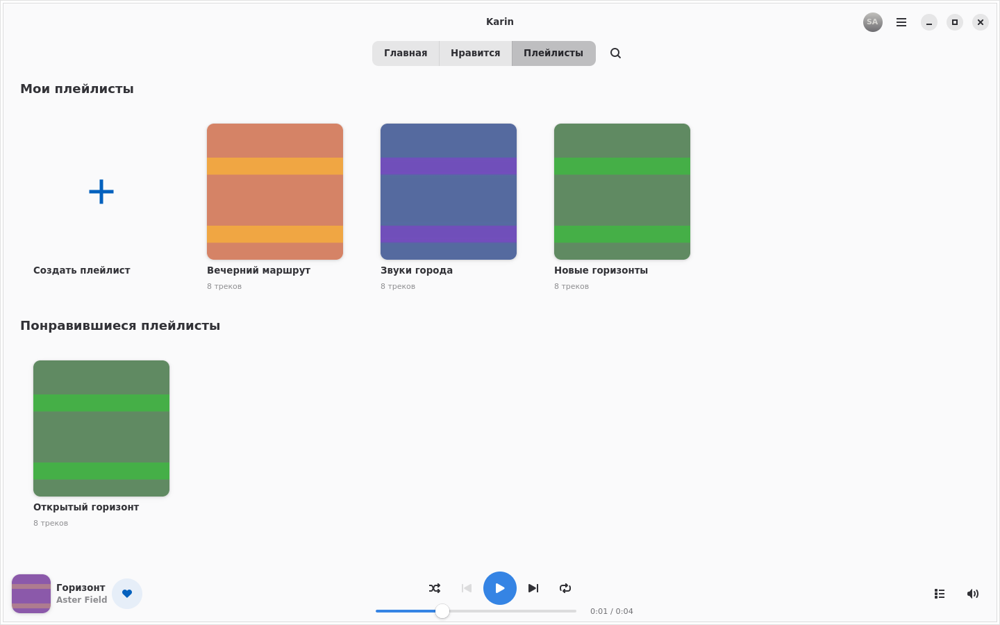
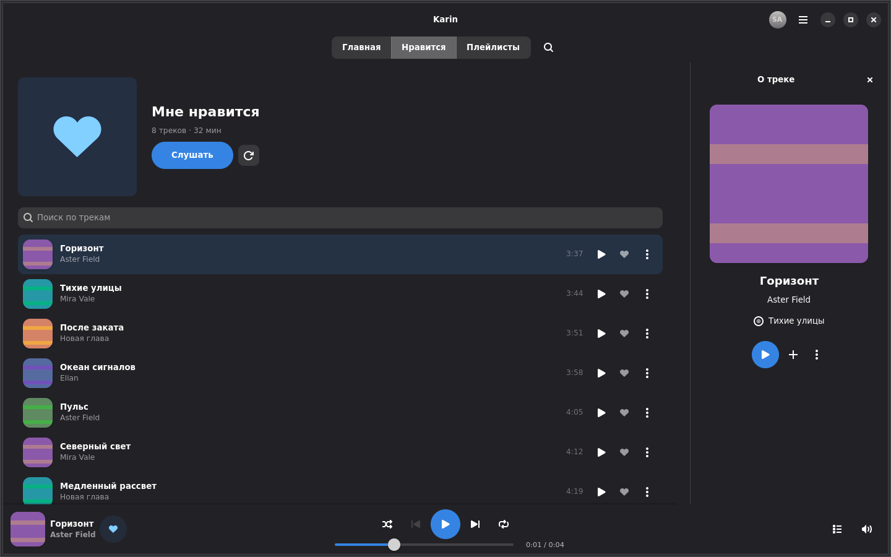

<!-- SPDX-License-Identifier: GPL-3.0-or-later -->

# Karin

**Native Yandex Music client for Linux.**

[](https://github.com/tracerxbrhd/karin/search?l=Rust)
[](Cargo.toml)
[](https://www.gtk.org/)
[](https://gnome.pages.gitlab.gnome.org/libadwaita/)
[](https://gstreamer.freedesktop.org/)
[](packaging/flatpak/io.github.tracerxbrhd.Karin.json)
[](https://github.com/tracerxbrhd/karin/actions/workflows/ci.yml)
[](LICENSE)

Listen to your library in a native GTK4/Libadwaita application, with GStreamer
playback and Linux desktop media controls. Karin is an independent project and
is not affiliated with or endorsed by Yandex.

## Screenshots



<p>
  
  
</p>

Actual GTK captures with synthetic library data and original test artwork.
[Capture details](docs/screenshots/README.md).

## Features

- Yandex sign-in, liked tracks, personal playlists and catalog search.
- Collection-local search, track details and server-confirmed playlist creation.
- Contextual queues, Shuffle/Repeat, seek and volume through GStreamer.
- A pinned track information / queue panel, responsive layouts, light/dark themes and HiDPI.
- MPRIS media controls and metadata for KDE Plasma and other Linux desktops.
- Protected remembered sign-in and an account-scoped metadata/artwork cache.

## Status

The v0.4 baseline is merged into `master` through
[PR #15](https://github.com/tracerxbrhd/karin/pull/15). The owner accepted its native
functionality, UI and Flatpak build on Fedora 44 with KDE Plasma, Wayland and PipeWire.
This is a development milestone, not a published release; the Cargo package
version remains `0.0.0`. See [validation](docs/VALIDATION.md) for the accepted scope.

The accepted stability update [PR #24](https://github.com/tracerxbrhd/karin/pull/24)
is merged at `920fd71`. The v0.5 **My Wave preview** uses this same player.
The owner confirmed real sessions, heard Music, all four supported feedback
events and continued batches on Fedora. The repeat test localized HTTP 400 to
the additional `radioFinished` sent after an accepted final `skip` on source
change. Local retirement now uses only supported track feedback; its source-change
and MPRIS Stop correction awaits repeat acceptance. Service access remains behind
`--experimental-wave` until [repeat owner acceptance](docs/BUILDING.md#my-wave-local-acceptance).
Normal Home shows the Hero with service access gated. No credentials
need to be copied for the preview.

The Music API is unofficial and may change. Dislike, recommendations,
lyrics and offline audio are not implemented. Cold first-player appearance in Cloud
still has unresolved frame gaps; desktop acceptance does not establish their
cause or resolution. See [known limitations](docs/LIMITATIONS.md).

## Build and run

Install the native dependencies using the [Fedora and Flatpak build guide](docs/BUILDING.md), then:

```sh
cargo build --release --locked
./target/release/karin
```

Use the ordinary **Войти** action to sign in with your Yandex account.
Flatpak builds use the [repository manifest](packaging/flatpak/io.github.tracerxbrhd.Karin.json)
and the same application code.

## Development

Read [AGENTS.md](AGENTS.md), the [architecture](docs/ARCHITECTURE.md) and
[build guide](docs/BUILDING.md) before changing the application.

```sh
cargo fmt --all -- --check
cargo clippy --workspace --all-targets --all-features --locked -- -D warnings
cargo test --workspace --locked
```

CI also checks the pinned Rust 1.98.1 toolchain, feature configurations and
native fixtures. The badge tracks `master`; proposed changes have their own PR checks.
The [roadmap](docs/ROADMAP.md) describes the next work.

## License

Karin's code and original materials use [GNU GPL-3.0-or-later](LICENSE), unless
otherwise stated. Third-party notices and the attribution for the adapted
Cassette authentication components are retained; see [licensing](docs/LICENSING.md).
The software license does not grant access to Yandex Music, its API or music content.
