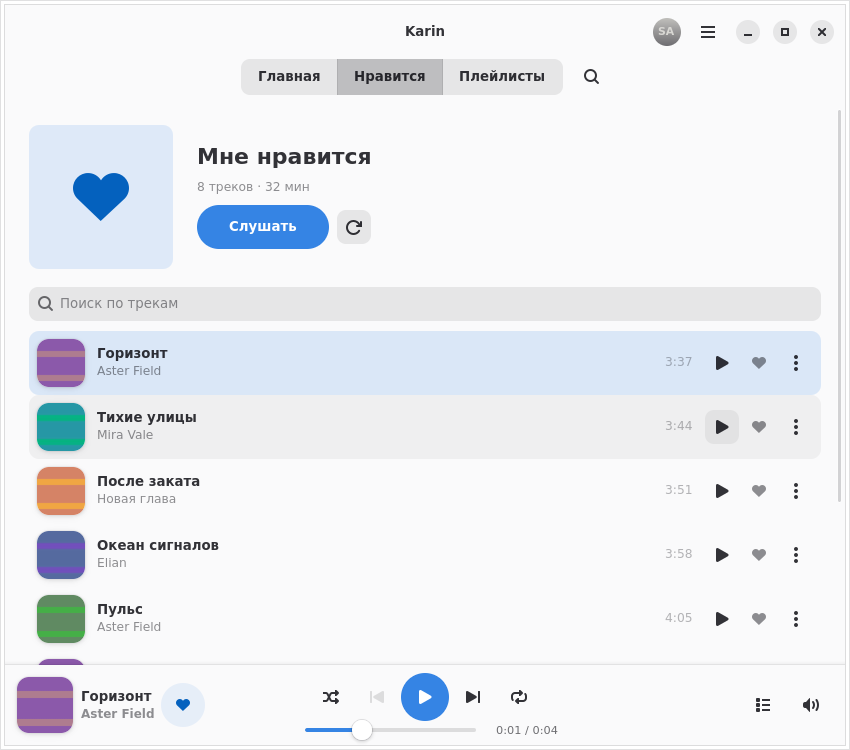
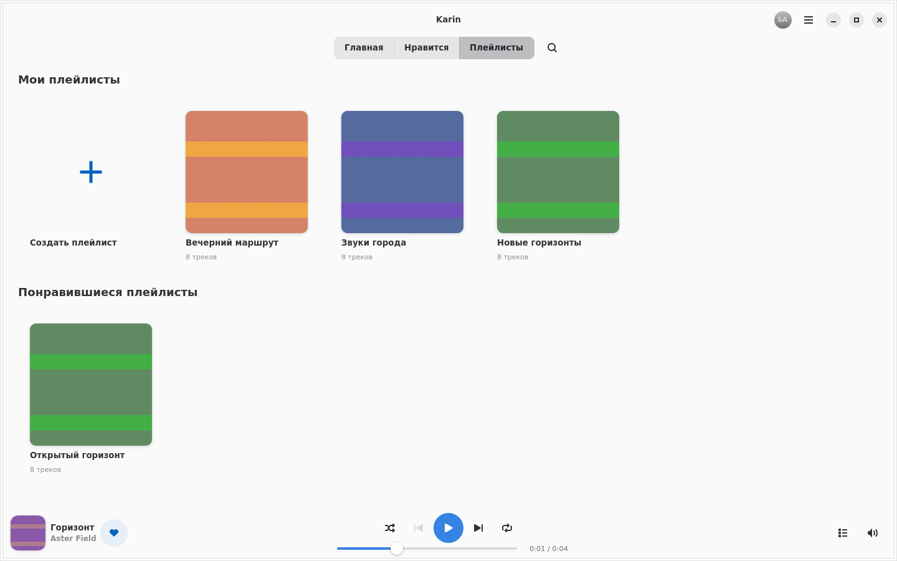
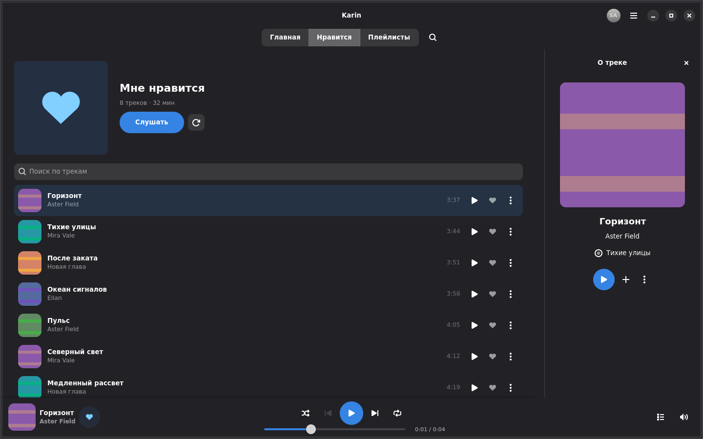

<!-- SPDX-License-Identifier: GPL-3.0-or-later -->

# Karin

**Native Yandex Music client for Linux.**

[](https://github.com/tracerxbrhd/karin/search?l=Rust)
[](Cargo.toml)
[](https://www.gtk.org/)
[](https://gnome.pages.gitlab.gnome.org/libadwaita/)
[](https://gstreamer.freedesktop.org/)
[](packaging/flatpak/io.github.tracerxbrhd.Karin.json)
[](https://github.com/tracerxbrhd/karin/actions/workflows/ci.yml)
[](LICENSE)

Listen to your library in a native GTK4/Libadwaita application, with GStreamer
playback and Linux desktop media controls. Karin is independent and is not
affiliated with or endorsed by Yandex.

## Features

- Ordinary Yandex sign-in, protected remembered sessions, liked tracks and playlists.
- Global catalog search and Unicode collection search/sorting. Searching eligible
  collections indexes up to 20,000 positions in bounded batches.
- Confirmed owned-playlist creation and editing, including exact duplicate occurrences.
- One pinned Track Info / Lyrics / Queue panel with related tracks and ordinary
  playback, queue and reaction actions.
- Yandex plain text and optional LRCLIB synchronized lyrics after disclosed consent.
  Animated line emphasis and Follow use the actual player position.
- Contextual queues, Play Next, drag/keyboard reordering, Shuffle/Repeat, seek and
  volume. Ordinary queue and position restore without autoplay.
- Explicit Resume renews an expired source for the same occurrence and position.
- My Wave from Home, started only by **Слушать**, using the same player and MPRIS.
- Confirmed Like/Dislike; adding Dislike to the current occurrence advances once.
- Adaptive System presentation, independent System/Light/Dark colors and HiDPI.
  The future designer's Karin style remains visibly unavailable.
- One account-scoped cache for metadata, artwork and eligible online-revalidated
  MP3 responses, with a shared 2 GiB default budget, Clear and Retry.

## Screenshots



<p>
  
  
</p>

These illustrate the accepted v0.4 UI using synthetic library data and original
artwork; they are retained references rather than current v0.8 captures.
[Capture provenance](docs/screenshots/README.md).

## Status and limitations

The owner completed Fedora acceptance of v0.8 functionality. Final repository
cleanup and exact-head CI are tracked in [PR #29](https://github.com/tracerxbrhd/karin/pull/29).
[Validation](docs/VALIDATION.md) separates that report from automated evidence and
retains links to earlier accepted milestones. Cargo remains at `0.0.0`; no v0.8
tag, public release or Flathub publication is announced.

The Music API is unofficial and may change. Lyrics availability and matching
are provider-dependent. Private audio caching requires current online access and
HTTP reuse proof; offline playback and mass downloads are not implemented.
Public service/content distribution conditions and Cloud cold-first-player
frame gaps remain unresolved. See [limitations](docs/LIMITATIONS.md),
[cache policy](docs/AUDIO_CACHE_REVIEW.md) and [roadmap](docs/ROADMAP.md).

## Build and run

Install dependencies using the [Native/Flatpak build guide](docs/BUILDING.md), then:

```sh
cargo build --release --locked
./target/release/karin
```

Use **Войти** to sign in normally. Flatpak uses the
[repository manifest](packaging/flatpak/io.github.tracerxbrhd.Karin.json) and the
same application code.

## Development

Read [AGENTS.md](AGENTS.md), [architecture](docs/ARCHITECTURE.md) and the
[build guide](docs/BUILDING.md).

```sh
cargo fmt --all -- --check
cargo clippy --workspace --all-targets --all-features --locked -- -D warnings
cargo test --workspace --locked
```

CI also checks exact Rust 1.98.1, feature boundaries, native fixtures and packaging.

## License

Karin's code and original materials use [GNU GPL-3.0-or-later](LICENSE), unless
otherwise stated. Third-party notices and attribution for adapted Cassette
authentication components are retained; see [licensing](docs/LICENSING.md).
The software license does not grant access to Yandex Music, its API or content.
