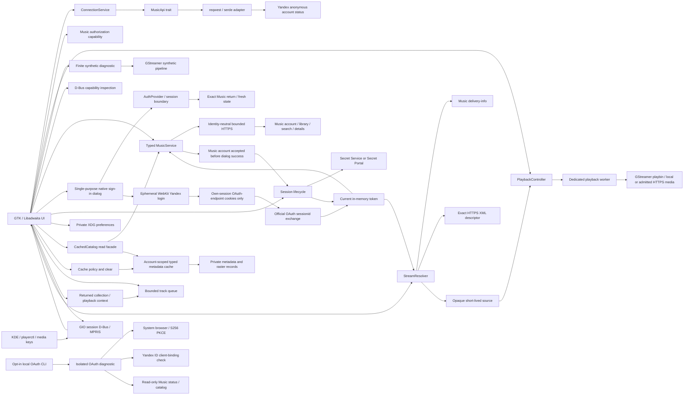

<!-- SPDX-License-Identifier: GPL-3.0-or-later -->

# Karin music workspace, guarded playback and platform integration

Karin remains one Cargo package with internal modules. The service integration
and the independently usable playback engine have separate responsibilities.
The merged v0.2 `master` (`09f7635`) has owner-reported native and Flatpak
acceptance: 17 PASS, 0 FAIL, 1 N/D (hardware media keys). v0.3 extends protected
session/settings persistence, bounded metadata/artwork cache and information/
playlist presentation around those accepted service and engine boundaries.
The owner accepted v0.3 runtime `0232548` on 2026-10-31 for persistent login/
restart, real covers, actual music, pane mechanics and KDE cover/metadata, and
reported successful final Flatpak auth/playback/system integration. The pane's
visual design remains for a separate UI/UX iteration; unreported backend/failure
cases are not inferred. PR #14 integrated that baseline at `5e85e8d`. v0.4's
complete music-experience redesign continues in Draft PR #15 after owner
UI/UX rejection of `a9eed45`; it requires fresh visual and behavioral acceptance; it does not replace the accepted service/audio path.
See
[validation](VALIDATION.md) and ADRs [0017](adr/0017-playback-context-unified-workspace-and-mpris.md),
[0018](adr/0018-persistent-session-and-settings.md),
[0019](adr/0019-bounded-account-cache.md) and
[0020](adr/0020-seamless-music-workspace.md) and
[0021](adr/0021-controlled-nonmodal-track-information.md),
[0022](adr/0022-universal-music-panel.md) and
[0023](adr/0023-local-playback-order-and-mpris-modes.md).

## Modules and boundaries

| Module | Responsibility |
| --- | --- |
| `domain` | Transport-independent account access, availability, errors and connection transitions |
| `application` | Cloneable connection service over the `MusicApi` boundary |
| `api` | Bounded anonymous HTTPS request, wire format parsing and sanitized errors |
| `oauth` | Separate opt-in code/PKCE experiment, bounded token exchange, ID-client binding and read-only Music probes with sanitized reports |
| `oauth_cli` | Binary-private local terminal input and system-browser launch; no credential arguments or GUI session |
| `music` | Typed metadata service, reduced models, bounded transport and token-bound account cache; explicit confirmed writes in `music::interactions` |
| `auth` / `auth::cassette` | Default Cassette-compatible session provider, bounded attempts/return-state validation and official OAuth session exchange; separate generic code/PKCE fixed-loopback infrastructure |
| `session` | Zeroizing live tokens and invalidation; library-only feature-gated Device Flow without bundled application credentials |
| `credentials` | Bounded native Secret Service or Flatpak Secret Portal protected-token I/O; no plaintext fallback |
| `session_lifecycle` | Generation/serialization boundary for restore, validated save, remember/forget and durable cleanup outcomes |
| `settings` | Versioned non-secret XDG preferences, atomic private writes and superseded-save reservations |
| `cache` / `music::cache_codec` | Account-scoped persistent store, policy/leases/integrity/eviction and reduced validated metadata records |
| `catalog_cache` | Read facade over unchanged MusicService; stable fresh hits, mutable network-first reads, explicit refresh and per-reply provenance |
| `artwork` | Bounded public-cover loading/RAM LRU and explicitly cacheable normalized raster persistence; GTK textures stay on main thread |
| `queue` | Bounded loaded context, exact-occurrence selection/appends and local Shuffle/Repeat policy with upcoming plan/history; active source binding remains in the music player |
| `capabilities` | Historical independent diagnostic capability types; not the normal provider or new resolver admission |
| `playback` / `playback::remote` | Reusable controller, worker-owned `playbin`, local sources and sealed short-lived HTTPS admission/transport policy |
| `stream` / `stream::resolver` | Metadata-only delivery diagnostic and the separate account-bound legacy full-MP3 resolver; bounded requests and sanitized reports |
| `audio` | Existing finite synthetic pipeline, EOS/error/timeout handling and resource cleanup |
| `platform` | Session D-Bus/Secret Service presence diagnostics |
| `mpris` | GIO session-bus adapter for MPRIS root/Player methods, typed snapshots and signals; no audio engine or network resource input |
| `config` | Non-secret application identity and version |
| `ui` / `ui::music` / `ui::music::player` | Native catalog/session UI plus explicit playback intents, queue/source binding, snapshot controls and cleanup |
| `ui::music::system_media` | MPRIS commands/snapshots joined to that same player; worker-acknowledged Seeked and bounded private cover-only files |
| `ui::music::workspace` / `track_pane` | One controlled TrackInfo/Queue panel, availability/presentation and occurrence-bound information target; the view retains no independent audio state |
| `ui::music::sliding_panel` | One native single-child geometry host; Adwaita animation translates the complete fixed-size surface inside a clipped viewport |
| `ui::music::player_bar` | Native footer construction/responsive controls over the controller's existing widgets; no audio or queue ownership |
| `ui::music::catalog_layout` / `playlist_grid` / `queue_view` | Native catalog hierarchy, compact song rows, adaptive playlist tiles and current/up-next presentation; actions retain controller/source ownership |
| `ui::auth` | Single-purpose Libadwaita sign-in dialog, ephemeral WebKitGTK6 login and scoped asynchronous cookie handoff |
| `main` | Concrete composition, application lifecycle and explicit diagnostic CLI modes |

UI consumes domain/application values and controller snapshots, not HTTP
responses, transport URLs or JSON schemas. The anonymous `YandexApi` accepts no
tokens, cookies or passwords and makes no authenticated requests. The separate
Gate B1 OAuth diagnostic does not inject credentials into this adapter or the
music interface. `MusicService` receives an ephemeral session token per call and
never impersonates an official client. Unknown
response schemas fail visibly rather than becoming invented account data.

The independent anonymous/OAuth diagnostic capability reports do not gate the
working ordinary provider. The scoped development-session and interface decision
is recorded in [ADR-0009](adr/0009-music-vertical-slice.md). Its historical remote-
source deferral and ADR-0007's local-only source are superseded for the guarded
legacy Play path by [ADR-0015](adr/0015-guarded-legacy-mp3-playback.md), without
turning account metadata into a blanket playback entitlement.
The corrected public sign-in boundary and provider gate are recorded in
[ADR-0011](adr/0011-cassette-session-auth-prototype.md), superseding the earlier
[ADR-0010](adr/0010-single-purpose-sign-in-and-provider-gate.md) provider block, and the
[authentication review](AUTHENTICATION_REVIEW.md).

## Native workspace and unified search

The desktop navigation defaults to a compact icon rail with an explicit
expand-labels action. At logical widths below 720 pixels, navigation uses
a native labelled drawer. Ctrl+B expands desktop labels or toggles that drawer.
Accessible names, tooltips and keyboard activation accompany icons. Diagnostics
remain in the application menu, outside the three everyday destinations Home,
Search and Library. Queue is opened from the Player Bar/Ctrl+J in the universal
right panel, not as a separate primary route. A compact native account
avatar in the HeaderBar uses initials from the validated display name, because
no profile-photo URI has been verified. Its popover displays only known name/
session information and the existing safe logout flow. Opening the fixed
`https://id.yandex.ru/` account page uses the system-browser handler without
account parameters, cookies or tokens; a launch failure remains local to the
popover. It does not replace the established WebKit login path.

The initial unified search consumes one `type=all` response and at most one
existing account-bound track-normalization batch. Tracks, albums, artists and
playlists have independent typed section results. One malformed/failed section
does not hide successful sections or become a fictional empty list. Empty
categories are omitted; an entirely empty successful search has one clear
message. Show All, section Retry and subsequent pages use only that category's
existing search path, with the original query and provider paging. Returning to
All performs a fresh bounded aggregate query. The strict own-ID and
50-position/50-distinct-ID track contract, bounded requests and account epochs
remain unchanged. Search and detail navigation preserve their real source
state; no extra per-row normalization request is introduced. Search playlist
summaries keep actual owner/kind and optional counts; a generic **Плейлист**
label for missing/invalid display text is not claimed to be a returned name.

The permanent Player Bar groups actual artwork/title/artist, centered
Shuffle/Previous/Play-Pause/Next/Repeat transport, functional progress/seek,
volume and a Queue action. Compact controls stay reachable through native
adaptation. No visible Stop button is presented; Stop remains a supported
PlaybackController/MPRIS command for external control and lifecycle cleanup.
Metadata width must not push the central transport off center. The bar consumes
existing worker snapshots and the queue's policy, never a second playback state.

Home uses real loaded liked tracks and available playlists as musical content,
not duplicate oversized navigation cards or invented recommendations. Library,
playlist/album heroes, native cover tiles, track rows and independent four-part
search use the same hierarchy and bounded typed models. Missing art/data,
loading, errors/Retry and server-confirmed playlist creation remain honest.
Artist/album links use verified identities; names do not invent an ID.

### One controlled universal panel in v0.4

[ADR-0022](adr/0022-universal-music-panel.md) extends ADR-0021's controlled intent
into one permanent surface with explicit `Closed`, `TrackInfo` and `Queue`
modes. User mode, content availability, responsive presentation, explicit
information target and actual playback occurrence are separate concepts.
GTK animation progress is presentation state, never the source of user intent.
There is one Queue widget tree and one information view inside the shared host,
not two independently opening panels or a duplicate primary queue page.

Cover/info opens TrackInfo and keeps it open; from Queue it changes content in
place. Ctrl+I is an explicit information toggle. Footer Queue/Ctrl+J opens Queue,
changes TrackInfo to Queue without another slide, and can explicitly close an
already open Queue. X or compact Back explicitly closes with focus return.
Outside clicks, scrolling, navigation, seek/pause/volume and resizing preserve
mode. Diagnostics can suspend rendering; logout retires personal targets and
work and resets closed mode. A stopped or empty player does not invent metadata.

The whole surface moves as a unit: background/border, stable header/close,
artwork, text and actions share the same animated geometry and clipping.
The old `a9eed45` layout's defect was reproduced with an after-paint observer:
the child surface's x stayed 1110 while its width contracted from 1520 toward
320; a left-aligned title stayed at x=1131 while centered cover x changed from
1742 toward 1142. These are one cloud case's coordinates, not a Fedora claim.
The old Revealer changed child allocation instead of moving the whole surface,
explaining the apparent instant text and separately travelling art.
`SlidingPanel`, a single-child GtkWidget, allocates the child at its full final
size and applies one GSK translation `x = (1 - progress) × width`. A native
240 ms AdwTimedAnimation with EaseOutCubic drives that geometry; it does not add
a custom frame-clock engine. The viewport clips the moving surface. Desktop
central reservation follows actual progress toward the 320+20-pixel wide or
300+16-pixel medium allocation, rather than jumping instantly to final width.
TrackInfo ↔ Queue changes only content; it does not close/reopen or change
outer/header geometry. A 100 ms GtkStack crossfade is independent of the slide.
Native animation honors reduced motion, which is checked
separately from actual intermediate normal-motion frames. Desktop allocation
must retain usable central controls throughout the transition; a fixed narrow
content clamp or a pane temporarily covering row actions is not an acceptable
substitute. Compact renders the same logical panel as an explicit subview,
with the permanent Player Bar available. Resize preserves mode and target.
Presentation also checks actual content width: below 620 logical pixels it
uses the dedicated subview even at nominal medium window size, such as 720
with expanded navigation. This leaves central actions usable rather than
forcing a narrow desktop split, and is not a new application minimum size.

Motion evidence now has an explicit test-only graphics-initialized scope.
One unconditional real normal 240 ms opening, six bounded offscreen GSK renders
of the actual mapped panel while open, and a real normal close are recorded as
setup with quarters not assessed. The setup fractions
`.137/.317/.533/.787/.941/1` do not change UI progress or animation clock and
produce no proof PNG. Only the subsequent real native cycle supplies the
original strict five-frame proof. Production has no such prewarming. Cold NGL
and Vulkan phase failures occurred even on modern GTK; internal cause remains
unattributed and first-use responsiveness is not accepted by the initialized
proof. Target Fedora fresh-first-open and repeated openings stay separate.

Information separates `FollowingCurrent` from `ExplicitSelection`. Context/source,
position and track identity, plus the existing occurrence-change hook,
distinguish duplicate IDs and new playback selections. Direct Play, Next/Previous,
queue selection, EOS advancement and MPRIS follow the actual current occurrence,
updating cover/metadata/actions together in place. Repeat One's same-occurrence
EOS restart is not a different queue position. Details changes information
without playing; Pause/Seek/Volume preserve that choice until the next actual
current-occurrence change. Existing generation/epoch checks retire old detail
and artwork completions. Removing another row only reindexes the same occurrence.
Opening, closing, switching modes or resizing never starts/stops audio or replaces
a PlaybackContext. Exact current-row removal follows its selected successor.

### Local playback policy

[ADR-0023](adr/0023-local-playback-order-and-mpris-modes.md) adds `RepeatMode`
Off/Queue/One and Shuffle to `MusicQueue`, above the unchanged GStreamer engine.
PlaybackContext's physical order and immutable shared Track list are retained.
A bounded occurrence-index upcoming plan and actual history supply shuffled
Next/Previous and the queue view; equal Track IDs remain distinct positions.
Unavailable loaded positions are skipped and manual edits update indices/plans.
Fisher-Yates uses unbiased bounded draws, with reproducible test seeds.

`next_track`/`previous_track` are explicit navigation; `advance_eos` applies
natural-completion policy. Repeat One restarts the same actual occurrence on
EOS with one ordinary resource resolution, never on an automatic failure loop.
Repeat Queue wraps available loaded positions; a shuffled new cycle avoids an
immediate current repeat when another available occurrence exists. Previous
revisits actual shuffle history and forward navigation consumes that history
before remaining planned positions. Toggling Shuffle changes future order
without restarting current audio. Disabling it restores physical source order.
No policy operation fetches remote pages or claims a partial context is complete.

Modes survive ordinary clear/context replacement within the app session, while
plans/history are retired. Explicit logout/account change and close reset modes;
no mode persistence or cloud-queue synchronization is introduced. The existing
500-position bound, caller token/session guards, resolver cancellation, worker
acknowledgements and failed-resource UI remain intact.

The expanded [quality gate](UI_QUALITY_GATE.md#v04-native-music-gate) requires
fresh before/current GTK captures and measured intermediate frames, actual
input/queue/worker/MPRIS regressions and a separate Fedora owner run. The rejected
`a9eed45` implementation and accepted v0.3 runtime stay historical evidence;
their green tests are not visual acceptance of this redesign.

Strict visual CI runs in dedicated Debian 13 stable/MSRV jobs with the same
modern native stack used for prepared cloud evidence. Ubuntu 24.04 retains the
compiler, native package, 29 functional selectors and sandboxed WebKit baseline;
the two strict visual selectors keep their original duration/tolerances and
both scales, with all 31 names accounted for across the jobs. This is test-only
placement following a recorded GTK 4.14/Adwaita 1.5/Mesa first-paint sampling
failure, not a production dependency, renderer, application minimum or Flatpak
SDK change. Its unattributed internal cause and each hosted result remain in
[VALIDATION.md](VALIDATION.md).

## Read-only music and session lifecycle

Issue #9's [catalog/delivery increment](adr/0012-catalog-repair-and-local-delivery-probe.md)
supersedes the global catalog admission lock. Account, initial library, explicit
library, search, detail and delivery requests have independent bounded lanes:
one running and one latest pending job each. Tickets and session generations
discard superseded replies; invalidated old work does not disable a new login.
Detail navigation opens before the HTTP response, preserves its source section
and displays loading, empty or retryable errors in native widgets.

The opt-in `stream::DeliveryProbe` is an executable owner-local metadata boundary,
separate from an audio resolver. It validates the existing Music session, performs
one legacy per-track offer read and at most one unauthenticated descriptor read
to an exact reviewed HTTPS origin/path. Bounded XML parsing has no DTD/entity
resolution. Only finite reports and separate HTTP statuses reach GTK. That diagnostic hands no source to GStreamer, and no raw URL/body, signing input
or personal identifier becomes a report. The separate explicit Play path uses
`StreamResolver`: token-bound offer → bounded XML → validated opaque source →
PlaybackController. Both share request policy but retain distinct result/action
semantics. See the current [delivery contract](STREAM_DELIVERY_REVIEW.md).

The native Music pane consumes typed account, track, artist, album and playlist
values. Library references are expanded in batches of at most 50 distinct IDs;
duplicate playlist positions remain intact. Track search first reads only a
validated own ID from each hit, ignoring its optional display metadata, then
uses the same account-bound `/tracks` normalization in one batch. Search order,
duplicate/composite identities and provider pagination survive normalization;
missing/null records have an explicit omitted count and unavailable returned
tracks remain visible but unplayable. Track pages accept at most 50 raw hit
positions as well as 50 distinct batch IDs, bounding restored duplicate models.
Larger pages fail before a POST rather than causing truncation, a new cursor or
N+1 requests; album/artist wire bounds remain unchanged.
See [ADR-0016](adr/0016-search-identity-and-batch-normalization.md).
Responses are bounded to 1 MiB, with
five-second connect and fifteen-second total request deadlines, no redirects or
automatic retries. A page can make at most two requests. No arbitrary returned
resource URL is fetched. Request IDs, personal response bodies, headers, URLs and
provider messages never enter displayable errors or Debug output.

The ordinary interface exposes one `Войти` action opening an `Adw.Dialog`,
without Client ID/secret, device codes, URL transfer or token-entry controls.
Default `cassette-auth` depends on `auth-webkit` and implements the published
Cassette browser-session grant with the same shared OAuth registration. It is a
real provider attempt, not a blocked stub or the known own-client PKCE 403 path.
The separate `experimental-device-auth` module remains library-only and excluded
from default/Flatpak builds. A no-feature compatibility artifact intentionally
omits session authentication and is not the real Fedora acceptance build.

The dialog owns a fresh ephemeral WebKitGTK6 NetworkSession with persistent
credentials disabled. Exact trusted HTTPS origins and return path replace
substring matching; a fresh cryptographic state must match the returned value
before a single-use main-document completion can proceed. Navigation-policy
callbacks alone cannot prove a main-frame return; the browser checks document
completion separately. No password/DOM reading or JavaScript injection is used.
`webkit6` 0.5 matches the existing GTK Rust 0.10 bindings and GNOME 50 WebKitGTK6.

After a validated return, CookieManager asynchronously retrieves only cookies
applicable to the fixed official OAuth token URI from this login's own ephemeral
session. A bounded redacted memory payload crosses to a worker for the official
`grant_type=sessionid` exchange; cookies never go to MusicService. Collect before
clearing WebKit data, cancel pending collection on close, and discard late results.
The published shared application configuration is attributed under upstream GPL;
it is not a user credential or independently approved Karin OAuth registration.
No Android/official-client Music request header is added.

This implicit/sessionid contract is distinct from Authorization Code+PKCE. The
own-client diagnostic and generic state/S256/fixed-loopback infrastructure remain
separate and unchanged. RFC 8252 rejects embedded native OAuth; Yandex mobile SDK
WebView support does not establish Linux approval, and source licensing does not
establish registration/service distribution permission. Those unresolved facts
are documented separately from technical stage errors, without replacing the
prototype with a permanent provider block. See [authentication research](AUTHENTICATION_REVIEW.md).

Token issuance and Music account validation are separate. The dialog completes
and library/search become usable only after the Music account endpoint accepts
the session. Successful completion starts the actual liked-track and playlist
loads. The v0.3 lifecycle may then save the minimal token through a supported
protected backend. Saved-token recovery runs independent Music validation before
re-entering that state. No refresh or remote revocation is claimed.

GTK jobs capture session/view generations and discard late results. Search text
can change while the previous bounded job finishes. Logout/close invalidates all
worker token clones locally and drops account/queue state. Normal close clears
live state while retaining permitted saved credentials/cache; explicit confirmed
logout also verifies credential deletion and purges persistent metadata/covers.
Cleanup failure remains visible and replacement login waits for active I/O to
settle. A failed result may allow memory-only login with restoration/new
persistent credentials/cache still suppressed by the durable barrier. New attempts and logout also reset stale API errors; signed-out status
appears in a native message row, and authentication errors stay in the dialog.
A cache epoch prevents an old in-flight validation from restoring facts
or overwriting a new session; an invalidated queued token cannot start another
validation. An active HTTP call may retain its temporary credential until its
deadline, without blocking GTK. Local invalidation is not server-side revocation.

Ordinary user logout is an explicit account-menu action followed by an
`Adw.AlertDialog` confirmation, with Cancel as the safe default. Opening the menu
or dismissing/cancelling the confirmation does not invalidate tokens, alter the
queue or interrupt audio. A confirmation is bound to the current session so a
late response cannot sign out a replacement login. Internal expired/rejected
session cleanup remains independent of this deliberate user action. Search
errors occupy one plain-language retry state; optional safe diagnostic details
do not compete with normal results or duplicate a global error banner.

The ordinary application retains its window/controller through close; signal
handlers reference controllers weakly. Activating a playable track row by mouse,
Enter or Space creates/selects its `PlaybackContext` and starts real resolution
immediately; opening details is a separate explicit action. A context retains
the collection source kind/identity, actually loaded ordered tracks and selected
position. Liked tracks, playlist/album contents and search results do not become
an invented complete collection: Next/Previous/EOS use the returned context and
skip unavailable loaded items, preserving paused/stopped intent. Contexts retain
exact clicked positions and duplicates within the existing 500-position bound.
Manual appends follow that context; starting another context drops old extra
appends. Partial data is marked without unbounded collection fetching.
Queue changes and view navigation must not cause an older context or pending
resolver intent to replace newer user work. The music player has one
running/latest-pending resolver intent, independent of
catalog lanes. Track ID, session and intent serial prevent stale completion from
restarting old audio. Stop, removing a playing selection, logout and close cancel
resolution and retire the controller off GTK. The existing generated-WAV
diagnostic remains a separate developer tool.

## MPRIS and the existing player

`mpris` owns `org.mpris.MediaPlayer2.io.github.tracerxbrhd.Karin` and exports root
and Player interfaces at `/org/mpris/MediaPlayer2` using GIO on the session bus.
It receives typed snapshots and emits PropertiesChanged/Seeked; native UI bridge
callbacks dispatch commands to the same context, resolver and PlaybackController
as native controls. There is no second GStreamer pipeline or provider. Raise/
Quit, Play/Pause/PlayPause/Stop, Next/Previous, Seek/SetPosition and Volume retain
actual lifecycle/capability checks. Position and length use microseconds; track
object paths are opaque and generation-bound, so a stale SetPosition cannot seek
a new selection. Next/Previous preserve paused/stopped intent and use the same
local queue policy as native controls.
Seeked waits for a matching worker acknowledgement, rather than assuming
successful delivery when the old position happens to be close to the target.

PlaybackStatus, Can* properties and metadata reflect actual state. Only known
title/artist/album/length and optional validated local-file cover artwork are
exported. `LocalArtwork` validates an absolute regular non-symlink file. The UI
bridge writes only an already bounded, decoded cover as a PNG of at most 256
pixels, into a private random directory under the user's cache directory;
directory/file modes are 0700/0600. RAII removes both on replacement, logout
and close. At most three local artwork-worker Busy admission attempts are
permitted; they do not retry HTTP. No music content is cached.
No audio resource/CDN URL, OAuth, cookie, query, raw response or `xesam:url`
crosses the bus. Writable `Shuffle` and `LoopStatus` (`None`/`Track`/`Playlist`)
map to the same local policy; valid native or external changes publish
PropertiesChanged and recompute CanGoNext/CanGoPrevious. Invalid property types
or values are rejected. OpenUri and TrackList remain unsupported. Rate stays
1.0 (minimum/maximum 1.0); the standard
Rate=0 action pauses rather than enabling speed control. Shutdown unregisters
interfaces and releases the owned name; logout instead publishes Stopped and
empty metadata while the application stays open.

The Flatpak manifest needs only the exact MPRIS own-name permission; broad
session-bus/filesystem access is unnecessary. Secret Service remains ungranted.
An isolated bus fixture and a synthetic native-player bridge fixture can verify
methods, properties, signals, stale IDs, capability changes and cleanup. The
owner accepted KDE Media Widget and Flatpak integration in v0.2 and actual
KDE cover/metadata plus final Flatpak system integration in v0.3; hardware media
keys remain N/D. Changed v0.4 interactions require a new Fedora run with an
audible Music track and the current native/Flatpak package, separately from
unreported per-backend storage failure/deletion cases.

## Confirmed library interactions

The explicit library-write extension lives in `music::interactions`, retaining
the existing transport and token/account cache. It separates membership, a
single deliberate POST and independent confirmation. Native controls use their
own read/write lanes and fixed errors, with no optimistic favorite toggle or
automatic write retry. Liked playlists retain the returned owner identity.
See [ADR-0014](adr/0014-confirmed-library-interactions.md). These operations do
not create a media source or change the independent playback boundary.

## Playback controller

`PlaybackController` sends commands to a dedicated worker through a bounded
32-entry queue. GTK never waits for media preroll, state changes or bus messages.
Enqueue failure is explicit, including a full queue or a stopped worker. The
worker processes bounded command batches while observing GStreamer bus events
and a five-second deadline for asynchronous state completion. This deadline
cannot preempt a blocked call inside a native plugin.

The controller exposes Idle, Loading, Ready, Playing, Paused, Stopped, Ended and
Error states. Snapshots include position, duration, seekability, volume, a safe
error category and worker completion status. Numeric `seek_serial` and
`seek_position` telemetry advance only after the existing native `seek_simple`
succeeds. The MPRIS bridge captures the counter before enqueueing and waits for
a matching acknowledged target before emitting Seeked. This adds observability
without changing source admission, resolution or GStreamer seek semantics.
Shared native/MPRIS Play also consumes outstanding Ready preparation/resume
state, preventing a late preparation result from leaving playback stuck.
Prepare, play, pause/resume, stop,
volume and seek all use the same real `playbin` path. EOS and errors update
state explicitly; seeking is permitted only when the source reports support.

The local constructor still validates/canonicalizes regular files and keeps
paths out of displayable errors/Debug. A separate constructor accepts only an
opaque `RemotePlaybackSource` produced by the resolver; there is no arbitrary
network-URI input. The worker does not receive OAuth/cookies or make Music API
requests. It repeats source policy/freshness checks and enforces guarded Soup
HTTPS, strict TLS, no redirects/retries, no credentials, no manifests/secondary
URI handlers and no media files. Native URI debug output is disabled before
handoff; finite categories and structured numeric HTTP status replace raw native
errors. A conservative 60-second admission prevents stale new connections,
resume/seek; it does not interrupt an already playing track. Explicit retry can
resolve a fresh resource. See ADR-0015 for the narrow CDN/path policy.
General local files must be trusted: a container or playlist can refer to other
resources through a decoder plugin. Gate A's GTK diagnostics and local diagnostic
tests accept only their own generated PCM WAV and contain no external references;
there is no general file chooser or untrusted-playlist feature.

Developer diagnostics generate a temporary low-volume PCM WAV and feed it into
that same source path; they do not replace playback with a fake state machine.
The generated file is owned by a session guard and removed when that guard is
dropped. No audio fixture is distributed in the repository. A clocked `fakesink`
permits real decoding, timing, transport and EOS checks without physical sound;
system audio is an explicit alternative for desktop acceptance.

Shutdown signals cancellation independently of queue capacity. The worker resets
the pipeline to `Null`, releases it and only then reports `worker_running=false`.
The last handle's destructor requests shutdown without joining a worker on the
GTK thread. Callers that need to verify cleanup observe worker completion with a
bounded deadline. See [ADR-0007](adr/0007-playback-controller.md).
The GTK panel requests shutdown immediately on close and retains an application
hold while a GIO worker observes completion, up to a six-second deadline. Media
guards survive that cleanup wait. UI polling captures widgets weakly; normal
window teardown is checked while actual local playback is active.

## Protected session and preferences

`credentials` performs synchronous bounded system I/O only on application
workers. Native processes use the configured Secret Service, including standard
unlock/prompt/cancellation; Flatpak selects the Secret Portal request/FD contract.
The portal's app-scoped secret derives an HKDF-SHA256/AES-256-GCM key for the
atomic private `credentials/session.enc` envelope under the app's XDG data area.
The key stays in memory;
forgetting removes/verifies the envelope, not the portal key or server grant.
Absent/locked/denied/corrupt/timeout/unconfirmed outcomes have fixed errors and
never select plaintext storage. See [ADR-0018](adr/0018-persistent-session-and-settings.md).

Native token bytes remain in Secret Service. A private non-secret
`credentials/native-write.pending` tombstone fences ambiguous CreateItem writes:
an empty query after a timeout cannot establish that no late item can commit.
The standard local OpenSession `plain` transport does not mean an application
plaintext file. Rust-owned sensitive buffers are zeroizing; opaque platform
copies have no universal wiping guarantee.

The lifecycle serializes protected mutations and tags restore/save/forget work
by generation. Load alone never authorizes Music: validation must accept the
current token before enabling service operations or saving it. Preferences are
non-secret, schema-versioned private XDG config; a synchronous save reservation
prevents delayed workers from overwriting newer state. `forget_pending` is a
durable restoration barrier before deletion. Turning remember-login off forgets
saved credentials while current live playback may continue; explicit logout
also stops audio and clears personal/cache state. Final success waits for known
cleanup, with retryable failures and guarded restoration. Window close can
retain a confirmed remembered session and permitted cache. There is no invented
refresh-token or remote-revocation mechanism.

Replacement saves first record the same barrier, then confirm protected storage
and clear it under the original preference reservation. Close lets already
validated required mutations finish with their provider expiry and application
hold. A main-context work fence delays a reopened window's storage setup until
retired required work and queued non-secret field merges finish; immediate pane
visibility changes cannot overwrite a pending lifecycle barrier. Failed cache
purge remains a separate obligation and cannot be cleared by a new token save.
Failed cleanup permits memory-only login after active I/O settles, while
current-process persistence remains paused. A failed barrier write is explicitly
unconfirmed protection across restart, rather than a claimed durable forget.

## Persistent metadata and artwork

The GTK-independent `cache` store and `catalog_cache::CachedCatalog` facade
bind a lease to a validated account namespace
and current generation. Private hashed filenames are not encryption; reduced
record payloads remain local personal metadata and must never be published.
Typed decoding revalidates identities and bounds; no account/token/stream schema,
raw JSON response, header, signed media address or audio is admitted. Default
policy is 256 MiB, metadata freshness 15 minutes and cover freshness 7 days,
subject to server artwork restrictions; supported size is 16 MiB–4 GiB. Records
have bounded framing/integrity checks, atomic temporary-write/fsync/rename,
LRU-like access ordering, 4096-entry/64-scope ceilings and corruption recovery.

Freshness and provenance belong to each reply, not a shared last-read notice.
Stable track/album reads can use a fresh cache hit; a bounded same-key flight gate
coalesces concurrent misses. Mutable liked/playlist/artist pages always use the
network first. Only Network/Timeout may fall back to a saved/stale record,
re-read with a current lease after the failure. Authorization/policy/rate/schema
refusals and other HTTP errors remove the record and never fall back. Cached
values never establish authentication, membership/revision or write success.
Removal is currently best effort if cache I/O itself fails; the previously
fresh metadata may then survive a refusal. The final review records this
nonblocking consistency edge in [limitations](LIMITATIONS.md#catalog-workspace-and-playback),
separately from live session validation and stream resolution.
Explicit Refresh bypasses fresh hits. UI rechecks cache-derived leases before
presentation; fresh network replies carry no cache lease so clearing/disable
does not discard otherwise valid server data. Library mutations invalidate metadata for every outcome,
including unknown writes, without deleting raster records. The original bounded
Music API deadlines, identity checks and independent operation lanes remain.

Artwork persists only normalized bounded pixels when HTTP policy permits it;
no-store/no-cache/private/Vary restrictions and shorter server freshness prevent
or limit disk writes. An explicitly fresh `must-revalidate` response may be
reused until expiry, but a compact raster-policy bit forbids its stale fallback,
including after restart; legacy raster records remain readable. No response
headers are stored. RAM LRU, dedicated image workers, account/cancellation
checks and main-thread texture ownership remain in place. MPRIS's live temporary
PNG is separate from persistent cover records, so ordinary cache clearing does
not destroy active media-widget presentation.

`CoverArt` accepts exact `avatars.yandex.net` templates in bare-host, HTTPS or
protocol-relative form. Only custom-playlist templates may carry a bounded
decimal revision query. Provider renditions 200/400/1000 are distinct from the
unchanged 128/256/512 decoded raster buckets; the latter are not valid CDN preset
names on the public resources checked during stabilization. Visible thumbnails
retry worker-queue admission with bounded backoff for at most 12 seconds, without
retrying failed HTTP responses. The opt-in `--artwork-diagnostic` reports finite,
fixed stage categories and HTTP status only; it cannot accept/log resource URLs,
personal fields or raw transport errors. Loopback fixtures exercise the ordinary
URL builder through native GTK rendering rather than pre-seeding RAM.

Bind/policy/clear generations reject old readers/writers. Cache-off prevents
persistent content reads/writes but leaves files until explicit clear; measured
usage and user-requested clear remain available. Clear removes persistent records
while retaining session, current context, audio and visible presentation. Logout
instead invalidates leases and purges personal records as part of confirmed
cleanup. An unavailable protected credential backend by itself does not disable
the independent permitted metadata/cover cache. No extra database, background
daemon or music file is introduced.
See [ADR-0019](adr/0019-bounded-account-cache.md) and the independent
[audio-cache rights/lifecycle review](AUDIO_CACHE_REVIEW.md).

## Other work and application lifecycle

GTK objects remain on the main thread. Bounded HTTP, finite audio and platform
operations use `gio::spawn_blocking`; `glib::spawn_future_local` awaits results and
updates widgets on that thread. Worker functions do not receive GTK objects.
The reqwest blocking client manages its own internal HTTP runtime; no additional
application-wide async runtime is introduced.

Only one connection check and one finite audio diagnostic run per window at once.
Loading is visible, duplicate requests are disabled, and errors permit retry.
These finite jobs retain an application hold until they return and clean up.
Normal close can wait for the existing HTTP timeout (12 seconds) or finite audio
timeout (5 seconds); forceful process termination cannot guarantee cleanup.

Every existing finite diagnostic exit path resets its pipeline to `Null` through
RAII. Long-lived playback belongs to the new controller instead of extending that
blocking diagnostic into a player.

## Security and future integration

The anonymous adapter keeps TLS verification, refuses redirects, limits response
bodies to 64 KiB and excludes raw bodies/URLs from displayable errors. The separate
OAuth experiment uses the same no-redirect/TLS/error policy with a 1 MiB response
ceiling. Offline HTTP fixtures exist only under `#[cfg(test)]`; production uses
fixed real service endpoints.

The platform diagnostic still queries Secret Service presence without reading an
item. It is not the protected-session implementation or proof that a store works.
The separate `credentials`/lifecycle boundary performs actual bounded protected
I/O and verifies outcomes as described below. There is no `.env` loading,
pasted-token login or plaintext credential file.

The opt-in local OAuth CLI is a separate experiment, not a GUI login path. It
accepts a local Client ID and the full returned browser URL from hidden terminal
prompts, creates random S256 PKCE/state, and launches the system browser through
GIO. The parser checks the exact registered origin/path, rejects ambiguous or
unexpected response parameters, and validates the returned state before a token
request. It extracts a bounded, nonempty opaque code without numeric-format
assumptions; the observed provider-added `cid` has no interpreted meaning.
There is no code-only bypass. The initial exchange uses no Client secret. Tokens
remain inside this process and are not passed to the anonymous service, playback
engine or UI.
ID identity/client binding, Music account access and catalog response remain
separate facts; errors and restrictions fail closed before later probes.
The owner observed code/state in the actual verification-page redirect on Fedora;
manual full-URL transfer now makes that return observable to the diagnostic.
This is not an automatic callback listener or a tested production Linux sign-in
flow. The owner verified token/ID binding; both Music account methods returned
403. See ADR-0008 and the dated [API evidence](API_FEASIBILITY.md).
Automated OAuth fixtures use loopback only and require no account or browser.

The earlier Gate A MPRIS reservation and later audio-only deferral are historical;
ADR-0017 defines the bridge accepted in the merged v0.2 baseline. v0.3 adds the
protected-session lifecycle without changing that provider/player. My Wave stays
hidden unless its complete service-session/feedback capability is established.
The separate owner v0.3 report supplies its stated functional acceptance; it does
not individually certify every cache, wallet or portal failure case. The exact MPRIS own-name grant does not enable direct
Secret Service access; Flatpak selects Secret Portal and a safe unavailable
result instead of silently widening the sandbox. The prototype manifest explicitly enables Cassette/WebKit authentication and
excludes the legacy Device Flow feature. Dependency availability and synthetic
fixtures do not establish a live accepted provider session or public-release
permission. Smoke/capture modes inject an offline provider and never contact
Yandex; ordinary no-argument startup uses the real provider.
