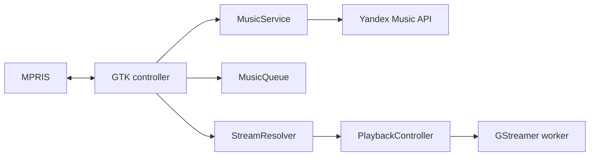

<!-- SPDX-License-Identifier: GPL-3.0-or-later -->

# Architecture

Karin uses Rust, GTK4, Libadwaita and GStreamer. UI, transport, credentials, cache
and playback have separate owners. Decisions are recorded in [ADR](adr/).

## Components

| Area | Modules | Responsibility |
| --- | --- | --- |
| Catalog | `music`, `api`, `application` | Typed service access and separate anonymous diagnostics |
| Authentication | `auth`, `auth::cassette`, `ui::auth`, `oauth` | Ordinary sign-in and independent PKCE diagnostic |
| Session | `session`, `credentials`, `session_lifecycle`, `settings` | Live tokens, protected persistence and non-secret preferences |
| Data | `cache_budget`, `cache`, `catalog_cache`, `artwork`, `audio_cache` | One shared resource policy; typed metadata/artwork and separately policy-admitted audio stores |
| Playback | `queue`, `stream`, `audio_cache::bridge`, `playback` | Context/order policy, resource/cache admission and one media worker |
| Desktop | `mpris`, `ui::music::system_media` | Session D-Bus commands and actual snapshots |
| Presentation | `ui::music` and its view modules | Native views, user intents and guarded result admission |

GIO workers perform bounded blocking work; main-context futures admit results
under current account/request/source generations. Twelve lanes each retain one
running and one latest pending job. The Wave lifecycle uses a separate
bounded FIFO lane because feedback must not be coalesced or retried. Source
changes, logout and close retire old work. GTK textures/updates stay on the main thread; deferred Like reads use weak
ownership outside render-time borrows. Reqwest owns its HTTP runtime.

## Authentication and protected sessions

The attributed Cassette-compatible provider uses one ephemeral WebKitGTK6 dialog
with strict navigation/return/state checks. No password inspection, JavaScript
injection, profile import or cookie persistence is allowed. MusicService validates
Music access before success/persistence; ID/cache data is insufficient. See [AUTHENTICATION_REVIEW.md](AUTHENTICATION_REVIEW.md).

Native persistence uses Secret Service; Flatpak uses a Secret Portal secret and
an authenticated encrypted token envelope. Unavailable storage permits memory-only
login, never plaintext fallback. Preferences are private, versioned XDG data.
Serialized, generation-bound operations and durable forget barriers fence late
writes/restoration. Uncertain deletion/purge remains visible with Retry.
Remember-off forgets the saved credential without stopping the live session;
logout also stops audio and clears personal views/cache. Close may retain an
allowed session/cache. Forgetting is local, with no claimed refresh or remote
revocation. [ADR-0018](adr/0018-persistent-session-and-settings.md) defines details.

## Catalog, filtering and playback context

MusicService validates account/IDs, bounds work and returns typed models. Search
accepts minimal hit IDs and one canonical batch of at most fifty distinct IDs,
preserving order, duplicates, unavailable records and paging. Optional display
fields cannot invalidate valid IDs. Reaction/playlist writes require independent
confirmation; ambiguous POSTs are not replayed.

`music::interactions` distinguishes Like, Unlike, account Dislike and removing
Dislike. Current-track reactions use compact live reads of both collections,
with account/track generations and a bounded write lane. A deliberate reaction
sends one POST and confirms both memberships/revision when dual reads are
available; opposite marks are not optimistically inferred. If Dislike cannot be
verified, a fresh independent Like read preserves the existing Like-only control
and its established confirmation path. Dislike remains hidden/unknown. Only a
confirmed Dislike addition on the same current occurrence invokes the existing
Next path once. Account/request generation and the queue-owned occurrence identity
fence late results, including repeated Track IDs; a replaced playback intent must
not be advanced. Removing Dislike and changing Like never advance playback.
A refusal or ambiguous result leaves playback alone and offers read-only recovery;
authorization loss still follows normal session teardown.
[ADR-0028](adr/0028-confirmed-track-reactions.md) separates account membership
from the unchanged Wave feedback protocol.

Continuous views admit fifty-position portions, at most 2,000 positions/100 pages.
Initial filling stops at three pages; further reads require user demand. Errors
preserve rows with read Retry. Remote end, missing/stale data and local limits
remain distinct. Like mutations retire continuation until explicit refresh,
without changing playback.

Collection filtering reuses rows and an NFKC → casefold → NFKC title/artist/album
index. Typing fetches no pages/metadata; bounded cover work may resume. Partial
coverage is labelled; next-part reads stay bounded and source changes reset the
query. An incomplete prefix is not complete remote search or sorting.

Play snapshots an aligned window of up to 500 matches in provider order, including
the selected item; at most four windows are cached. Opaque feed binding and original
admitted positions distinguish duplicates across windows/reindexing. Filtering,
appending and navigation never rewrite active playback. MusicQueue also owns a
bounded opaque identity token for every admitted occurrence, including manual
duplicates. Removing another row preserves that token; a replacement context
gets new tokens. Info and MPRIS share this identity without publishing it.
ADR-0016 and ADR-0024 cover normalization/loading;
[ADR-0025](adr/0025-loaded-collection-search-and-playback-provenance.md) defines filtering/provenance.

## Playback controller

StreamResolver admits the reviewed unprotected full-MP3 path as a sealed HTTPS
source. OAuth stays at Music API; credentials never reach descriptor/CDN or worker.
Exact origins/paths, TLS, bounded XML and no redirects exclude arbitrary URIs,
manifests and protection/identity fallbacks. The sixty-second admission lease
does not stop existing playback; later connection/resume/seek may require fresh
Play. See [stream delivery](STREAM_DELIVERY_REVIEW.md) and
[ADR-0015](adr/0015-guarded-legacy-mp3-playback.md).

PlaybackController sends commands through a 32-entry channel to one worker-owned
`playbin`. Snapshots supply actual state, position/duration, seekability, volume
and safe errors. A worker-owned cumulative Playing clock excludes pause and seek
distance independently of GTK scheduling. Commands alone do not imply Playing; Seeked requires worker
acknowledgement. Local-file diagnostics remain. Supported online MP3 resources
can use the shared private HTTP cache when storage and version checks succeed;
otherwise the same player uses the admitted network source.
Shutdown bypasses channel capacity and releases the pipeline in `Null` before
completion, without GTK joining the worker.

MusicQueue owns Shuffle, Repeat Off/Queue/One, upcoming order and actual history.
Repeat One handles natural EOS; explicit Next/Previous still navigate. Queue
repeat covers admitted items only, without library autofetch or error retry loops.
Modes survive normal clear/context replacement and reset on logout or close.
[ADR-0023](adr/0023-local-playback-order-and-mpris-modes.md) defines the policy
shared by native controls and MPRIS.

## My Wave

The existing `music::wave` protocol/observation components feed the same queue,
resolver and player through `ui::music::radio`. The Home Hero is available after
Music-validated sign-in in the ordinary application. Listen/Pause/Resume delegate
to the same lifecycle/player. Only explicit Listen creates a radio session;
application startup, protected-login restoration and opening Home create none.
The deprecated `--experimental-wave` CLI alias has no effect on availability,
activation or application identity. Only pending startup
has a Cancel action. There is no separate user-facing Finish control.

Original batch markers stay attached to opaque occurrence identities in memory.
Feedback and continuation use one serialized bounded lane; an uncertain POST
terminates continuation without replay. Pause preserves context and excludes
paused time. Ordinary source selection or MPRIS Stop retires radio and restores
modes; account/logout/close cancel queued work. Local retirement uses no separate
network session-finished event: only an interrupted heard track can add one final
skip; completed EOS and unheard tracks add none. Exact admitted event and local
origin/phase/finish classifications accompany safe HTTP diagnostics. JSON/body,
identities and listening payloads never enter those logs. See
[ADR-0027](adr/0027-experimental-wave-lifecycle.md) and the
[Fedora acceptance procedure](BUILDING.md#my-wave-local-acceptance).

## Metadata and artwork cache

The private account cache stores reduced metadata/permitted normalized art, never
credentials, raw responses, signed resources or audio. Hashed paths are not
encryption. Metadata retains its fifteen-minute freshness and art its seven-day
maximum; HTTP restrictions can shorten or forbid art persistence. Records keep
bounds/integrity checks, atomic writes and eviction. Their resource budget is
shared with the separately admitted audio store as described below.

Stable reads can use fresh data; mutable pages are network-first. Only eligible
network/timeout errors allow labelled saved-data fallback. Cached values never
establish authentication, membership/revision or write success. Per-reply leases
are rechecked at presentation; a fresh reply does not hide retained stale origins.
Catalog leases also bind a key epoch: known API refusals retire cached replies
and older writers before storage work. Fixed tombstones and bounded cleanup keep
Busy/I/O failures from reviving refused entries. After restart, account binding
or a policy change, metadata needs a new successful write before fresh reuse;
otherwise it is eligible only for labelled saved-data fallback. Artwork keeps
its separate HTTP/TTL policy. State admission never holds its mutex over disk I/O.
Refresh bypasses fresh hits. Cache-off stops persistent reads/writes; Clear keeps
session/audio/textures, while logout purges personal records.
[ADR-0019](adr/0019-bounded-account-cache.md) defines the cache contract;
[ADR-0026](adr/0026-refusal-fences-and-queue-occurrence-identity.md) defines the
refusal fence and stable queue identity extensions.

### Audio storage and playback selection

`cache_budget` coordinates the ordinary application's metadata/artwork and audio
stores through the same shared instance. One enabled policy defaults to **2 GiB**
and offers 500 MiB, 1/2/3/4 GiB or Unlimited. Reservations account for concurrent
writes and bounded staging; shared LRU/fairness protects small metadata within
the one total. Disk-space headroom is checked in every mode. Unlimited removes
the user byte cap, while retaining record/count bounds and the free-space guard.
Worker-only scans, trims and publication never hold the GTK admission-state
mutex over disk I/O. Preferences expose one integer Scale, total measured usage,
Clear and operation Retry; limit maintenance is coalesced for 200 ms while
Disable/Clear admission fences are immediate. Version-1 quotas migrate to the
version-2 enum without replacing credentials or cache files.
[ADR-0030](adr/0030-unified-cache-budget-and-preferences.md) defines migration,
staging accounting, metadata fairness and local disk safeguards.

`audio_cache` remains typed production code, opened on a worker under the app's
XDG cache `audio` directory. Account-scoped opaque keys, generation fences,
integrity/atomic publication and an exclusive namespace owner guard reads/writes
and restart. A separate one-writer gate spans the streamed body; the read/Clear
I/O gate covers initialization and atomic commit, with a live staging marker.
Scans preserve that marker; Clear fences and unlinks it without waiting for more
network bytes. Commit retries contention only on the worker, for at most 250 ms,
with cancellation checks. Retired staging is recovered before quota eviction.
Per-resource 64 MiB, 1024-record and four-pending-capture bounds remain, with one
staging writer; these safety bounds are independent of the shared user quota.

Disk integrity preparation overlaps fresh StreamResolver resolution on bounded
workers. Only an already-ready candidate is considered; a slow or busy cache
leaves that play online. The ordinary application's private HTTP policy separates
current account/resource access, storage eligibility of the actual response,
validation of retained bytes and explicit content restrictions. Local cache
admission is not a provider entitlement or copyright license. The absence of a
separate storage-grant endpoint is not itself an HTTP refusal.

Each replay resolves the currently admitted MP3 source, then checks an existing
candidate using bounded, credential-free HTTP validation. A strong validator must
be bound to the same resource/variant: either exact URI identity or the sealed
Legacy descriptor's lowercase host, validated XML path, MP3 codec and selected
bitrate fingerprint. Signing inputs `s` and `ts` are excluded from this file
locator. This is not a claim that a path is immutable. Equal track IDs or a
renewed signed URL alone do not establish unchanged bytes. A trusted full
`Repr-Digest` can identify the representation independently of URL rotation. Unverifiable versions,
explicit refusals and failed checks select the ordinary network source. A
validated hit pins its verified read-only descriptor; final admission is
memory-only and LRU bookkeeping remains deferred. The separate exact-content
licensed-resource policy remains available for independently licensed material.
This is online-revalidated caching, not offline entitlement.

The shared bridge hands an admitted hit's verified read-only file descriptor to
the same PlaybackController. A decoder failure before any actual Playing can
fall back once to its admitted online source in that same worker. A failure after
Playing remains a normal player error, preserving Wave's actual-playing ledger.
A source-pad capture reuses that player's compressed HTTP bytes without an extra
media GET or second pipeline. Its bounded retention can hold a complete resource
up to 64 MiB; at most four bodies allocate on arrival, for a worst-case retained
body bound of 256 MiB. The writer starts draining during preparation, before Playing or
the next GTK tick. The existing queue2 transport limit remains 2 MiB. Neither
probe nor GTK waits for storage. Exact HTTP-body receipt marks capture complete
without waiting for pipeline EOS, and completed bytes survive pipeline drop.
Actual GStreamer Playing is latched separately and gates publication. A finite
`captured` progress diagnostic cannot stand in for `write-confirmed`.

A write-specific pin acquired after fresh access can be sealed only for a
completed, played resource, allowing at most 30 seconds for final hash/metadata/
atomic commit. Ordinary Next, natural EOS, Wave rollover and the next online
lookup do not invalidate that finalization merely by changing current playback.
This pin is not a playback admission and cannot be reused for a later cache hit.
Partial replacement, seek/discontinuity, overflow and failed capture cancel the
incomplete copy with a preserved first cause. Explicit Stop, account/logout,
Clear and Disable cancel or fence writes. Complete HTTP200 or whole-resource
HTTP206 and valid policy/integrity remain necessary for publication. The
response's bounded metadata is retained with that record; credentials, cookies
and signed URLs are not.
`no-cache` and `must-revalidate` cannot authorize stale reuse: the private path
requires a new successful online validation before every hit, even if an HTTP
freshness lifetime has not elapsed. `Content-Encoding: identity` is allowed;
other encodings and unsupported `Vary` dimensions are declined. The supported
`Vary: Accept-Encoding` case sends `identity` on both the player and HEAD request.
A fresh `no-store` response removes the completed record before online fallback,
without invalidating an
already active playback descriptor. Missing validators do not forbid storing a
complete eligible response; they forbid a hit until the current version can be
proved. HTTP451 is a fixed content-restriction refusal.
Clear/logout/account changes fence old work before cleanup. Clear can unlink a
record without invalidating an already admitted active descriptor; normal close
may retain records for fresh online admission after restart. The process-level
application fixture supplies original audio expressly dedicated to CC0 and uses
the ordinary private HTTP policy/store/player path without a real Yandex account.
It does not establish actual Music CDN validator support or legal rights for
public distribution; live Native/Flatpak acceptance remains separate.
[ADR-0029](adr/0029-synthetic-audio-cache-foundation.md) and
[AUDIO_CACHE_REVIEW](AUDIO_CACHE_REVIEW.md) define the admission gate.

## GTK workspace, MPRIS and Flatpak

Home/Liked/Playlists lead to native collections and catalog search. Total duration
requires complete known data and a checked sum. Row mouse/Enter/Space plays its
exact occurrence; Details is separate.

One surface holds `Closed`, `TrackInfo` or `Queue`. Outside clicks, navigation
and resize preserve mode; current-occurrence changes resume following, while
Details may inspect another track without playing. The entire surface translates
under a native 240 ms animation; compact layout uses a nonmodal Back subview.
See [ADR-0022](adr/0022-universal-music-panel.md).

The footer appears for real playback intent, stays through Pause/retryable failure
and hides on Stop/clear/logout. Its child conceals at the closed native endpoint
to release hidden width. Metadata, Like and Dislike are separate focus/click
targets; resize retains the same controls/controller. Reaction pending/error
state never changes the current source or opens Track Info. Confirmed current
Dislike addition alone delegates to Next after presenting the confirmed state.

The in-process GIO MPRIS 2.2 adapter exposes actual state, opaque track paths and
temporary cover PNGs, never credentials, account IDs or media URLs. Flatpak keeps
`org.mpris.MediaPlayer2.io.github.tracerxbrhd.Karin` own-name permission and uses
portal storage rather than broad session-bus access. See [BUILDING.md](BUILDING.md),
[VALIDATION.md](VALIDATION.md) and [LIMITATIONS.md](LIMITATIONS.md).
