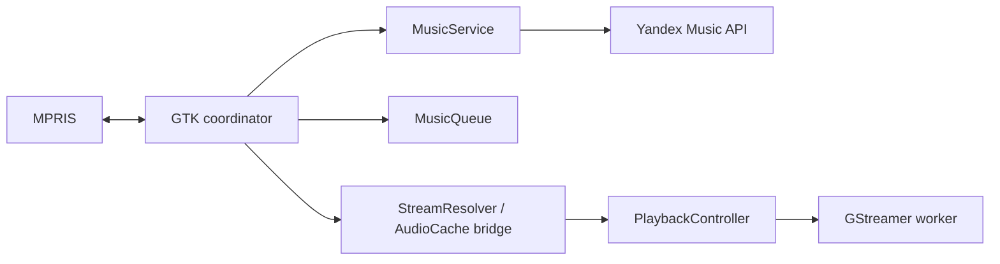

<!-- SPDX-License-Identifier: GPL-3.0-or-later -->

# Architecture

Rust, GTK4/Libadwaita and GStreamer form the native application. Widgets,
transport, protected sessions, cache and playback have separate owners.
[ADRs](adr/) retain the detailed decisions and evolution.

## Components and execution

| Area | Modules | Responsibility |
| --- | --- | --- |
| Catalog | `music`, `api`, `application` | Typed account-bound service access, normalized catalog and isolated diagnostics |
| Collection/text | `music::library_index`, `music::track_extras`, `lyrics` | Process-only index, related reads and bounded literal TEXT/LRC |
| Authentication | `auth`, `auth::cassette`, `ui::auth`, `oauth` | Ordinary sign-in and separate PKCE diagnostic |
| Session | `session`, `credentials`, `session_lifecycle`, `settings` | Live token, protected persistence and non-secret preferences |
| Cache | `cache_budget`, `cache`, `catalog_cache`, `artwork`, `audio_cache` | Shared budget and distinct metadata/artwork/HTTP-audio policies |
| Playback | `queue`, `playback_session`, `stream`, `audio_cache::bridge`, `playback` | Occurrences/order, continuation, source admission and one worker |
| Desktop | `mpris`, `ui::music::system_media` | Actual media snapshots and commands |
| Presentation | `ui::music`, `ui::style`, `ui::preferences` | Native views and typed user intents |

GIO workers do bounded blocking I/O; main-context futures admit results under
current account/request/source generations. Sixteen request lanes retain one
running and one latest pending job each, including separate Lyrics, Similar and
CollectionIndex reads. Playlist writes share a service gate and dedicated lane;
the editor's reads have a bounded worker. Wave feedback uses a separate bounded
FIFO because it cannot be coalesced/replayed. Source changes/logout/close retire
late work. GTK textures and widget updates remain on the main thread. Deferred
membership reads use weak ownership outside rendering borrows. Reqwest owns its
HTTP runtime. [ADR-0002](adr/0002-foundation-boundaries-and-workers.md).

## Authentication and persistence

The attributed Cassette-compatible provider uses one ephemeral WebKitGTK6 dialog
with exact navigation/return/state checks, scoped in-memory cookies and
cancellation. It does not inspect passwords, inject login-reading JavaScript,
import profiles or persist cookies. Music validation precedes session admission
or saving. [AUTHENTICATION_REVIEW](AUTHENTICATION_REVIEW.md).

Native uses Secret Service; Flatpak uses a Secret Portal secret and authenticated
encrypted token envelope. Unavailable storage allows memory-only login without
plaintext fallback. Generation-bound writes and durable forget barriers fence
late saving/restoration. Uncertain deletion/purge retains Retry. Remember-off
preserves live audio/session; logout stops audio and purges personal state; close
may retain permitted state. Forgetting is local, without claimed remote
revocation or refresh. [ADR-0018](adr/0018-persistent-session-and-settings.md).

Ordinary continuation is bounded, private account-bound IDs/order/position/history,
written off GTK. Fresh Music and batch-track validation precede restoration;
there is no autoplay or player preparation until explicit Play. Stop/forget/
logout tombstone it; Wave never persists. Queue provenance survives source-view
eviction or later server edits without asserting current membership.
[ADR-0031](adr/0031-private-playback-continuation.md).

## Catalog, search and writes

MusicService fixes the API origin and bounds IDs, responses and requests. Search
normalizes at most 50 distinct IDs per canonical batch, preserving provider order,
duplicates and unavailable positions. Optional display fields cannot invalidate
valid identity. [API_FEASIBILITY](API_FEASIBILITY.md) defines transport contracts.

The top navigation owns one global search entry. A homogeneous GtkStack keeps
its field and three tabs in the same measured slot, with a 220 ms crossfade and
a compact adjacent toggle. Both states retain group center/HeaderBar geometry.
Toggle/Ctrl+F/Home focus the entry over the existing route. Nonempty input shows
results after 350 ms or Enter. Clear restores the source route with the entry
open; Escape/toggle/background dismiss and retire work. Interactive targets and
deliberate navigation remain authoritative. Result/paging/Retry use current
request generations.

Ordinary feeds admit 50-position portions, at most 2,000 positions/100 pages,
with initial filling limited to three pages. A content-column search row gives
remaining width to its entry beside a compact sort button. Admitted metadata
filters immediately. A settled nonempty query/Enter can resume an eligible
incomplete liked/playlist index; opening a view alone cannot start it.

`library_index` admits at most 4 MiB/20,000 original membership positions,
independent 50-position canonical batches and a final full sequence/revision
recheck. It keeps one process-only reusable index, latest-query projections,
200-row windows and contextual Pause/Continue/Retry. Clear/leave suspends work;
account/source changes retire it. NFKC/casefold keys support title/artist/album
matching and stable sorts. Added-date sorting needs valid timestamps throughout;
complete duration needs every duration known and checked arithmetic. Incomplete,
changed and oversized coverage remain explicit.
[ADR-0035](adr/0035-incremental-whole-collection-index.md).

Explicit Play snapshots an aligned window of at most 500 matches; at most four
windows are cached. Original positions distinguish duplicates across sorting/
indexing. Queue-owned opaque occurrence IDs, rather than mutable indices or
service IDs, bind Info/MPRIS. Filtering/indexing/navigation cannot change active
playback. [ADR-0025](adr/0025-loaded-collection-search-and-playback-provenance.md)
and [ADR-0026](adr/0026-refusal-fences-and-queue-occurrence-identity.md).

Reactions and playlist mutations send one POST per intent and require independent
readback. Unknown outcomes offer GET-only reconciliation. Dislike is distinct
from Unlike; unavailable Dislike can leave independently confirmed Like usable.
Only confirmed Dislike addition on the unchanged current occurrence invokes Next
once, including the existing Wave Skip lifecycle. Playlist diffs use exact
complete positions/revision; metadata/delete have no proven server revision CAS.
Edits do not rewrite active playback.
[ADR-0028](adr/0028-confirmed-track-reactions.md),
[playlist contracts](PLAYLIST_MANAGEMENT.md).

## Playback, queue and Wave

StreamResolver admits only the reviewed unprotected full-MP3 HTTPS path. Exact
origins/paths, TLS, bounded XML, no redirects and sealed sources prevent arbitrary
URI/protection fallbacks. OAuth remains at Music API; credentials never reach
CDN/worker. The 60-second admission lease does not interrupt existing playback.
[STREAM_DELIVERY_REVIEW](STREAM_DELIVERY_REVIEW.md).

PlaybackController uses a 32-command channel and one worker-owned `playbin`.
Snapshots report actual state, position/duration, seekability, volume and safe
errors. Cumulative worker-confirmed Playing time feeds Wave. Shutdown bypasses
capacity and releases the pipeline to Null without GTK joining the worker.

Explicit Resume may renew an expired source once through current access and the
cache/resolver, keeping the exact occurrence, confirmed position, modes/volume,
logical generation and Wave ledger. A source revision distinguishes renewed native
transport; preroll/internal seek precede autoplay without fake MPRIS Seeked.
Pause/Stop/seek/replacement/account changes fence the transient ticket. No timer
renews Pause; failure/unseekable restoration remains explicit.
[ADR-0038](adr/0038-same-occurrence-source-renewal.md).

MusicQueue owns Shuffle, Repeat Off/Queue/One, upcoming order and actual history.
Repeat One applies to EOS; explicit Next/Previous navigate. Play Next and future
reorder target stable occurrences and remap history/provenance together. Typed
local GTK drag/drop and keyboard equivalents cannot admit outside IDs. Current
worker/source/position remain intact. Manual ordering is unavailable for Wave.
[ADR-0023](adr/0023-local-playback-order-and-mpris-modes.md),
[ADR-0036](adr/0036-occurrence-queue-editing.md).

`music::wave`/`ui::music::radio` use the same queue/resolver/player. Only Listen
starts radio after Music validation; startup/restore/Home do not. Original batch
markers remain occurrence-bound in memory. A serialized lane sends the four
admitted events using actual listening time; ambiguous POSTs stop continuation
without replay. Pause retains context; source replacement/MPRIS Stop retires it
locally without `radioFinished`. EOS/unheard tracks gain no invented skip.
[ADR-0027](adr/0027-experimental-wave-lifecycle.md).

## Cache

`cache_budget` coordinates metadata, artwork and policy-admitted audio under one
default-on 2 GiB budget, six quota choices including Unlimited, measured usage,
LRU, Clear and Retry. Worker reservations/disk headroom remain effective. Quota
changes coalesce; Clear/Disable fence immediately. v1/v2 settings migrate to schema
3 without losing other preferences.
[ADR-0030](adr/0030-unified-cache-budget-and-preferences.md).

Metadata/artwork stores retain reduced typed data, bounded integrity/atomic
writes and distinct TTL/HTTP rules. Mutable pages are network-first; only eligible
transport failures permit labelled saved data. Cache never establishes login,
membership or write success. Catalog refusals retire key epochs before I/O;
reply leases recheck them and cold metadata remains Stale until a positive write.
No GTK-visible cache mutex spans disk I/O.
[ADR-0019](adr/0019-bounded-account-cache.md),
[ADR-0026](adr/0026-refusal-fences-and-queue-occurrence-identity.md).

AudioCache is private account-scoped complete-MP3 storage with integrity,
exclusive namespace ownership, protected staging, crash recovery and atomic
replacement/rollback. Current Music access, authenticated offer/variant and fresh
HTTP reuse proof select a complete local file before XML/CDN resolution. On a miss,
online playback starts immediately while a separate bounded worker may save the
complete policy-admitted response. Ordinary track changes/Pause/Seek do not cancel
that download; Stop/close/Clear/Disable/logout/account changes fence it. Storage
failure preserves admitted playback. A pinned file survives Clear for current audio.

HTTP policy separates freshness, scoped representation validation and explicit
content restrictions; `no-store`/`no-cache` and conservative legacy migration
remain effective. Logical identity is not immutable bytes. GTK indicators derive
from verified record state, without per-row I/O; Stored promises presence rather
than an offline right/hit. [AUDIO_CACHE_REVIEW](AUDIO_CACHE_REVIEW.md) and
[ADR-0029](adr/0029-synthetic-audio-cache-foundation.md) contain the full policy.

## Presentation and desktop

One pinned `Closed`/`TrackInfo`/`Lyrics`/`Queue` surface preserves intent across
navigation/resize/outside clicks. New current occurrences resume following.
Lyrics toggle/Back returns to Info in place; Close is explicit. Footer appears
for playback intent, remains through Pause/retryable failure and hides without
height on Stop/clear/logout. Its inner bottom margin is 24 logical pixels.
[ADR-0022](adr/0022-universal-music-panel.md).

`track_extras` owns legacy Yandex TEXT, consented external LRCLIB lookup and
seed-bound Similar reads. `lyrics` parses bounded literal TEXT/LRC without a
second clock. FollowingCurrent uses actual position for the exact occurrence.
Native virtualized rows interpolate glyph scale/weight/contrast and Follow over
300 ms; per-frame presentation advancement is capped at 30 ms. Seek/Reduced Motion
apply endpoints; manual scroll suspends centering while emphasis continues.
Account/request/pane generations retire stale content/transitions. Text is
memory-only/source-labelled; successful views keep captions minimal.
[ADR-0034](adr/0034-bounded-track-lyrics-and-similar.md).

`UiStyle::{System,Karin}` is independent of System/Light/Dark color. Only System
is available; Karin stays disabled until real designer materials exist. Scoped
component/System/Lyrics CSS and `AdwStyleManager` retain native semantic surfaces,
dividers, spacing, High Contrast and Reduced Motion. Removed/unknown saved styles
fall back to System without losing other settings. There is no special background
renderer or texture cache. [ADR-0033](adr/0033-independent-ui-style-and-color-scheme.md),
[designer handoff](design/KARIN_STYLE_INTEGRATION.md).

The in-process GIO MPRIS adapter exposes actual state, confirmed transport/modes,
opaque track paths and decoded temporary covers, without account/media secrets.
Flatpak keeps the exact application MPRIS own-name and portal storage rather than
broad session-bus/filesystem access. [BUILDING](BUILDING.md) and
[LIMITATIONS](LIMITATIONS.md) describe packaging and remaining platform boundaries.
