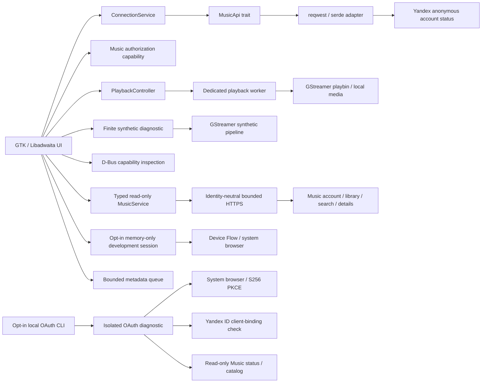

<!-- SPDX-License-Identifier: GPL-3.0-or-later -->

# Karin music interface, playback and local OAuth experiments

Karin remains one Cargo package with internal modules. The service integration
and the independently usable playback engine have separate responsibilities.

## Modules and boundaries

| Module | Responsibility |
| --- | --- |
| `domain` | Transport-independent account access, availability, errors and connection transitions |
| `application` | Cloneable connection service over the `MusicApi` boundary |
| `api` | Bounded anonymous HTTPS request, wire format parsing and sanitized errors |
| `oauth` | Separate opt-in code/PKCE experiment, bounded token exchange, ID-client binding and read-only Music probes with sanitized reports |
| `oauth_cli` | Binary-private local terminal input and system-browser launch; no credential arguments or GUI session |
| `music` | Application-facing typed read-only service, reduced models, bounded transport and token-bound account cache |
| `session` | Zeroizing ephemeral tokens; feature-gated Device Flow without bundled application credentials |
| `queue` | Bounded selection/order of real track metadata, independent of unavailable service audio |
| `capabilities` | Explicit unavailable Music authentication and a typed future permitted-stream boundary |
| `playback` | Reusable controller, worker-owned `playbin`, typed playback state, local media sources and developer self-test |
| `audio` | Existing finite synthetic pipeline, EOS/error/timeout handling and resource cleanup |
| `platform` | Session D-Bus/Secret Service presence diagnostics; reserved future MPRIS identity |
| `config` | Non-secret application identity and version |
| `ui` / `ui::music` | Native library/search/details/queue, opt-in session controls, diagnostics and main-thread updates |
| `main` | Concrete composition, application lifecycle and explicit diagnostic CLI modes |

UI consumes domain/application values and controller snapshots, not HTTP
responses, transport URLs or JSON schemas. The anonymous `YandexApi` accepts no
tokens, cookies or passwords and makes no authenticated requests. The separate
Gate B1 OAuth diagnostic does not inject credentials into this adapter or the
music interface. `MusicService` receives an ephemeral session token per call and
never impersonates an official client. Unknown
response schemas fail visibly rather than becoming invented account data.

`AuthenticationUnavailable` is independent of a successful anonymous HTTP
response and of generic Yandex ID login support. A typed permitted-stream resolver
boundary reserves the future integration point; no production resolver or remote
stream source is enabled. Its implementation requires the evidence and owner
actions in [API feasibility](API_FEASIBILITY.md) and
[ADR-0006](adr/0006-music-authorization-feasibility.md), updated by the separate
local experiment in [ADR-0008](adr/0008-local-oauth-pkce-diagnostic.md).
The scoped development-session and read-only interface decision is recorded in
[ADR-0009](adr/0009-music-vertical-slice.md); it does not enable a remote source.

## Read-only music and session lifecycle

The native Music pane consumes typed account, track, artist, album and playlist
values. Library references are expanded in batches of at most 50 distinct IDs;
duplicate playlist positions remain intact. Responses are bounded to 1 MiB, with
five-second connect and fifteen-second total request deadlines, no redirects or
automatic retries. A page can make at most two requests. No arbitrary returned
resource URL is fetched. Request IDs, personal response bodies, headers, URLs and
provider messages never enter displayable errors or Debug output.

Default builds have no Device Flow provider. Both `experimental-device-auth` and
`--experimental-music` are required for the local native experiment. Application
credentials are entered in memory and cleared from the controls before the
worker begins; no default identity, file/environment input or token-paste path
exists. The provider code screen uses a system browser, bounded polling,
countdown and cancellation. Music account validation is independent of token
issuance. There is no persistent store, refresh or remote revocation claim.

GTK jobs capture session/view generations and discard late results. Search text
can change while the previous bounded job finishes. Logout/close invalidates all
worker token clones locally, drops account/queue state and clears the service
cache. A cache epoch prevents an old in-flight validation from restoring facts
or overwriting a new session; an invalidated queued token cannot start another
validation. An active HTTP call may retain its temporary credential until its
deadline, without blocking GTK. Local invalidation is not server-side revocation.

The ordinary application retains its window/controller through close; signal
handlers reference controllers weakly. Queue editing selects metadata only.
No permitted audio resource is resolved and the player bar reports this blocker.
The existing generated-WAV diagnostic remains a separate developer tool.

## Playback controller

`PlaybackController` sends commands to a dedicated worker through a bounded
32-entry queue. GTK never waits for media preroll, state changes or bus messages.
Enqueue failure is explicit, including a full queue or a stopped worker. The
worker processes bounded command batches while observing GStreamer bus events
and a five-second deadline for asynchronous state completion. This deadline
cannot preempt a blocked call inside a native plugin.

The controller exposes Idle, Loading, Ready, Playing, Paused, Stopped, Ended and
Error states. Snapshots include position, duration, seekability, volume, a safe
error category and worker completion status. Prepare, play, pause/resume, stop,
volume and seek all use the same real `playbin` path. EOS and errors update
state explicitly; seeking is permitted only when the source reports support.

The current source type accepts regular local files. It validates/canonicalizes
the path and keeps it out of displayable errors and debug output. There is no
arbitrary network-URI entry point. The engine therefore has no dependency on
Yandex endpoints, tokens, subscriptions or stream signing.
General local files must be trusted: a container or playlist can refer to other
resources through a decoder plugin. Gate A's GTK diagnostics and automated tests
accept only their own generated PCM WAV and contain no external references;
there is no general file chooser or untrusted-playlist feature.

Developer diagnostics generate a temporary low-volume PCM WAV and feed it into
that same source path; they do not replace playback with a fake state machine.
The generated file is owned by a session guard and removed when that guard is
dropped. No audio fixture is distributed in the repository. A clocked `fakesink`
permits real decoding, timing, transport and EOS checks without physical sound;
system audio is an explicit alternative for desktop acceptance.

Shutdown signals cancellation independently of queue capacity. The worker resets
the pipeline to `Null`, releases it and only then reports `worker_running=false`.
The last handle's destructor requests shutdown without joining a worker on the
GTK thread. Callers that need to verify cleanup observe worker completion with a
bounded deadline. See [ADR-0007](adr/0007-playback-controller.md).
The GTK panel requests shutdown immediately on close and retains an application
hold while a GIO worker observes completion, up to a six-second deadline. Media
guards survive that cleanup wait. UI polling captures widgets weakly; normal
window teardown is checked while actual local playback is active.

## Other work and application lifecycle

GTK objects remain on the main thread. Bounded HTTP, finite audio and platform
operations use `gio::spawn_blocking`; `glib::spawn_future_local` awaits results and
updates widgets on that thread. Worker functions do not receive GTK objects.
The reqwest blocking client manages its own internal HTTP runtime; no additional
application-wide async runtime is introduced.

Only one connection check and one finite audio diagnostic run per window at once.
Loading is visible, duplicate requests are disabled, and errors permit retry.
These finite jobs retain an application hold until they return and clean up.
Normal close can wait for the existing HTTP timeout (12 seconds) or finite audio
timeout (5 seconds); forceful process termination cannot guarantee cleanup.

Every existing finite diagnostic exit path resets its pipeline to `Null` through
RAII. Long-lived playback belongs to the new controller instead of extending that
blocking diagnostic into a player.

## Security and future integration

The anonymous adapter keeps TLS verification, refuses redirects, limits response
bodies to 64 KiB and excludes raw bodies/URLs from displayable errors. The separate
OAuth experiment uses the same no-redirect/TLS/error policy with a 1 MiB response
ceiling. Offline HTTP fixtures exist only under `#[cfg(test)]`; production uses
fixed real service endpoints.

The platform module queries whether Secret Service is running without activating
it or reading an item. Permanent token lifecycle/storage belongs behind a
separately validated Secret Service integration. There is no `.env` loading,
pasted-token login or file credential store.

The opt-in local OAuth CLI is a separate experiment, not a GUI login path. It
accepts a local Client ID and the full returned browser URL from hidden terminal
prompts, creates random S256 PKCE/state, and launches the system browser through
GIO. The parser checks the exact registered origin/path, rejects ambiguous or
unexpected response parameters, and validates the returned state before a token
request. It extracts a bounded, nonempty opaque code without numeric-format
assumptions; the observed provider-added `cid` has no interpreted meaning.
There is no code-only bypass. The initial exchange uses no Client secret. Tokens
remain inside this process and are not passed to the anonymous service, playback
engine or UI.
ID identity/client binding, Music account access and catalog response remain
separate facts; errors and restrictions fail closed before later probes.
The owner observed code/state in the actual verification-page redirect on Fedora;
manual full-URL transfer now makes that return observable to the diagnostic.
This is not an automatic callback listener or a tested production Linux sign-in
flow. The owner verified token/ID binding; both Music account methods returned
403. See ADR-0008 and the dated [API evidence](API_FEASIBILITY.md).
Automated OAuth fixtures use loopback only and require no account or browser.

`org.mpris.MediaPlayer2.Karin` remains reserved and unexported. Gate A does not
implement MPRIS or My Wave. The new music interface provides catalog/library
reads and a metadata queue, with service playback still blocked.
Flatpak permissions omit Secret Service and MPRIS ownership because neither is
used. The existing sandbox grants suffice for generated local media and explicit
system-output diagnostics; the Runtime/SDK selection is unchanged.
