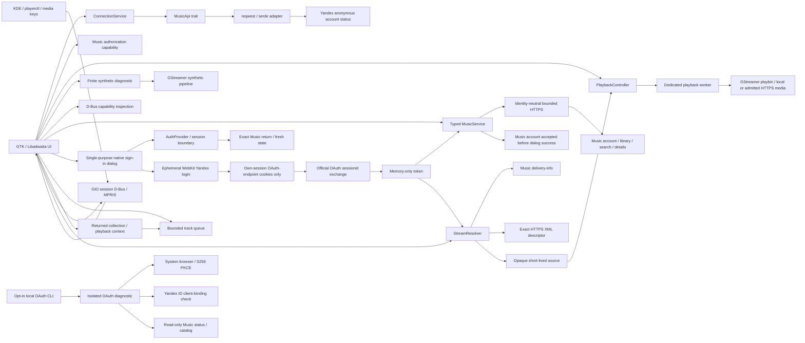

<!-- SPDX-License-Identifier: GPL-3.0-or-later -->

# Karin music workspace, guarded playback and platform integration

Karin remains one Cargo package with internal modules. The service integration
and the independently usable playback engine have separate responsibilities.
The owner accepted real search, account actions and preserved service playback
at `f0aa2bb`; the overall UI was rejected. The next context/workspace/MPRIS
increment preserves those accepted service and engine boundaries, with fresh
target-desktop acceptance required. See [ADR-0017](adr/0017-playback-context-unified-workspace-and-mpris.md).

## Modules and boundaries

| Module | Responsibility |
| --- | --- |
| `domain` | Transport-independent account access, availability, errors and connection transitions |
| `application` | Cloneable connection service over the `MusicApi` boundary |
| `api` | Bounded anonymous HTTPS request, wire format parsing and sanitized errors |
| `oauth` | Separate opt-in code/PKCE experiment, bounded token exchange, ID-client binding and read-only Music probes with sanitized reports |
| `oauth_cli` | Binary-private local terminal input and system-browser launch; no credential arguments or GUI session |
| `music` | Typed metadata service, reduced models, bounded transport and token-bound account cache; explicit confirmed writes in `music::interactions` |
| `auth` / `auth::cassette` | Default Cassette-compatible session provider, bounded attempts/return-state validation and official OAuth session exchange; separate generic code/PKCE fixed-loopback infrastructure |
| `session` | Zeroizing ephemeral tokens; library-only feature-gated Device Flow without bundled application credentials |
| `queue` | Bounded ordered playback context and explicit queue appends from real track metadata; active source binding remains in the music player |
| `capabilities` | Historical independent diagnostic capability types; not the normal provider or new resolver admission |
| `playback` / `playback::remote` | Reusable controller, worker-owned `playbin`, local sources and sealed short-lived HTTPS admission/transport policy |
| `stream` / `stream::resolver` | Metadata-only delivery diagnostic and the separate account-bound legacy full-MP3 resolver; bounded requests and sanitized reports |
| `audio` | Existing finite synthetic pipeline, EOS/error/timeout handling and resource cleanup |
| `platform` | Session D-Bus/Secret Service presence diagnostics |
| `mpris` | GIO session-bus adapter for MPRIS root/Player methods, typed snapshots and signals; no audio engine or network resource input |
| `config` | Non-secret application identity and version |
| `ui` / `ui::music` / `ui::music::player` | Native catalog/session UI plus explicit playback intents, queue/source binding, snapshot controls and cleanup |
| `ui::music::system_media` | MPRIS commands/snapshots joined to that same player; worker-acknowledged Seeked and bounded private cover-only files |
| `ui::auth` | Single-purpose Libadwaita sign-in dialog, ephemeral WebKitGTK6 login and scoped asynchronous cookie handoff |
| `main` | Concrete composition, application lifecycle and explicit diagnostic CLI modes |

UI consumes domain/application values and controller snapshots, not HTTP
responses, transport URLs or JSON schemas. The anonymous `YandexApi` accepts no
tokens, cookies or passwords and makes no authenticated requests. The separate
Gate B1 OAuth diagnostic does not inject credentials into this adapter or the
music interface. `MusicService` receives an ephemeral session token per call and
never impersonates an official client. Unknown
response schemas fail visibly rather than becoming invented account data.

The independent anonymous/OAuth diagnostic capability reports do not gate the
working ordinary provider. The scoped development-session and interface decision
is recorded in [ADR-0009](adr/0009-music-vertical-slice.md). Its historical remote-
source deferral and ADR-0007's local-only source are superseded for the guarded
legacy Play path by [ADR-0015](adr/0015-guarded-legacy-mp3-playback.md), without
turning account metadata into a blanket playback entitlement.
The corrected public sign-in boundary and provider gate are recorded in
[ADR-0011](adr/0011-cassette-session-auth-prototype.md), superseding the earlier
[ADR-0010](adr/0010-single-purpose-sign-in-and-provider-gate.md) provider block, and the
[authentication review](AUTHENTICATION_REVIEW.md).

## Native workspace and unified search

The desktop navigation defaults to a 72-pixel icon rail with an explicit
expand-labels action. At logical widths of 760 pixels or less, navigation uses
a native labelled drawer. Ctrl+B expands desktop labels or toggles that drawer.
Accessible names, tooltips and keyboard activation accompany icons. Diagnostics
remain in the application menu, outside everyday library/search destinations. A compact native account
avatar in the HeaderBar uses initials from the validated display name, because
no profile-photo URI has been verified. Its popover displays only known name/
session information and the existing safe logout flow. Opening the fixed
`https://id.yandex.ru/` account page uses the system-browser handler without
account parameters, cookies or tokens; a launch failure remains local to the
popover. It does not replace the established WebKit login path.

The initial unified search consumes one `type=all` response and at most one
existing account-bound track-normalization batch. Tracks, albums, artists and
playlists have independent typed section results. One malformed/failed section
does not hide successful sections or become a fictional empty list. Empty
categories are omitted; an entirely empty successful search has one clear
message. Show All, section Retry and subsequent pages use only that category's
existing search path, with the original query and provider paging. Returning to
All performs a fresh bounded aggregate query. The strict own-ID and
50-position/50-distinct-ID track contract, bounded requests and account epochs
remain unchanged. Search and detail navigation preserve their real source
state; no extra per-row normalization request is introduced. Search playlist
summaries keep actual owner/kind and optional counts; a generic **Плейлист**
label for missing/invalid display text is not claimed to be a returned name.

The persistent music bar groups a 56-pixel cover, actual title/artist, a
44-pixel native Play control, transport, progress/seek, volume and queue.
Its compact vertical arrangement preserves readable metadata and controls.
It follows the existing worker snapshots; a
redesigned control must not invent a new playing state or source. Both the
workspace's useful density and its keyboard/HiDPI behavior require actual visual
and structural review, separately from the accepted backend functionality.
Details remain on their existing page with a distinct action; the optional
wide information pane is not implemented in this increment.

## Read-only music and session lifecycle

Issue #9's [catalog/delivery increment](adr/0012-catalog-repair-and-local-delivery-probe.md)
supersedes the global catalog admission lock. Account, initial library, explicit
library, search, detail and delivery requests have independent bounded lanes:
one running and one latest pending job each. Tickets and session generations
discard superseded replies; invalidated old work does not disable a new login.
Detail navigation opens before the HTTP response, preserves its source section
and displays loading, empty or retryable errors in native widgets.

The opt-in `stream::DeliveryProbe` is an executable owner-local metadata boundary,
separate from an audio resolver. It validates the existing Music session, performs
one legacy per-track offer read and at most one unauthenticated descriptor read
to an exact reviewed HTTPS origin/path. Bounded XML parsing has no DTD/entity
resolution. Only finite reports and separate HTTP statuses reach GTK. That diagnostic hands no source to GStreamer, and no raw URL/body, signing input
or personal identifier becomes a report. The separate explicit Play path uses
`StreamResolver`: token-bound offer → bounded XML → validated opaque source →
PlaybackController. Both share request policy but retain distinct result/action
semantics. See the current [delivery contract](STREAM_DELIVERY_REVIEW.md).

The native Music pane consumes typed account, track, artist, album and playlist
values. Library references are expanded in batches of at most 50 distinct IDs;
duplicate playlist positions remain intact. Track search first reads only a
validated own ID from each hit, ignoring its optional display metadata, then
uses the same account-bound `/tracks` normalization in one batch. Search order,
duplicate/composite identities and provider pagination survive normalization;
missing/null records have an explicit omitted count and unavailable returned
tracks remain visible but unplayable. Track pages accept at most 50 raw hit
positions as well as 50 distinct batch IDs, bounding restored duplicate models.
Larger pages fail before a POST rather than causing truncation, a new cursor or
N+1 requests; album/artist wire bounds remain unchanged.
See [ADR-0016](adr/0016-search-identity-and-batch-normalization.md).
Responses are bounded to 1 MiB, with
five-second connect and fifteen-second total request deadlines, no redirects or
automatic retries. A page can make at most two requests. No arbitrary returned
resource URL is fetched. Request IDs, personal response bodies, headers, URLs and
provider messages never enter displayable errors or Debug output.

The ordinary interface exposes one `Войти` action opening an `Adw.Dialog`,
without Client ID/secret, device codes, URL transfer or token-entry controls.
Default `cassette-auth` depends on `auth-webkit` and implements the published
Cassette browser-session grant with the same shared OAuth registration. It is a
real provider attempt, not a blocked stub or the known own-client PKCE 403 path.
The separate `experimental-device-auth` module remains library-only and excluded
from default/Flatpak builds. A no-feature compatibility artifact intentionally
omits session authentication and is not the real Fedora acceptance build.

The dialog owns a fresh ephemeral WebKitGTK6 NetworkSession with persistent
credentials disabled. Exact trusted HTTPS origins and return path replace
substring matching; a fresh cryptographic state must match the returned value
before a single-use main-document completion can proceed. Navigation-policy
callbacks alone cannot prove a main-frame return; the browser checks document
completion separately. No password/DOM reading or JavaScript injection is used.
`webkit6` 0.5 matches the existing GTK Rust 0.10 bindings and GNOME 50 WebKitGTK6.

After a validated return, CookieManager asynchronously retrieves only cookies
applicable to the fixed official OAuth token URI from this login's own ephemeral
session. A bounded redacted memory payload crosses to a worker for the official
`grant_type=sessionid` exchange; cookies never go to MusicService. Collect before
clearing WebKit data, cancel pending collection on close, and discard late results.
The published shared application configuration is attributed under upstream GPL;
it is not a user credential or independently approved Karin OAuth registration.
No Android/official-client Music request header is added.

This implicit/sessionid contract is distinct from Authorization Code+PKCE. The
own-client diagnostic and generic state/S256/fixed-loopback infrastructure remain
separate and unchanged. RFC 8252 rejects embedded native OAuth; Yandex mobile SDK
WebView support does not establish Linux approval, and source licensing does not
establish registration/service distribution permission. Those unresolved facts
are documented separately from technical stage errors, without replacing the
prototype with a permanent provider block. See [authentication research](AUTHENTICATION_REVIEW.md).

Token issuance and Music account validation are separate. The dialog completes
and library/search become usable only after the Music account endpoint accepts
the session. Successful completion starts the actual liked-track and playlist
loads. No persistent store, refresh or remote revocation is claimed.

GTK jobs capture session/view generations and discard late results. Search text
can change while the previous bounded job finishes. Logout/close invalidates all
worker token clones locally, drops account/queue state and clears the service
cache. New attempts and logout also reset stale API errors; signed-out status
appears in a native message row, and authentication errors stay in the dialog.
A cache epoch prevents an old in-flight validation from restoring facts
or overwriting a new session; an invalidated queued token cannot start another
validation. An active HTTP call may retain its temporary credential until its
deadline, without blocking GTK. Local invalidation is not server-side revocation.

Ordinary user logout is an explicit account-menu action followed by an
`Adw.AlertDialog` confirmation, with Cancel as the safe default. Opening the menu
or dismissing/cancelling the confirmation does not invalidate tokens, alter the
queue or interrupt audio. A confirmation is bound to the current session so a
late response cannot sign out a replacement login. Internal expired/rejected
session cleanup remains independent of this deliberate user action. Search
errors occupy one plain-language retry state; optional safe diagnostic details
do not compete with normal results or duplicate a global error banner.

The ordinary application retains its window/controller through close; signal
handlers reference controllers weakly. Activating a playable track row by mouse,
Enter or Space creates/selects its `PlaybackContext` and starts real resolution
immediately; opening details is a separate explicit action. A context retains
the collection source kind/identity, actually loaded ordered tracks and selected
position. Liked tracks, playlist/album contents and search results do not become
an invented complete collection: Next/Previous/EOS use the returned context and
skip unavailable loaded items, preserving paused/stopped intent. Contexts retain
exact clicked positions and duplicates within the existing 500-position bound.
Manual appends follow that context; starting another context drops old extra
appends. Partial data is marked without unbounded collection fetching.
Queue changes and view navigation must not cause an older context or pending
resolver intent to replace newer user work. The music player has one
running/latest-pending resolver intent, independent of
catalog lanes. Track ID, session and intent serial prevent stale completion from
restarting old audio. Stop, removing a playing selection, logout and close cancel
resolution and retire the controller off GTK. The existing generated-WAV
diagnostic remains a separate developer tool.

## MPRIS and the existing player

`mpris` owns `org.mpris.MediaPlayer2.io.github.tracerxbrhd.Karin` and exports root
and Player interfaces at `/org/mpris/MediaPlayer2` using GIO on the session bus.
It receives typed snapshots and emits PropertiesChanged/Seeked; native UI bridge
callbacks dispatch commands to the same context, resolver and PlaybackController
as native controls. There is no second GStreamer pipeline or provider. Raise/
Quit, Play/Pause/PlayPause/Stop, Next/Previous, Seek/SetPosition and Volume retain
actual lifecycle/capability checks. Position and length use microseconds; track
object paths are opaque and generation-bound, so a stale SetPosition cannot seek
a new selection. Next/Previous preserve paused/stopped intent.
Seeked waits for a matching worker acknowledgement, rather than assuming
successful delivery when the old position happens to be close to the target.

PlaybackStatus, Can* properties and metadata reflect actual state. Only known
title/artist/album/length and optional validated local-file cover artwork are
exported. `LocalArtwork` validates an absolute regular non-symlink file. The UI
bridge writes only an already bounded, decoded cover as a PNG of at most 256
pixels, into a private random directory under the user's cache directory;
directory/file modes are 0700/0600. RAII removes both on replacement, logout
and close. At most three local artwork-worker Busy admission attempts are
permitted; they do not retry HTTP. No music content is cached.
No audio resource/CDN URL, OAuth, cookie, query, raw response or `xesam:url`
crosses the bus. OpenUri is unsupported; no TrackList, repeat or shuffle
properties are advertised. Rate stays 1.0 (minimum/maximum 1.0); the standard
Rate=0 action pauses rather than enabling speed control. Shutdown unregisters
interfaces and releases the owned name; logout instead publishes Stopped and
empty metadata while the application stays open.

The Flatpak manifest needs only the exact MPRIS own-name permission; broad
session-bus/filesystem access is unnecessary. Secret Service remains ungranted.
An isolated bus fixture and a synthetic native-player bridge fixture can verify
methods, properties, signals, stale IDs, capability changes and cleanup. Actual
KDE integration, hardware media keys and `playerctl` controlling an audible
Music track remain a separate Fedora acceptance check; a complete current
Flatpak build/install/sandbox result also remains separate.

## Confirmed library interactions

The explicit library-write extension lives in `music::interactions`, retaining
the existing transport and token/account cache. It separates membership, a
single deliberate POST and independent confirmation. Native controls use their
own read/write lanes and fixed errors, with no optimistic favorite toggle or
automatic write retry. Liked playlists retain the returned owner identity.
See [ADR-0014](adr/0014-confirmed-library-interactions.md). These operations do
not create a media source or change the independent playback boundary.

## Playback controller

`PlaybackController` sends commands to a dedicated worker through a bounded
32-entry queue. GTK never waits for media preroll, state changes or bus messages.
Enqueue failure is explicit, including a full queue or a stopped worker. The
worker processes bounded command batches while observing GStreamer bus events
and a five-second deadline for asynchronous state completion. This deadline
cannot preempt a blocked call inside a native plugin.

The controller exposes Idle, Loading, Ready, Playing, Paused, Stopped, Ended and
Error states. Snapshots include position, duration, seekability, volume, a safe
error category and worker completion status. Numeric `seek_serial` and
`seek_position` telemetry advance only after the existing native `seek_simple`
succeeds. The MPRIS bridge captures the counter before enqueueing and waits for
a matching acknowledged target before emitting Seeked. This adds observability
without changing source admission, resolution or GStreamer seek semantics.
Shared native/MPRIS Play also consumes outstanding Ready preparation/resume
state, preventing a late preparation result from leaving playback stuck.
Prepare, play, pause/resume, stop,
volume and seek all use the same real `playbin` path. EOS and errors update
state explicitly; seeking is permitted only when the source reports support.

The local constructor still validates/canonicalizes regular files and keeps
paths out of displayable errors/Debug. A separate constructor accepts only an
opaque `RemotePlaybackSource` produced by the resolver; there is no arbitrary
network-URI input. The worker does not receive OAuth/cookies or make Music API
requests. It repeats source policy/freshness checks and enforces guarded Soup
HTTPS, strict TLS, no redirects/retries, no credentials, no manifests/secondary
URI handlers and no media files. Native URI debug output is disabled before
handoff; finite categories and structured numeric HTTP status replace raw native
errors. A conservative 60-second admission prevents stale new connections,
resume/seek; it does not interrupt an already playing track. Explicit retry can
resolve a fresh resource. See ADR-0015 for the narrow CDN/path policy.
General local files must be trusted: a container or playlist can refer to other
resources through a decoder plugin. Gate A's GTK diagnostics and local diagnostic
tests accept only their own generated PCM WAV and contain no external references;
there is no general file chooser or untrusted-playlist feature.

Developer diagnostics generate a temporary low-volume PCM WAV and feed it into
that same source path; they do not replace playback with a fake state machine.
The generated file is owned by a session guard and removed when that guard is
dropped. No audio fixture is distributed in the repository. A clocked `fakesink`
permits real decoding, timing, transport and EOS checks without physical sound;
system audio is an explicit alternative for desktop acceptance.

Shutdown signals cancellation independently of queue capacity. The worker resets
the pipeline to `Null`, releases it and only then reports `worker_running=false`.
The last handle's destructor requests shutdown without joining a worker on the
GTK thread. Callers that need to verify cleanup observe worker completion with a
bounded deadline. See [ADR-0007](adr/0007-playback-controller.md).
The GTK panel requests shutdown immediately on close and retains an application
hold while a GIO worker observes completion, up to a six-second deadline. Media
guards survive that cleanup wait. UI polling captures widgets weakly; normal
window teardown is checked while actual local playback is active.

## Other work and application lifecycle

GTK objects remain on the main thread. Bounded HTTP, finite audio and platform
operations use `gio::spawn_blocking`; `glib::spawn_future_local` awaits results and
updates widgets on that thread. Worker functions do not receive GTK objects.
The reqwest blocking client manages its own internal HTTP runtime; no additional
application-wide async runtime is introduced.

Only one connection check and one finite audio diagnostic run per window at once.
Loading is visible, duplicate requests are disabled, and errors permit retry.
These finite jobs retain an application hold until they return and clean up.
Normal close can wait for the existing HTTP timeout (12 seconds) or finite audio
timeout (5 seconds); forceful process termination cannot guarantee cleanup.

Every existing finite diagnostic exit path resets its pipeline to `Null` through
RAII. Long-lived playback belongs to the new controller instead of extending that
blocking diagnostic into a player.

## Security and future integration

The anonymous adapter keeps TLS verification, refuses redirects, limits response
bodies to 64 KiB and excludes raw bodies/URLs from displayable errors. The separate
OAuth experiment uses the same no-redirect/TLS/error policy with a 1 MiB response
ceiling. Offline HTTP fixtures exist only under `#[cfg(test)]`; production uses
fixed real service endpoints.

The platform module queries whether Secret Service is running without activating
it or reading an item. Permanent token lifecycle/storage belongs behind a
separately validated Secret Service integration. There is no `.env` loading,
pasted-token login or file credential store.

The opt-in local OAuth CLI is a separate experiment, not a GUI login path. It
accepts a local Client ID and the full returned browser URL from hidden terminal
prompts, creates random S256 PKCE/state, and launches the system browser through
GIO. The parser checks the exact registered origin/path, rejects ambiguous or
unexpected response parameters, and validates the returned state before a token
request. It extracts a bounded, nonempty opaque code without numeric-format
assumptions; the observed provider-added `cid` has no interpreted meaning.
There is no code-only bypass. The initial exchange uses no Client secret. Tokens
remain inside this process and are not passed to the anonymous service, playback
engine or UI.
ID identity/client binding, Music account access and catalog response remain
separate facts; errors and restrictions fail closed before later probes.
The owner observed code/state in the actual verification-page redirect on Fedora;
manual full-URL transfer now makes that return observable to the diagnostic.
This is not an automatic callback listener or a tested production Linux sign-in
flow. The owner verified token/ID binding; both Music account methods returned
403. See ADR-0008 and the dated [API evidence](API_FEASIBILITY.md).
Automated OAuth fixtures use loopback only and require no account or browser.

The earlier Gate A MPRIS reservation and later audio-only deferral are historical;
ADR-0017 defines the scoped bridge to the now accepted player. My Wave and
persistent Secret Service sessions remain unimplemented. Actual service-audio
acceptance at `8f1b09d` and preservation at `f0aa2bb` do not by themselves pass
the new workspace/MPRIS or current Flatpak. The exact MPRIS own-name grant does
not enable Secret Service access. The prototype manifest explicitly enables Cassette/WebKit authentication and
excludes the legacy Device Flow feature. Dependency availability and synthetic
fixtures do not establish a live accepted provider session or public-release
permission. Smoke/capture modes inject an offline provider and never contact
Yandex; ordinary no-argument startup uses the real provider.
