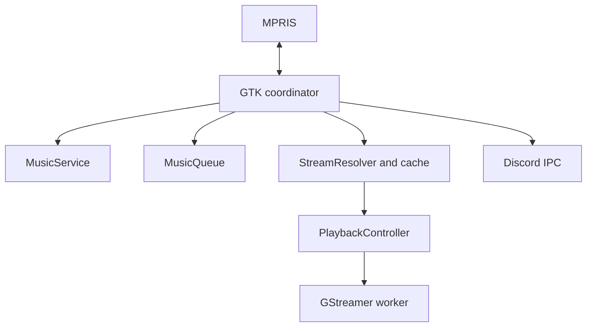

<!-- SPDX-License-Identifier: GPL-3.0-or-later -->

# Architecture

Karin uses Rust, GTK4 and Libadwaita for a native Linux interface and GStreamer
for playback. Keeping one typed service, one queue and one audio engine lets
the interface, system controls and integrations observe the same session.
WebKitGTK6 serves the browser-session sign-in.

## Ownership and execution

| Area | Modules | Responsibility |
| --- | --- | --- |
| Catalog | `music`, `api` | Account-bound transport, search and confirmed writes |
| Sign-in | `auth`, `ui::auth`, `oauth`, `independent_auth` | Credential admission and provider-specific flows |
| Private state | `session`, `credentials`, `session_lifecycle`, `settings` | Protected storage, preferences and forgetting |
| Playback | `queue`, `playback_session`, `stream`, `playback` | Queue occurrences, source admission and one player |
| Cache | `cache_budget`, `catalog_cache`, `artwork`, `audio_cache` | Shared budget and storage policy |
| Desktop | `ui`, `mpris`, `discord_presence`, `updates` | Presentation, media controls, presence and release checks |

Widgets send typed intents. HTTP, parsing and file I/O run on bounded workers
and return results to the GTK main context. Each ordinary read lane holds one
running request and one latest pending request. Writes and Wave feedback have
separate serialized lanes. Account, request, source and intent generations
fence results from retired state. Weak view ownership and deferred membership
reads prevent late and reentrant GTK updates.

The audio worker owns GStreamer. Shutdown bypasses the command queue and
transitions to Null without blocking GTK on a join. Application holds let
admitted durable operations settle before conflicting I/O begins. Native
plugin calls can delay cooperative shutdown.

## Sign-in and private state

The attributed Cassette-compatible provider uses ephemeral WebKitGTK with
exact trusted navigation, callback and single-use state checks. The token
exchange uses scoped in-memory cookies at the provider endpoint. The browser
sandbox stays enabled. Music account validation precedes library access and
credential storage.

Independent sign-in uses a system browser, an exact registered IPv4 loopback
callback, Authorization Code and S256 PKCE. The opt-in terminal path validates
Yandex ID and Music against the same account. It stores credentials only on
explicit request, in a separate scope, and repeats validation on restore.
The earlier own-registration test passed Yandex ID and received HTTP 403 from
Music. [#35](https://github.com/tracerxbrhd/karin/issues/35) records the work on
independent sign-in and the decision to defer desktop adoption.

Native uses Secret Service. Flatpak stores an encrypted token envelope backed
by the Secret Portal. Unavailable storage permits memory-only login. Restore
requires fresh Music validation. Logout fences late work, drops the credential
and purges retired personal data. An uncertain cleanup keeps a visible Retry
and prevents restore. Ordinary playback continuation stores bounded,
account-bound selectors, order and position. It resolves fresh access before
restoring and waits for Play. Wave sessions are transient.

## Catalog and queue

Search hydrates validated selectors in canonical batches of up to 50.
Navigation and membership reads have independent ownership. Ordinary views
stop at 2,000 positions or 100 pages. A settled search in an eligible collection
can start an index with a 20,000-position and 4 MiB limit. Coverage is explicit
when the collection changes or exceeds the limit. Cached metadata may support
labelled transport-error fallback. Current account or resource refusal takes
precedence over saved data.

Explicit Play snapshots up to 500 opaque queue occurrences. Duplicate tracks
retain their own identity across filtering, sorting and queue edits. Catalog
or server playlist changes cannot rewrite an admitted playback context.
MPRIS publishes actual player state and addresses the current occurrence.

Library writes serialize under the validated account. Each intent sends one
write and requires independent readback. Uncertain results reconcile through
GET. Playlist edits use a complete revisioned snapshot and the exact server
position of the chosen occurrence. Revisions and ordered sequences are
checked again before writing. Playlist metadata edits and deletes can race
with another client between independent reads. Only confirmed Dislike for
the current occurrence advances to the next track.

## Playback and cache

StreamResolver admits supported, unprotected full MP3 offers over HTTPS under
exact origin and path checks. Descriptor/XML work is bounded. Music credentials
stay off CDN requests and signed media URLs stay in memory. PlaybackController
owns one GStreamer pipeline. An explicit Resume can renew an expired source
once for the same occurrence and then restore the confirmed position.

My Wave starts on request and uses the same player. Its bounded feedback queue
uses the actual listening ledger and serializes feedback. An ambiguous write
stops continuation. Explicit Retry starts a new session. Manual future-order
editing is unavailable during Wave.

One default-on 2 GiB budget coordinates metadata, artwork and audio. Private
staging, atomic publication, integrity checks and shared LRU protect stored
data. Unlimited retains disk headroom and bounds on work. Clear, Disable,
logout and account changes fence pending admission. Eligible, selected audio
can be saved independently after online playback starts. Storage failure
preserves admitted playback.

Audio reuse requires current Music access, a matching offer, complete MP3
integrity and a fresh HTTP lease or positive revalidation. Validators apply to
the exact compatible media URI. `no-store` retires retained data,
`no-cache` requires validation and an inconclusive comparison plays online.
A stored file indicates local presence. Offline playback is unavailable.
[HTTP caching](https://www.rfc-editor.org/rfc/rfc9111.html) · [Licensing](LICENSING.md)

## Presentation and desktop

One pinned Info, Lyrics and Queue panel preserves intent across navigation and
resize. Lyrics follows the actual position of the current occurrence. Yandex
plain text requires an explicit rights indication. Synchronized lookup in
LRCLIB requires consent and sends public track metadata. Lyrics stay in memory.
Similar tracks and external lyrics load only for the relevant visible view.
System styling follows Libadwaita, with High Contrast and Reduced Motion.

Discord Rich Presence starts off. An opt-in local IPC worker sends the latest
track, transport and seek events without periodic position updates. It shares
canonical track links and eligible public cover URLs. Flatpak grants read-only
access to `xdg-run/discord-ipc-0` and `xdg-run/app/com.discordapp.Discord`.
Restart Karin if the Discord socket was unavailable at startup or recreated.

## Application updates

Karin checks the public GitHub release before Music sign-in. Native directs
users to the release for manual replacement. For Flatpak, the SHA-256 in the
release notes binds the pinned Pages record to its release, source commit,
App ID, ref, OSTree commit and signing fingerprint. Flatpak verifies the
repository signature.

The host UpdateMonitor schedules discovery. Karin requests installation when
the Portal reports the matching commit, then checks the installed commit
before offering restart and verifies it after restart. A system update is
needed when sandbox permissions expand. Production verification of the
in-app transition after 0.8.3 is tracked in
[#40](https://github.com/tracerxbrhd/karin/issues/40).
[Release and update instructions](BUILDING.md#stable-flatpak-channel)

## Decision history

Record changes to these contracts under the relevant heading with the reason
and a link to the deciding PR. The [original decision records](https://github.com/tracerxbrhd/karin/tree/36ac6820d619fb9aa6c7e235a445ef66f55c610e/docs/adr)
remain available in the 0.8.3 source tree.
