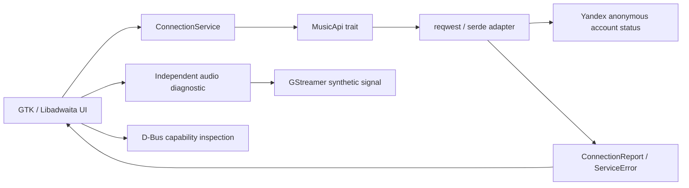

# Technical foundation architecture

Karin starts with one Cargo package and internal modules. There is no reason yet
to introduce multiple crates or a separate backend process.

## Modules

| Module | Responsibility |
| --- | --- |
| `domain` | Transport-independent account access, availability, errors and connection state transitions |
| `application` | Cloneable connection service over the `MusicApi` boundary |
| `api` | Bounded anonymous HTTPS request, wire format parsing and sanitized errors |
| `audio` | Finite low-volume synthetic pipeline, EOS/error/timeout handling and resource cleanup |
| `platform` | Session D-Bus/Secret Service presence diagnostics; reserved future MPRIS identity |
| `config` | Non-secret application identity and version |
| `ui` | Native navigation, status presentation, user actions and main-thread updates |
| `main` | Concrete service composition, application lifecycle and diagnostic CLI modes |

UI depends on the application service and domain values, not reqwest, endpoints or
JSON schemas. The production adapter makes no authenticated requests. It does not
accept tokens, cookies or account passwords. Unknown response schemas fail visibly
rather than being replaced with invented account data.

## Concurrency and lifecycle

GTK objects live only on the main thread. User actions dispatch bounded blocking
operations with `gio::spawn_blocking`; `glib::spawn_future_local` awaits results and
updates widgets on that thread. No worker receives a GTK object. This uses the GIO
worker pool rather than managing another application-wide async runtime; reqwest's
blocking client manages its own internal HTTP runtime.

Only one connection check and one audio diagnostic can run per window at once.
Loading is visible and duplicate action buttons are disabled. Errors remain
visible with a retry action. Closing the window during work releases widgets once
the bounded worker completes: an application hold keeps the main context alive
until the worker has returned and cleaned up. Normal shutdown may therefore wait
for the outstanding request (12-second HTTP timeout) or audio diagnostic
(5-second bus timeout). Forceful process termination has no cleanup guarantee.

Every diagnostic GStreamer exit path resets the pipeline to `Null` through RAII,
including timeout and error. There is no retained player, background stream or
queue. Physical output is requested only by the explicitly labelled test button.

## Security and future integration

Requests retain TLS verification, refuse redirects, limit responses to 64 KiB and
exclude raw bodies/URLs from displayable network errors. Offline HTTP fixtures
exist only inside `#[cfg(test)]`; production always uses the real adapter.

The platform boundary queries whether Secret Service is running without
activating it or reading any item. Token storage must be implemented through
Secret Service only after an authorized client flow is established. No `.env`
loading, token input or file-based credential store exists.

`org.mpris.MediaPlayer2.Karin` is reserved but not exported: there is no real music
player to control yet. Implement MPRIS against future application playback state,
not directly against widgets or transport endpoints. Flatpak permissions currently
omit Secret Service and MPRIS ownership because those capabilities are not used.
