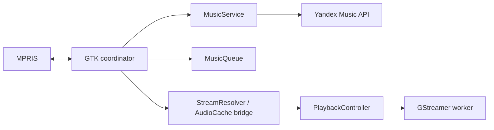

<!-- SPDX-License-Identifier: GPL-3.0-or-later -->

# Architecture

Karin is a native Rust/GTK4/Libadwaita application with one GStreamer player.
Views express typed user intents; service, session, queue, cache and desktop
adapters own their respective state. The [ADRs](adr/) describe current decisions.

## Ownership and execution

| Area | Modules | Responsibility |
| --- | --- | --- |
| Catalog | `music`, `api`, `application` | Account-bound transport, typed models, search and confirmed writes |
| Collections/text | `music::library_index`, `music::track_extras`, `lyrics` | Bounded indexing, related reads and literal TEXT/LRC |
| Sign-in | `auth`, `auth::cassette`, `ui::auth`, `oauth`, `oauth_cli` | Ordinary browser-session sign-in, PKCE diagnostic and isolated independent sign-in |
| Persistence | `session`, `credentials`, `session_lifecycle`, `settings` | Live token, protected storage, preferences and forgetting barriers |
| Cache | `cache_budget`, `catalog_cache`, `artwork`, `audio_cache` | Shared budget and distinct metadata/artwork/HTTP-audio policies |
| Playback | `queue`, `playback_session`, `stream`, `playback` | Occurrence identity, continuation, source admission and one worker |
| Desktop/UI | `mpris`, `discord_presence`, `ui::music`, `ui::style`, `ui::preferences` | Actual media state, local integrations and native views |

Blocking I/O and parsing run on bounded workers. Coalesced reads keep one running
and one latest pending job per lane; playlist edits serialize, and Wave feedback
uses its own bounded FIFO without replay. Main-context admission checks account,
request, source and intent generations. Weak UI owners and deferred membership
reads avoid late/reentrant updates. GTK widgets/textures remain on GTK.
[Worker boundaries](adr/0002-foundation-boundaries-and-workers.md).

## Sign-in and private state

The attributed Cassette-compatible provider owns an ephemeral WebKitGTK6 dialog,
exact navigation/callback/state checks and scoped in-memory cookies. No password
inspection, injected JavaScript, imported profiles or persistent browser cookies
are used. Music validation admits the session before library access or saving.
UI and MusicService do not depend on the provider's registration/grant details.
[Authentication](adr/0011-browser-session-authentication.md).

The independent opt-in command uses a system browser, a registered IPv4
loopback callback and Karin's existing OAuth Code/S256 PKCE primitives. It
validates the Yandex ID registration and Music account through the existing
service boundary before admitting a token. Remembered independent credentials
have their own storage scope and lifecycle. The command runs before GTK and
reports account validation in the terminal. [Independent authentication](adr/0037-independent-authentication.md).

Native uses Secret Service; Flatpak uses a Secret Portal secret and an encrypted
token envelope. Unavailable storage permits memory-only login, never plaintext
fallback. Logout/forgetting fence late writes and clear personal state; uncertain
cleanup retains Retry. Ordinary continuation restores bounded account-bound
IDs/order/position after fresh access checks without autoplay. Wave never persists.
[Session lifecycle](adr/0018-persistent-session-and-settings.md).

## Catalog and queue

Search collects minimal validated identities and normalizes tracks in canonical
batches, preserving order, duplicates and unavailable positions. Global search
and collection search have independent request ownership. Eligible collection
indexing starts from settled search intent, not startup/per-keystroke scans;
coverage, paging and membership rechecks stay bounded.
[Catalog/index decisions](adr/0035-incremental-whole-collection-index.md).

Queue occurrences are opaque and independent of provider IDs or visible indices.
Explicit Play snapshots its source context. Filtering, sorting, growing an index
or editing a server playlist cannot rewrite active playback. Local future-order
edits preserve current source, history and occurrence identity.
[Account/queue fences](adr/0026-refusal-fences-and-queue-occurrence-identity.md).
Writes send one intent, require independent readback and reconcile unknown
outcomes with GET only. [Playlist/reaction contracts](adr/0032-playlist-management.md).

## Playback and cache

StreamResolver admits only reviewed unprotected MP3 HTTPS resources under exact
origin/path policies. OAuth/cookies stay off CDN transport; media URLs remain
private and transient. One PlaybackController owns one `playbin`; actual worker
snapshots drive transport, queue and MPRIS. Explicit Resume can renew once for the
same occurrence and restore confirmed position without a second player/clock.
[Source/player contract](adr/0015-guarded-audio-playback.md).

My Wave uses that same pipeline and actual listening-time ledger. Only Listen
starts radio; batches/feedback remain occurrence-bound, serialized and in memory.
[Wave lifecycle](adr/0027-my-wave-lifecycle.md).

Metadata, artwork and policy-admitted audio share one default-on 2 GiB budget.
AudioCache verifies complete files and fresh account/offer/HTTP reuse evidence
before local playback. A miss admits online playback immediately; independent
bounded saving must not delay it. Atomic publication, integrity, LRU, disk
headroom and Clear/Disable/account fences protect reuse. No cache establishes
entitlement, and storage failure preserves admitted playback.
[Cache policy](adr/0029-unified-cache-and-audio-reuse.md).

## Presentation and desktop

One pinned Info/Lyrics/Queue surface preserves user intent across navigation,
outside clicks and resize. Lyrics follows the actual current occurrence/player
position; external LRCLIB lookup needs consent and text stays in memory.
System presentation uses native semantic surfaces, independent color preference,
High Contrast and Reduced Motion. Karin Style remains unavailable.
[Presentation/lyrics](adr/0034-bounded-track-lyrics-and-similar.md).

The in-process GIO MPRIS adapter exports actual transport/position/modes,
opaque track paths and decoded local covers, without account/media secrets.
Optional Discord Rich Presence uses the same player snapshots and sends a
bounded stream of track, transport and seek changes through local IPC. Public
music links used by Discord and the clipboard derive from catalog IDs.
[Discord integration](adr/0038-local-discord-rich-presence.md).

Flatpak keeps its exact MPRIS name and portal storage. Its two Discord IPC
grants are read-only. See [BUILDING](BUILDING.md), [LICENSING](LICENSING.md)
and [LIMITATIONS](LIMITATIONS.md).
