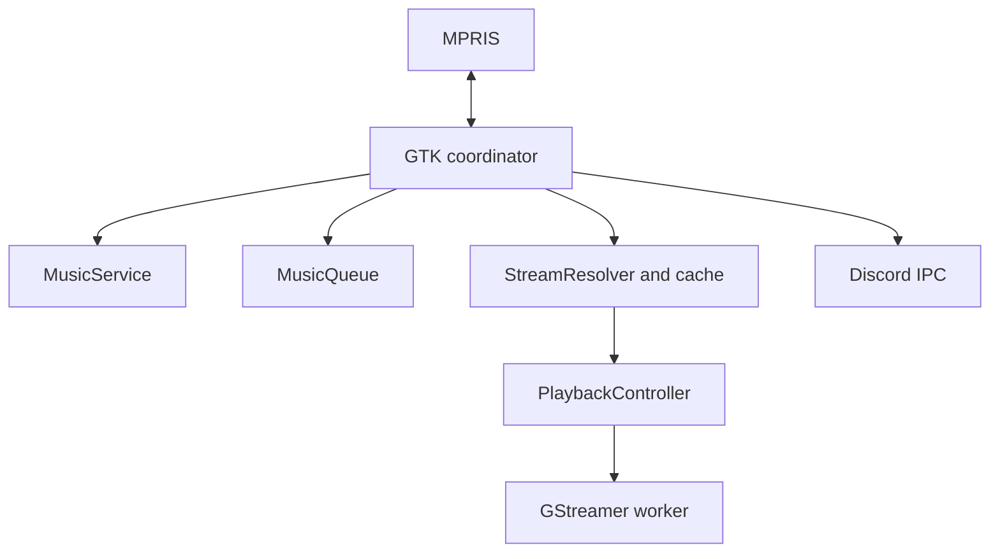

<!-- SPDX-License-Identifier: GPL-3.0-or-later -->

# Architecture

Karin uses Rust, GTK4 and Libadwaita for a native Linux interface and GStreamer
for playback. Keeping one typed service, one queue and one audio engine lets
the interface, system controls and integrations observe the same session.
WebKitGTK6 serves the browser-session sign-in.

## Ownership and execution

| Area | Modules | Responsibility |
| --- | --- | --- |
| Catalog | `music`, `api` | Account-bound transport, search and confirmed writes |
| Sign-in | `ui::music::login`, `ui::auth`, `auth`, `oauth`, `independent_auth` | Dialog lifecycle, credential admission and provider-specific flows |
| Private state | `session`, `credentials`, `session_lifecycle`, `settings` | Protected storage, preferences and forgetting |
| Playback | `queue`, `playback_session`, `stream`, `playback` | Queue occurrences, source admission and one player |
| Cache | `cache_budget`, `catalog_cache`, `artwork`, `audio_cache` | Shared budget and storage policy |
| Desktop | `ui`, `mpris`, `discord_presence`, `updates` | Presentation, tray, media controls, presence and release checks |

Widgets send typed intents. HTTP, parsing and file I/O run on bounded workers
and return results to the GTK main context. Each ordinary read lane holds one
running request and one latest pending request. Writes and Wave feedback have
separate serialized lanes. Account, request, source and intent generations
fence results from retired state. Weak view ownership and deferred membership
reads prevent late and reentrant GTK updates.

The audio worker owns GStreamer. Shutdown bypasses the command queue and
transitions to Null without blocking GTK on a join. Application holds let
admitted durable operations settle before conflicting I/O begins. Native
plugin calls can delay cooperative shutdown.

## Sign-in and private state

The desktop login module owns the dialog, cancellation and Music account
validation. `KarinProvider` handles supported sign-in modes and delegates the
browser-session request and token exchange to the existing adapter. The
embedded browser uses an isolated WebKitGTK session with exact navigation and
callback checks. Library access and credential storage follow account validation.
[Provider attribution](LICENSING.md#upstream-components)

Independent sign-in uses a system browser, an exact registered IPv4 loopback
callback, Authorization Code and S256 PKCE. The opt-in terminal path validates
Yandex ID and Music against the same account. It stores credentials only on
explicit request, in a separate scope, and repeats validation on restore.
The earlier own-registration test passed Yandex ID and received HTTP 403 from
Music. The [earlier test](https://github.com/tracerxbrhd/karin/issues/5#issuecomment-6470853664)
records the result. [#35](https://github.com/tracerxbrhd/karin/issues/35) covers
the desktop login changes.

Native uses Secret Service. Flatpak stores an encrypted token envelope backed
by the Secret Portal. Unavailable storage permits memory-only login. Restore
requires fresh Music validation. Logout fences late work, drops the credential
and purges retired personal data. An uncertain cleanup keeps a visible Retry
and prevents restore. Ordinary playback continuation stores bounded,
account-bound selectors, order and position. It resolves fresh access before
restoring and waits for Play. Wave sessions are transient.

## Catalog and queue

Search hydrates validated selectors in canonical batches of up to 50.
Navigation and membership reads have independent ownership. Ordinary views
stop at 2,000 positions or 100 pages. Opening Liked Tracks displays the first
page and continues through the collection index in batches of up to 50 tracks.
A search in an eligible playlist can use the same 20,000-position and 4 MiB
index. The UI mounts a bounded row window and sorts and filters the available
index. Count and duration reflect the verified coverage. Cached metadata may
support labelled transport-error fallback. Current account or resource refusal
takes precedence over saved data.

Collection playback snapshots the bounded loaded source, including tracks
beyond position 500. Shuffle draws from the whole admitted source. Manual
queues and Wave use their existing bounds. Duplicate tracks retain their own
identity across filtering, sorting and queue edits. Catalog or server playlist
changes cannot rewrite an admitted playback context. The continuation record
stores up to 500 occurrences around the current position. MPRIS publishes
actual player state and addresses the current occurrence.

Queue dragging uses a native snapshot of the grabbed row and marks the
insertion edge without rearranging the live list. A valid drop moves the
exact upcoming occurrence from the same rendered queue.

Library writes serialize under the validated account. Each intent sends one
write and requires independent readback. Uncertain results reconcile through
GET. Playlist edits use a complete revisioned snapshot and the exact server
position of the chosen occurrence. Revisions and ordered sequences are
checked again before writing. Playlist metadata edits and deletes can race
with another client between independent reads. Only confirmed Dislike for
the current occurrence advances to the next track.

## Playback and cache

StreamResolver admits supported, unprotected full MP3 offers over HTTPS under
exact origin and path checks. Descriptor/XML work is bounded. Music credentials
stay off CDN requests and signed media URLs stay in memory. PlaybackController
owns one GStreamer pipeline. An explicit Resume can renew an expired source
once for the same occurrence and then restore the confirmed position.

My Wave starts on request and uses the same player for the personal, track and
Liked Tracks sources. Rotor receives a typed seed through `POST /rotor/session/new`.
The liked source uses the authenticated account's kind-3 playlist as a single
seed. Rotor derives recommendations from that collection without needing a
local list of track IDs. Its bounded feedback queue uses actual listening
events. An ambiguous write stops continuation. Retry starts a new session for
the same source. Manual future-order editing is unavailable during Wave.

[Track seed contract](https://ym.marshal.dev/radio/) · [Yandex's Liked Tracks Wave](https://yandexmusic.userecho.ru/communities/45/topics/10818-filtr-trekov-v-plejliste-mne-nravitsya?page=1)

One default-on 2 GiB budget coordinates metadata, artwork and audio. Private
staging, atomic publication, integrity checks and shared LRU protect stored
data. Unlimited retains disk headroom and bounds on work. Clear, Disable,
logout and account changes fence pending admission. Eligible, selected audio
can be saved independently after online playback starts. Storage failure
preserves admitted playback.

Audio reuse requires current Music access, a matching offer, complete MP3
integrity and a fresh HTTP lease or positive revalidation. Validators apply to
the exact compatible media URI. `no-store` retires retained data,
`no-cache` requires validation and an inconclusive comparison plays online.
A stored file indicates local presence. Offline playback is unavailable.
[HTTP caching](https://www.rfc-editor.org/rfc/rfc9111.html) · [Licensing](LICENSING.md)

## Presentation and desktop

One pinned Info, Lyrics and Queue panel preserves intent across navigation and
resize. Lyrics follows the actual position of the current occurrence. Yandex
plain text requires an explicit rights indication. Synchronized lookup in
LRCLIB requires consent and sends public track metadata. Lyrics stay in memory.
Similar tracks and external lyrics load only for the relevant visible view.
System styling follows Libadwaita, with High Contrast and Reduced Motion.
Karin's navigation, controls and titles use bundled Montserrat. Secondary
metadata, lyrics and numeric readouts use bundled Inter Variable. Test the
fonts used for actual Cyrillic glyphs and digits at normal and HiDPI scales.
Native window chrome and embedded sign-in keep the platform typography.

The collection overview reads the account-scoped liked and playlist feeds
used by the full sections. Preview playback uses the same loaded occurrence
and queue context as the full liked list. Two preview columns share a
horizontal viewport with arrow navigation when the window is narrow. Playable
rows retain their accessible full text and scroll overflowing titles and artist
credits on hover or focus when animations are enabled.

The header Back action unwinds the current overlay or nested catalog route
before restoring the previous primary section and scroll position. The
navigation history is bounded and cleared on account teardown. The main header
keeps its Back icon at compact widths and includes the label when space allows.

The footer track opens Now Playing inside the same window. Its heading uses a
native window handle and the desktop's window controls. Closing follows the
existing window lifecycle, including the opt-in tray behavior. The regular
workspace keeps its widgets in the navigation stack, preserving page, scroll and
side panel intent. Now Playing borrows the existing Info, Lyrics and Queue
surface in the expanded layout and follows the active synchronized lyric line.
Now Playing, Mini and the footer share the player's transport, queue order,
volume and verified reaction state. Opening another surface reuses the current
reaction state. Now Playing preserves the saved regular side panel preference.

Discord Rich Presence is enabled for new profiles and can be disabled under
Integrations. Earlier settings files represented an unchecked switch by omitting
the field. The loader preserves that state and saves both choices explicitly.
The local IPC worker sends track, transport and seek events without periodic
position updates. The title links to the public album-track page. Collection
selectors that include an album suffix must match the track's catalog album
metadata. The artist and distinct album share one line, and the cover uses an
eligible public image URL.
Flatpak grants read-only access to `xdg-run/discord-ipc-0` and
`xdg-run/app/com.discordapp.Discord`.
When the native Discord socket is missing or stale, the worker uses a short-lived
instance of the same Flatpak to open the current socket and pass back its file
descriptor. This refreshes the file mount without new permissions or restarting
playback. The worker verifies the peer UID before any Discord exchange. A peer
outside the sandbox's PID namespace can have PID zero.

Close to tray is opt-in. Karin hides the existing window only after its
StatusNotifierItem is registered with a host. A hidden window holds the
application open so playback and media controls keep using the same controller.
The tray icon toggles Karin Mini. Middle-click toggles playback and vertical
scroll adjusts the shared volume. Mini hides when focus leaves it, allowing its
native popovers to finish first. While mapped, Mini reads the same player's
state and sends commands to that player. When the tray supplies screen
coordinates, Mini opens inward from the nearest edge of that output, using
Wayland Layer Shell where available or placement through an X11 window
manager. Without a usable position and backend, the window manager places
Mini as an ordinary window. The tray menu, ordinary application activation
and Mini's Open Karin button present the main window. Losing the
host closes Mini and restores a hidden main window. On Plasma the panel's D-Bus
name also tracks host availability because the watcher can outlive the panel.
Explicit quit and update restart follow the normal window and persistence
shutdown.

## Application updates

Karin checks the public GitHub release before Music sign-in. Native directs
users to the release for manual replacement. For Flatpak, the SHA-256 in the
release notes binds the pinned Pages record to its release, source commit,
App ID, ref, OSTree commit and signing fingerprint. Flatpak verifies the
repository signature.

The host UpdateMonitor schedules discovery. While the Portal checks a verified
release, the dialog can open Karin in the system software manager or open the
release page. Versions and actions sit outside the scrolling release notes.
Karin requests in-app installation when the Portal reports the matching commit,
then checks the installed commit before offering restart and verifies it after
restart. A system update is needed when sandbox permissions expand. Production
verification of the in-app transition after 0.8.3 is tracked in
[#40](https://github.com/tracerxbrhd/karin/issues/40).
[Release and update instructions](BUILDING.md#stable-flatpak-channel)

## Decision history

Record changes to these contracts under the relevant heading with the reason
and a link to the deciding PR. The [original decision records](https://github.com/tracerxbrhd/karin/tree/36ac6820d619fb9aa6c7e235a445ef66f55c610e/docs/adr)
remain available in the 0.8.3 source tree.
