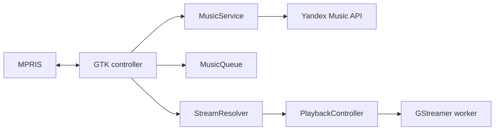

<!-- SPDX-License-Identifier: GPL-3.0-or-later -->

# Architecture

Karin uses Rust, GTK4, Libadwaita and GStreamer. UI, transport, credentials, cache
and playback have separate owners. Decisions are recorded in [ADR](adr/).

## Components

| Area | Modules | Responsibility |
| --- | --- | --- |
| Catalog | `music`, `music::library_index`, `music::track_extras`, `api`, `application` | Typed service access, explicit collection indexing, read-only text/related metadata and separate anonymous diagnostics |
| Authentication | `auth`, `auth::cassette`, `ui::auth`, `oauth` | Ordinary sign-in and independent PKCE diagnostic |
| Session | `session`, `credentials`, `session_lifecycle`, `settings` | Live tokens, protected persistence and non-secret preferences |
| Data | `cache_budget`, `cache`, `catalog_cache`, `artwork`, `audio_cache` | One shared resource policy; typed metadata/artwork and separately policy-admitted audio stores |
| Playback | `queue`, `playback_session`, `stream`, `audio_cache::bridge`, `playback` | Context/order policy, private continuation, resource/cache admission and one media worker |
| Desktop | `mpris`, `ui::music::system_media` | Session D-Bus commands and actual snapshots |
| Presentation | `ui::music` and its view modules | Native views, user intents and guarded result admission |

GIO workers perform bounded blocking work; main-context futures admit results
under current account/request/source generations. Sixteen lanes each retain one
running and one latest pending job, including independent Lyrics, Similar and
CollectionIndex reads. Playlist mutations additionally use a shared service write gate and a dedicated
request lane; GTK rejects concurrent write intents before submission. Their
read-only native editor has one bounded worker. The Wave lifecycle uses a separate
bounded FIFO lane because feedback must not be coalesced or retried. Source
changes, logout and close retire old work. GTK textures/updates stay on the main thread; deferred Like reads use weak
ownership outside render-time borrows. Reqwest owns its HTTP runtime.

## Authentication and protected sessions

The attributed Cassette-compatible provider uses one ephemeral WebKitGTK6 dialog
with strict navigation/return/state checks. No password inspection, JavaScript
injection, profile import or cookie persistence is allowed. MusicService validates
Music access before success/persistence; ID/cache data is insufficient. See [AUTHENTICATION_REVIEW.md](AUTHENTICATION_REVIEW.md).

Native persistence uses Secret Service; Flatpak uses a Secret Portal secret and
an authenticated encrypted token envelope. Unavailable storage permits memory-only
login, never plaintext fallback. Preferences are private, versioned XDG data.
Serialized, generation-bound operations and durable forget barriers fence late
writes/restoration. Uncertain deletion/purge remains visible with Retry.
Remember-off forgets the saved credential without stopping the live session;
logout also stops audio and clears personal views/cache. Close may retain an
allowed session/cache. Forgetting is local, with no claimed refresh or remote
revocation. [ADR-0018](adr/0018-persistent-session-and-settings.md) defines details.

## Catalog, filtering and playback context

MusicService validates account/IDs, bounds work and returns typed models. Search
accepts minimal hit IDs and one canonical batch of at most fifty distinct IDs,
preserving order, duplicates, unavailable records and paging. Optional display
fields cannot invalidate valid IDs. Reaction/playlist writes require independent
confirmation; ambiguous POSTs are not replayed.

`music::interactions` distinguishes Like, Unlike, account Dislike and removing
Dislike. Current-track reactions use compact live reads of both collections,
with account/track generations and a bounded write lane. A deliberate reaction
sends one POST and confirms both memberships/revision when dual reads are
available; opposite marks are not optimistically inferred. If Dislike cannot be
verified, a fresh independent Like read preserves the existing Like-only control
and its established confirmation path. Dislike remains hidden/unknown. Only a
confirmed Dislike addition on the same current occurrence invokes the existing
Next path once. Account/request generation and the queue-owned occurrence identity
fence late results, including repeated Track IDs; a replaced playback intent must
not be advanced. Removing Dislike and changing Like never advance playback.
A refusal or ambiguous result leaves playback alone and offers read-only recovery;
authorization loss still follows normal session teardown.
[ADR-0028](adr/0028-confirmed-track-reactions.md) separates account membership
from the unchanged Wave feedback protocol.

Ordinary continuous views admit fifty-position portions, at most 2,000 positions/
100 pages. Initial filling stops at three pages; further reads require user demand.
Errors preserve rows with read Retry. Remote end, missing/stale data and local
limits remain distinct. Like mutations retire continuation until explicit refresh,
without changing playback.

Explicit whole-collection indexing uses `music::library_index`: a current compact
membership manifest (4 MiB/20,000 original positions), independent 50-position
canonical batches and a final full sequence/revision recheck. It remains
process-only, with progress/pause/Retry and 200-row result windows. No new database,
quota, whole-library startup scan or per-key network request is introduced.
NFKC → casefold → NFKC title/artist/album keys support local matching and stable
sorts. Added-date sorting requires valid occurrence timestamps throughout;
provider order is not relabelled as an invented date. Incomplete/changed/oversized
coverage remains explicit. Normal navigation retains useful projection state;
logout/source changes retire late work. The active queue/player remains untouched.
[ADR-0035](adr/0035-incremental-whole-collection-index.md) extends the original
loaded-prefix decision.

Play snapshots an aligned window of up to 500 matches in provider order, including
the selected item; at most four windows are cached. Opaque feed binding and original
admitted positions distinguish duplicates across windows/reindexing. Filtering,
appending and navigation never rewrite active playback. MusicQueue also owns a
bounded opaque identity token for every admitted occurrence, including manual
duplicates. Removing another row preserves that token; a replacement context
gets new tokens. Info and MPRIS share this identity without publishing it.
ADR-0016 and ADR-0024 cover normalization/loading;
[ADR-0025](adr/0025-loaded-collection-search-and-playback-provenance.md) defines filtering/provenance.

## Track text and related tracks

`music::track_extras` owns legacy Yandex supplement full text, explicit external
LRCLIB lookup and seed-bound similar-track reads. `lyrics` provides a bounded
literal TEXT/LRC model and position lookup; it has no playback clock. The native
Lyrics mode of the existing universal panel uses the player snapshot only for
the exact FollowingCurrent occurrence and retires old content with account/track/
pane generations; another equal Track ID cannot borrow that playhead. A manually
scrolled lyric stays under user control until following is requested again.
External requests disclose public
metadata sharing and never receive Music tokens/account or track IDs. Text is
memory-only and source-labelled. TEXT uses selectable stanza/line labels; LRC
uses virtualized lines, semantic past/current/future states and native scrolling
that honors reduced motion. Copy exports only the displayed text to the local
clipboard. Opening Lyrics starts the Yandex read; LRCLIB remains an explicitly
disclosed user request. Track Info displays related tracks under an ordinary
heading, without expanders or a nested lyrics viewport. Similar rows use one
canonical batch and the existing Play/Next/Append/Info/reaction paths, without
creating Wave.
[ADR-0034](adr/0034-bounded-track-lyrics-and-similar.md) and
[API_FEASIBILITY](API_FEASIBILITY.md#lyrics-and-related-tracks-in-v08) define
bounds, source provenance and the exclusion of extracted modern signing keys.

## Playback controller

StreamResolver admits the reviewed unprotected full-MP3 path as a sealed HTTPS
source. OAuth stays at Music API; credentials never reach descriptor/CDN or worker.
Exact origins/paths, TLS, bounded XML and no redirects exclude arbitrary URIs,
manifests and protection/identity fallbacks. The sixty-second admission lease
does not stop existing playback or turn idle Pause into a visible expiry error.
Explicit Resume can renew that same occurrence through current access and the
existing local-first/resolver path, retaining position and intent. See
[stream delivery](STREAM_DELIVERY_REVIEW.md),
[ADR-0038](adr/0038-same-occurrence-source-renewal.md) and
[ADR-0015](adr/0015-guarded-legacy-mp3-playback.md).

PlaybackController sends commands through a 32-entry channel to one worker-owned
`playbin`. Snapshots supply actual state, position/duration, seekability, volume
and safe errors. A worker-owned cumulative Playing clock excludes pause and seek
distance independently of GTK scheduling. Commands alone do not imply Playing; Seeked requires worker
acknowledgement. Local-file diagnostics remain. Supported online MP3 resources
can use the shared private HTTP cache when storage and version checks succeed;
otherwise the same player uses the admitted network source.
Same-occurrence renewal replaces native transport on that worker using a source
revision, preserving logical generation and cumulative confirmed Playing time.
Preroll and internal seek precede autoplay; internal restoration does not invent
MPRIS Seeked or a Wave cycle. The transient account/occurrence/intent-bound ticket
has one expiry recovery budget and is cancelled by changed user/session intent.
No request timer runs during Pause; failed/unseekable restoration remains honest.
Shutdown bypasses channel capacity and releases the pipeline in `Null` before
completion, without GTK joining the worker.

MusicQueue owns Shuffle, Repeat Off/Queue/One, upcoming order and actual history.
Repeat One handles natural EOS; explicit Next/Previous still navigate. Queue
repeat covers admitted items only, without library autofetch or error retry loops.
Modes survive normal clear/context replacement. Logout resets live modes;
ordinary close saves them with the account-bound continuation, restored without
autoplay after current Music validation.
[ADR-0023](adr/0023-local-playback-order-and-mpris-modes.md) defines the policy
shared by native controls and MPRIS. [ADR-0036](adr/0036-occurrence-queue-editing.md)
extends it with exact Play Next and upcoming reorder, typed local GTK drag/drop
and keyboard equivalents. Edits remap current/history/provenance together without
preparing the player; interleaved manual occurrences and edited future order
survive the same private continuation path. Wave ordering remains unchanged.

## My Wave

The existing `music::wave` protocol/observation components feed the same queue,
resolver and player through `ui::music::radio`. The Home Hero is available after
Music-validated sign-in in the ordinary application. Listen/Pause/Resume delegate
to the same lifecycle/player. Only explicit Listen creates a radio session;
application startup, protected-login restoration and opening Home create none.
The deprecated `--experimental-wave` CLI alias has no effect on availability,
activation or application identity. Only pending startup
has a Cancel action. There is no separate user-facing Finish control.

Original batch markers stay attached to opaque occurrence identities in memory.
Feedback and continuation use one serialized bounded lane; an uncertain POST
terminates continuation without replay. Pause preserves context and excludes
paused time. Ordinary source selection or MPRIS Stop retires radio and restores
modes; account/logout/close cancel queued work. Local retirement uses no separate
network session-finished event: only an interrupted heard track can add one final
skip; completed EOS and unheard tracks add none. Exact admitted event and local
origin/phase/finish classifications accompany safe HTTP diagnostics. JSON/body,
identities and listening payloads never enter those logs. See
[ADR-0027](adr/0027-experimental-wave-lifecycle.md) and the
[Fedora acceptance procedure](BUILDING.md#my-wave-local-acceptance).

## Metadata and artwork cache

The private account cache stores reduced metadata/permitted normalized art, never
credentials, raw responses, signed resources or audio. Hashed paths are not
encryption. Metadata retains its fifteen-minute freshness and art its seven-day
maximum; HTTP restrictions can shorten or forbid art persistence. Records keep
bounds/integrity checks, atomic writes and eviction. Their resource budget is
shared with the separately admitted audio store as described below.

Stable reads can use fresh data; mutable pages are network-first. Only eligible
network/timeout errors allow labelled saved-data fallback. Cached values never
establish authentication, membership/revision or write success. Per-reply leases
are rechecked at presentation; a fresh reply does not hide retained stale origins.
Catalog leases also bind a key epoch: known API refusals retire cached replies
and older writers before storage work. Fixed tombstones and bounded cleanup keep
Busy/I/O failures from reviving refused entries. After restart, account binding
or a policy change, metadata needs a new successful write before fresh reuse;
otherwise it is eligible only for labelled saved-data fallback. Artwork keeps
its separate HTTP/TTL policy. State admission never holds its mutex over disk I/O.
Refresh bypasses fresh hits. Cache-off stops persistent reads/writes; Clear keeps
session/audio/textures, while logout purges personal records.
[ADR-0019](adr/0019-bounded-account-cache.md) defines the cache contract;
[ADR-0026](adr/0026-refusal-fences-and-queue-occurrence-identity.md) defines the
refusal fence and stable queue identity extensions.

### Audio storage and playback selection

`cache_budget` coordinates metadata, artwork and audio under one enabled-by-default
**2 GiB** policy. Preferences retain 500 MiB, 1/2/3/4 GiB or Unlimited, total
measured usage, LRU, Clear and Retry. Reservations, metadata fairness and disk
headroom remain active in every mode. Limit maintenance is worker-only and
coalesced while dragging; Disable/Clear fences are immediate. Version-1 settings
migrate without resetting credentials or saved records; see [ADR-0030](adr/0030-unified-cache-budget-and-preferences.md).

AudioCache retains private XDG storage, account-scoped opaque keys, integrity,
atomic publication, crash recovery and exclusive namespace ownership. A separate
one-writer gate spans each complete download; its short I/O gate covers staging
initialization and commit, not network waits. Stats preserve live staging;
Clear fences and unlinks it without waiting for more bytes. Initialization,
commit and Clear retry short I/O contention on workers for at most 250 ms, with
generation/cancellation checks. Keep the existing 64 MiB resource, 1024-record
and four-job-context bounds. There is no whole-response capture buffer.
Whole-response reservations protect an existing target from LRU throughout the
copy. A validated replacement exchanges complete directories atomically and
retains the original at the registered stage until final permission, generation,
quota and publication checks succeed. A late failure restores it; the reservation
protects both publication and rollback from concurrent shared-budget eviction.

A playback intent checks current account access and the authenticated full-MP3
API offer before looking up local audio. A complete matching selection with
verified integrity and a fresh private HTTP reuse lease passes its pinned
read-only file to the existing PlaybackController **before XML/CDN resolution**.
The selection binds the logical descriptor object and codec/bitrate/gain/fullness
(schema 2); it is not an immutable provider byte-version claim. Missing, slow,
busy, corrupt or unverified candidates leave the play online. Cache failure
cannot turn a valid source into a playback error.

On a miss, the selected network source starts immediately and one independent
worker saves a complete supported response through the existing HTTP client.
Autoplay intent can schedule it before native Playing; a preparation without
autoplay waits for explicit Play. No unselected-track prefetch is implied.
The released Cassette orchestration informed this independent Rust design;
Karin retains its own protected streaming writer and checks rather than copying
whole-body memory loading or reversible cache encoding.

The cache job has its own one-use write ticket, separate from latest-playback
admission. Registration lasts at most 30 minutes; activation starts a
nonrenewable 30-second write admission, with a 15-second HTTP request timeout. Ordinary Next,
Previous, source changes, manual Skip, Pause, Seek and Wave rollover do not
cancel it. Explicit Stop, application close, Clear, Disable, logout and account
change cancel or fence unfinished work. No GStreamer probe, compressed-byte
channel, Playing admission latch, EOS finalizer or range-joining downloader
controls the save. Queue/Wave still use actual playback snapshots for their
own listening ledger and MPRIS.

The worker streams to protected staging, screens bounded MP3 structure, verifies
complete response length and SHA-256, and publishes atomically. It checks actual response policy,
including no-store, encoding and supported Vary dimensions. A fresh source may
be resolved when its short-lived admission expires. A first CDN403/410 can
resolve once more and retry only a changed sealed URI. A new private response
needs usable freshness or scoped validation evidence before body storage.
Token/account/cache cancellation is checked throughout reads and publication. Credentials are not
sent to media hosts; signed URLs remain in memory. HTTP permission to store is
separate from playback access and applicable content/distribution rights.

Local-first reuse separates Music account/track access, selected recording and
variant, saved-file integrity, HTTP freshness and the temporary delivery locator.
The authenticated offer's opaque fingerprint retains the validated descriptor
origin, full logical object path and semantic query, excluding only recognized
sign/ts signing fields. Exact selected MP3 bitrate/gain/fullness and account/token
epochs must match. Known selection changes retire/refill; renewed signed CDN
URLs alone do not invalidate an otherwise fresh record. Track ID alone never
selects a hit. Logical storage keys are mutable; equality is not a content hash
or permission to compare independent replicas' validators.

A saved response can be reused within explicit max-age/Expires, accounting for
Date, Age, request/response time and residence across restart. Without explicit
expiration, a valid Date/Last-Modified pair allows conservative RFC9111 heuristic
freshness of ten percent of the interval, capped at one hour. `no-cache` always
requires validation; `must-revalidate` prevents stale reuse; `no-store` forbids
storage. Invalid clocks/directives and missing receipt metadata do not acquire
a fresh lease.

Outside that lease, strict representation validation remains available: exact
compatible media URI for opaque ETag/Last-Modified and whole length, or a trusted
full Repr-Digest matching the saved SHA-256 and length across locators. Legacy
XML ts remains opaque. Same can update metadata atomically after final fences;
Different follows the applicable retirement/update policy; Unknown preserves a
modern candidate and online playback without a redundant body save. Legacy
records with pre-schema-2 selection, or upgraded records whose original response
status is unknown, first attempt strict validation. If inconclusive, a current
authenticated offer can admit one complete
response through the existing background writer to migrate them. Only successful
atomic publication replaces the old file; its bytes/mtime never gain a fabricated
lease. Missing clocks on an otherwise modern record do not make it legacy or
authorize repeated migration. For an expired modern selection with incomparable replica validators, a
fresh current probe may admit one replacement only if the actual GET headers
also permit fresh reuse, checked before reading its body. A successful save
starts the measured new lease, avoiding repeated refresh downloads; no-cache or
unproved current freshness stays online. Actual access
refusal, no-store, corruption and encoding changes retain their separate fences.
No second database, audio engine or invented offline right is introduced.

Compact GTK cache indicators use a derived view of AudioCache, not playback
intent, HTTP200, usage totals or a second persisted track database. A bounded
worker batch verifies requested local records and publishes account-scoped
Missing/Downloading/Stored states; unchanged-file fingerprints avoid repeated
hashing. GTK only updates weakly registered slots, with no file or HTTP work per
row. Downloading follows an actual cache writer; Stored follows verified complete
publication or disk recovery. Clear/Disable, LRU eviction, corruption and account
changes remove the corresponding indication. A Stored icon promises a completed
local record, not offline rights or a successful future local hit.
Final descriptor admission is memory-only; LRU updates are deferred. An early
local decoder failure before actual Playing may fall back once to its admitted
online source in the same worker; later errors remain normal playback errors.

Clear may unlink an entry without interrupting the already admitted playback
file descriptor. Normal close can retain completed records for revalidation
after restart. Storage and access failures never become fabricated offline
rights. [ADR-0029](adr/0029-synthetic-audio-cache-foundation.md) and
[AUDIO_CACHE_REVIEW](AUDIO_CACHE_REVIEW.md) record the policy and source influence.
Cloud checks use original permitted audio/local HTTP through this ordinary
application, not a second player or a mock provider grant. The owner accepted
real Native and installed-Flatpak complete saving, local hits and restart-local
playback at `c1de869`; #26 normally merged at `1fd4028`. Earlier service failures
remain revision-specific history in VALIDATION. Subsequent v0.7 acceptance at
`949d1f9` also covers restoration and the unchanged audio/cache path. Neither
report establishes offline lifetimes or public service/content rights.

## GTK workspace, MPRIS and Flatpak

Home/Liked/Playlists lead to native collections and catalog search. Total duration
requires complete known data and a checked sum. Row mouse/Enter/Space plays its
exact occurrence; the separate Info action never starts playback.

One surface holds `Closed`, `TrackInfo`, `Lyrics` or `Queue`. Outside clicks,
navigation and resize preserve mode; current-occurrence changes resume following.
Info inspects another track without playing; there is no separate track-detail
route. Album, artist and playlist pages remain separate. A native
Track Info menu reuses Play Next, Append, Add to Playlist and Lyrics handlers;
only Play, compact Append and that menu remain in the primary action row.
The footer Lyrics action always selects the current opaque occurrence, while
the Track Info menu may open text for its explicit inspected selection. Lyrics
Back returns to Track Info in place. The entire surface translates
under a native 240 ms animation; compact layout uses a nonmodal Back subview.
See [ADR-0022](adr/0022-universal-music-panel.md).

The footer appears for real playback intent, stays through Pause/retryable failure
and hides on Stop/clear/logout. Its child conceals at the closed native endpoint
to release hidden width. Metadata, Like and Dislike are separate focus/click
targets; resize retains the same controls/controller. Reaction pending/error
state never changes the current source or opens Track Info. Confirmed current
Dislike addition alone delegates to Next after presenting the confirmed state.
Its Lyrics toggle shares the existing panel and is independently keyboard
accessible. Wheel input on Volume calls the same `set_music_volume` path as the
slider and MPRIS: five percentage points per admitted step, clamped to 0–100%.
Smooth input accumulates a bounded gesture step; it cannot scroll an ancestor
or open the popover. No separate volume state is introduced.

The in-process GIO MPRIS 2.2 adapter exposes actual state, opaque track paths and
temporary cover PNGs, never credentials, account IDs or media URLs. Flatpak keeps
`org.mpris.MediaPlayer2.io.github.tracerxbrhd.Karin` own-name permission and uses
portal storage rather than broad session-bus access. See [BUILDING.md](BUILDING.md),
[VALIDATION.md](VALIDATION.md) and [LIMITATIONS.md](LIMITATIONS.md).

## Ordinary playback continuation and playlist editing

[ADR-0031](adr/0031-private-playback-continuation.md) extends the memory-only
queue contract with private, bounded IDs-only XDG snapshots. Current account and
batch track validation precede selection restoration; a fresh explicit Play
uses the existing cache/resolver/player and saved seek. Stop/forget/logout
tombstone continuation; Wave state is never persisted. Typed source provenance
survives view eviction without claiming current server collection membership.

`music::playlist_management` owns exact revision/occurrence-bound edits and
independent readback; widgets never construct transport diffs. See
[playlist management](PLAYLIST_MANAGEMENT.md) and [ADR-0032](adr/0032-playlist-management.md).
Edits never rewrite the active queue. Metadata/delete endpoints have no proven
revision CAS; fresh preflight/readback do not promise external-writer atomicity.

`UiStyle` is independent of the existing System/Light/Dark color scheme. Settings
schema 3 migrates v1/v2 without losing protected-session/cache/pane preferences.
System is supported; Karin remains explicitly unavailable until designer assets
exist. Scoped presentation CSS never owns application state.
[ADR-0033](adr/0033-independent-ui-style-and-color-scheme.md) and
[designer handoff](design/KARIN_STYLE_INTEGRATION.md) define that boundary.
