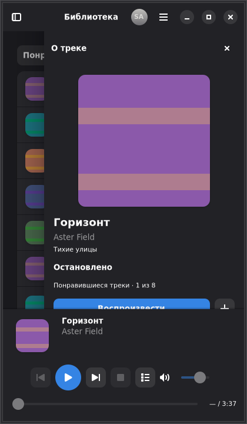
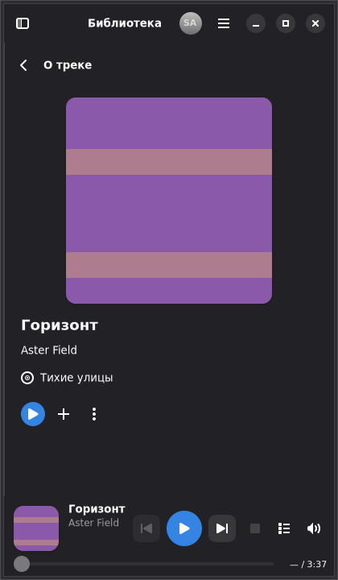
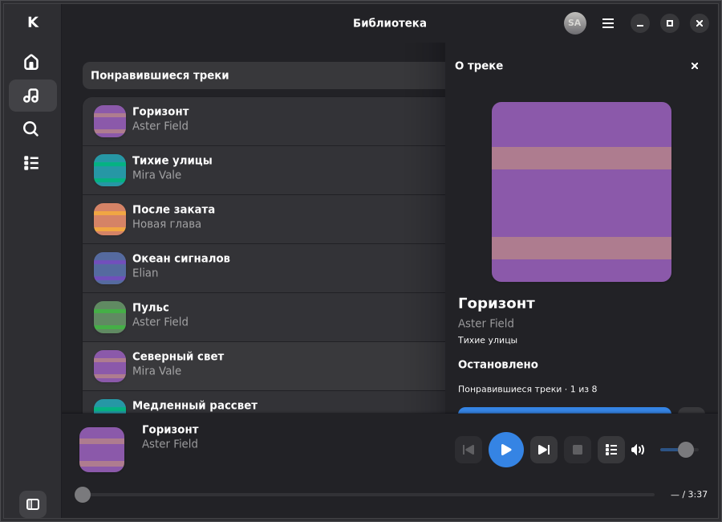
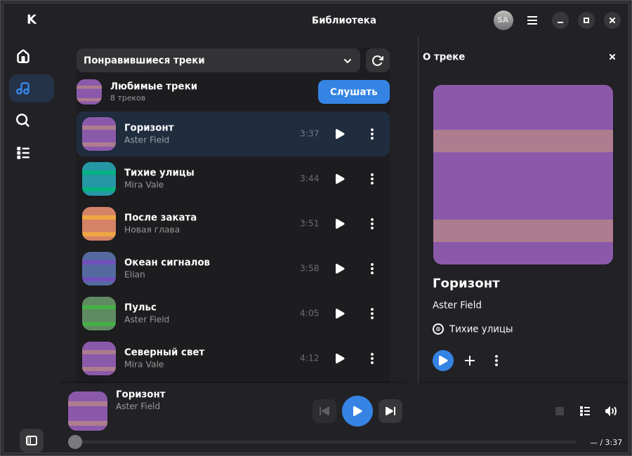
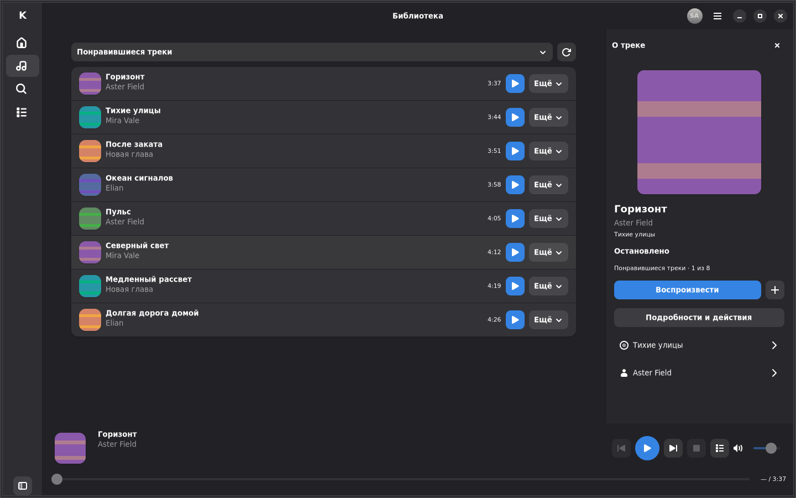
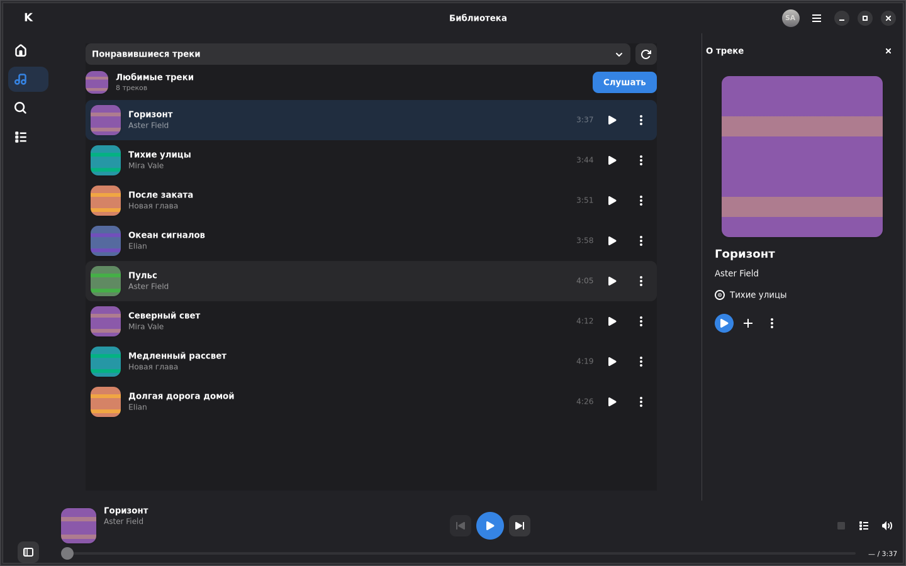
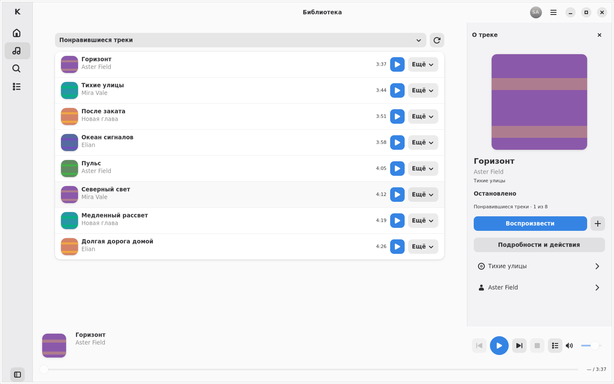
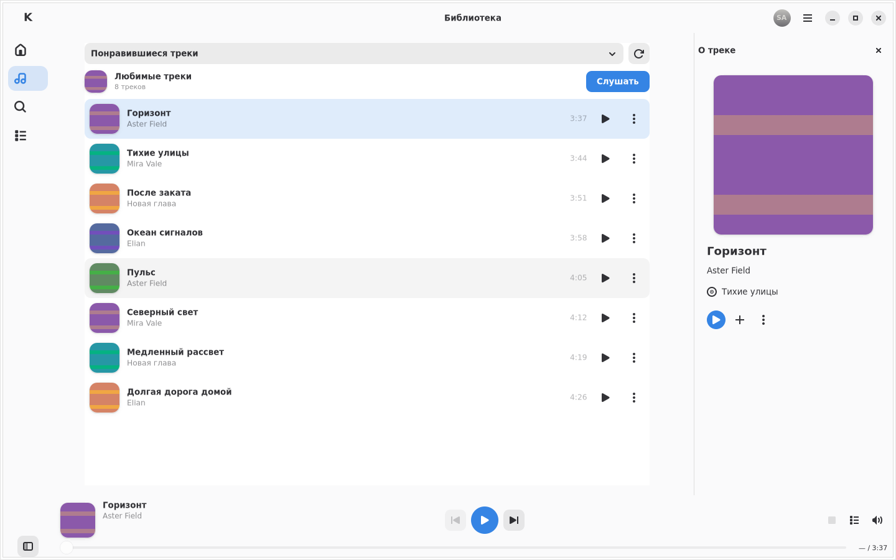

<!-- SPDX-License-Identifier: GPL-3.0-or-later -->

# Cassette-like refinement — implementation and review

This iteration starts at **`a70bbf714e3d7ea775c03839eb01f0b1d9dd4f62`** in
existing Draft PR #15. The [latest task](CODEX_TASK.md) and
[current specification](DESIGN_SPEC.md) supersede previous permanent-footer,
rail/dropdown and track-page-button assumptions. This is refinement of the
working engine and integrations, not a new application.

## Implemented composition

The primary rail and collection dropdown have been replaced by a fixed native
**Моя волна / Нравится / Плейлисты** segment row beneath the HeaderBar, with a
separate Search action. Primary views use the application title **Karin**;
**Любимые треки** names the actual collection once. Liked music uses quiet
64-pixel rows with artwork, title/artist, duration and independent actions.
Owned and liked playlists have straightforward sections and natural-size cover
tiles. Wave explicitly says it is not connected and has no pretend Play action.

The Player Bar is absent before playback, appears with native bottom-up motion,
remains while paused and disappears after explicit Stop. Its cover/title/artist
block is one Info target; the direct confirmed Like action is a separate target.
Wide transport stays centered; compact layouts use two rows so metadata, Like,
transport and progress remain legible. A stable-size spinner replaces a loading
caption during start, preventing footer-height reversals during the reveal.

Track Info retains the existing pinned universal surface. Its artwork, title,
artist, known album and actions now form one centered music cluster; artwork
adapts to available height as well as width. Short normal metadata and its
actions fit above the active footer at 420×720, 720×650 and 900×650. Longer
information can scroll. Queue retains its shared header and pinned source/count/
Clear tools above scrolling current/upcoming/history rows. No related music is
invented. Whole-surface motion and existing playback/session boundaries remain.

Continuous track lists append bounded service batches and preserve the displayed
prefix, scroll and exact occurrences. Initial prefill is capped at three pages;
subsequent actual scroll gestures admit continuation, including sparse views.
Tail Retry is distinct from manual pagination. The 2000-position/100-page view
limits and aligned 500-position playback-context window are explicit partial
boundaries, not a promise to fetch every remote item or silently change a playing
queue. These are implemented contracts; screenshots alone do not prove them.

## New acceptance boundary

Each change needs its own current execution evidence. Historical green checks
below cannot accept these new behaviors:

| Change | Required current evidence |
| --- | --- |
| Player Bar lifecycle | Hidden with no active playback; native bottom-up reveal on Play; pause retention; safe Stop/no-active hide; reduced motion and focus cleanup |
| Metadata interaction | Real mouse/keyboard on cover, title, artist and metadata space opens the same pinned Info panel; Like and other independent actions remain separate |
| Musical navigation | Wave/Liked/Playlists native tabs, coherent Search/Back, no primary dropdown; Wave visibly unavailable without fake radio data |
| Continuous tracks | Multiple bounded fixture pages; one append per page, stable scroll, honest end, tail error/Retry, duplicates/retired replies and preserved active queue |
| Confirmed actions | Direct real Like and server confirmation; unsupported/unverified Dislike hidden, never implemented as local decoration |
| Visual refinement | Source-matched current GTK captures at the required sizes/themes/scales, coherent Info/Queue and active/hidden footer, actual motion phases |

Exact-a70 hosted visual evidence was inspected as the starting UI. It shows the
three-destination rail, collection dropdown and permanently allocated footer.
Those are **before** observations, not proof of the new behavior. The owner's
new private Cassette screenshot was inspected by the primary agent for
composition only; its desktop/personal artwork is not stored or redistributed.

Dislike qualification: published Cassette v0.2.4 and yamuse expose different
Dislike write shapes, but Karin has no validated matching write/state/side-effect
contract. This is not proof that Yandex has no Dislike API. The current task
permits hiding the unconfirmed action. Existing Like membership/write/readback
is the verified integration to reuse, with no optimistic success or automatic
repeat of an ambiguous POST.

## C9 current visual evidence

The source-frozen C9 native-test executable is
**`1dfb1167c73fef4b7d8a2fdd2d7e917e360e1fc2611a314de43d7504c9be16c0`**;
its source-manifest SHA-256 is
`42b3d65135bbd5703a3c7a7c36cafe4d7fdf9b1ac94913d17eee7a8f639a0636`.
The fresh `candidate-9/e-complete-native-proof.json` and
`native-execution.json` audit **204 static originals**, 96 matched a70 dimensions,
**240 strict motion frames / 48 trajectories**, and **19 raw footer frames**.
The actual renderer is `GskGLRenderer`; the recorded test environment uses
`LP_NUM_THREADS=2` and a fresh candidate-local XDG root, shared between stages
without a cache reset. These are test execution settings, not application
overrides. The [gallery](evidence-refinement/README.md) records the immutable
source and provenance of its own selected originals.

Independent UX review reopened **11 untouched C9 originals**: eight static
states and three genuine intermediate frames. This narrower final-source check
covers short Info at 420/720/900, compact HiDPI metadata/transport, owner-wide
Queue, idle hidden footer, playlist sections, unified Search, raw footer reveal/
hide and an intermediate whole-panel slide. No new visual P0/P1 was observed;
the C7 composition conclusions remain consistent with these current originals.
This does **not** claim all 204 C9 images were independently viewed again or
substitute an image for the separate account-retirement, mutation-cancellation,
continuous-loading and playback fixtures.

Raw first-start footer captures have three intermediate frames at 1× and five
at 2×, with a stable 64-pixel child and zero observed height reversals. The 1×
first reveal still has a **116.7 ms native paint gap**, jumping from roughly 16
to 73 logical pixels of revealed footer. Its 19 raw images are not invented
quarter phases. **Cold first-use smoothness/latency remains unaccepted.** The
strict right-panel runs pass at both scales only within their recorded graphics
initialization/resource-control scope; they do not erase the retained C7 default
2× phase miss or establish its cause. No production prewarming was added.

Rust/functional/hosted CI and the final Fedora artifact must identify this same
runtime source separately. Real-account writes, audible Music and ordinary cold
appearance on Fedora/KDE/Wayland/PipeWire remain owner-local acceptance gates.

## C7 immutable visual checkpoint

The independently reviewed checkpoint uses the frozen native-test executable
SHA-256 **`9ea0c6b6b7d6851816b7e3fc34a45fdc09ae20fee74c269068cef1378c980fe4`**.
Its `source.json` records the Rust/Cargo hashes. Local evidence is retained under
`karin-environment/v04-refinement/candidate-7/`; the
[selected gallery](evidence-refinement/README.md) records the revision and
provenance of its own originals. Later fixes and CI must identify their own
source; C7 is a reviewed checkpoint, not automatic acceptance of a newer head.

There are **204 fresh static originals**: eight geometries × three panel modes
× two themes × two scales, plus 108 state supplements. Actual renderer records
identify `GskGLRenderer`. Independent UX review inspected all 204 in labeled
overviews and 22 critical untouched originals, covering every geometry, both
themes/scales, hidden/paused/stopped player, Liked/Playlists/Wave/Search,
short and long Info, Queue and error Retry. No new static P0/P1 was observed in
that scope. The earlier short-Info actions-below-footer defect is visibly fixed;
native viewport/density assertions complement those images. Long metadata still
uses ordinary scrolling/ellipsis as appropriate. Empty space after a small
collection is genuine; it is not filled with invented data.

Twenty additional raw footer frames show actual first-start and Stop reveal/
hide. Their after-paint records contain intermediate native frames and zero
observed height reversals at either scale. They are not normalized quarter-phase
samples and **do not establish cold first-use latency**. A separate mouse/HTTP
append/Retry fixture is needed for continuous loading; an eight-track static
end-of-list image is not evidence of multiple appended provider pages.

Normal panel motion has two distinct results on the same C7 binary. The default
1× run passed; the default 2× run missed the 75% compact/light/Queue closing phase
after a 66.7 ms native frame gap. That failure is retained. A separately recorded
paired 1×/2× software-renderer resource-control run with **`LP_NUM_THREADS=2`**
passed the unchanged guards: **240 selected native frames / 48 trajectories**,
five distinct frame times/indices per sequence and rigid whole-surface geometry.
The scope includes the previously documented test graphics initialization;
there is no production renderer/thread override or prewarming, no assertion
relaxation, and no established cause of the default-environment miss.
`e-lp2-panel-motion-proof.json` records both the qualified pass and retained
failure. This is not an unconditional motion or cold-start acceptance.

Current functional/Rust/hosted CI, the final source-matched handoff artifact and
owner-local results are reported for their exact revision separately. Account
retirement and cancelled writes need functional checks even if static composition
looks correct. Fedora/KDE/Wayland/PipeWire, real-account Like/session/library
behavior, audible Music, first ordinary cold appearance and current Flatpak still
require owner acceptance. PR #15 remains Draft; no merge is authorized.

## Historical reports through a70bbf7 — retained evidence only

**Everything below this divider describes the previous iterations.** Their
source hashes, measured warm-cycle scope, cold failures, UI composition, test
counts and PASS/FAIL statements remain intact as history. In particular, the
old statement that the application was byte-identical to runtime `37379a7`
applies only to that earlier follow-up, not to the new refinement source.

---

# Complete Music Experience redesign review

The owner rejected `a9eed4514802df84d73b0608dd1a62930fc1af76` on Fedora.
This historical iteration followed the [complete brief at a70](https://github.com/tracerxbrhd/karin/blob/a70bbf714e3d7ea775c03839eb01f0b1d9dd4f62/docs/design/v0.4/CODEX_TASK.md), superseding the older
Native Music sketches. Authentication and audible Music were already accepted;
that functional baseline must survive, and does not accept the new visual design.

## Composition and behavior

Karin now has three primary destinations—Home, Search and Library—and one
persistent Player Bar. Home leads with the real liked collection, playable
preview rows and a modest personal-playlist shelf. Library/details/search retain
useful content width, consistent artwork, quiet rows and explicit secondary
actions. Compact navigation keeps native tooltips and accessible names.
[UX research](UX_RESEARCH.md) records the inspected Yandex desktop and Cassette
sources and the reasons for Karin's independent composition.

Track Info and Queue occupy **one controlled right surface**. Outside clicks,
scrolling, navigation and playback do not dismiss it. Ctrl+J and the footer Queue
button select Queue; the sidebar has no Queue destination. Mode changes replace
content in place, without another slide. Narrow content uses a dedicated view;
resizing preserves the user's chosen mode. Exact playback-occurrence changes
resume following; explicit other-track details survive pause, seek and volume.
Logout and shutdown retire pending work and private content.

The old animation defect was reproduced on unchanged a9 production code with a
test-only observer. Its surface x stayed 1110 while its child allocation changed
1520 → 594 → 483 → 420 → 320; text x stayed 1131 while the centered cover moved
1742 → 1279 → 1224 → 1192 → 1142. These are cloud coordinates, not Fedora
measurements. The old Revealer reallocated and reflowed the child during a slide.
The replacement [SlidingPanel](../../../src/ui/music/sliding_panel.rs) gives the
whole surface its final size and applies one common native GSK translation to
background, border, heading, cover, text and controls. Normal duration is 240 ms;
reduced motion is checked separately.

The footer centers transport in equal native columns, retains artwork/title/
artist, timeline, volume and Queue, and moves secondary controls into an upward
native popover at compact widths. A readable full-width error caption grows above
the transport. **No visible Stop remains**; the existing controller and MPRIS Stop
still work. Repeat One has an actual visible “1”, rather than relying on a theme's
repeat-song icon to draw one.

Shuffle and Repeat Off/Queue/One operate on the existing bounded queue and audio
worker, never another engine. Shuffle uses exact occurrences, an upcoming plan and
actual history. Repeat One affects natural EOS; manual Next/Previous still move.
Ordinary clear/new context retains selected modes; session retirement resets them.
Unavailable tracks, duplicate IDs, removal and partial/500-position contexts are
covered. Writable MPRIS Shuffle/LoopStatus update the same policy and native
controls, emit PropertiesChanged and retain real transport/seek/volume behavior.
See [ADR-0022](../../adr/0022-universal-music-panel.md) and
[ADR-0023](../../adr/0023-local-playback-order-and-mpris-modes.md).

## Verification follow-up: graphics initialization and first paint

Initial hosted runs at `709f5b3` failed strict motion coverage. Instrumented
old-stack reproduction measured roughly 915 ms in a first paint cycle, while
the snapshot observer took at most 208 microseconds. Further modern-stack cold
NGL/Vulkan controls also missed phases. Nodes were present and actual renderer
classes were verified; the internal driver/paint cause is not attributed to
shaders without evidence. Moving the job alone is not a performance fix.

The [new measured sequence](evidence-redesign/motion/README.md) separates one
recorded native initialization cycle and six bounded native offscreen material
renders from the unchanged strict measurement. Initialization emits no evidence
PNG, changes no UI progress/clock and claims no quarter-frame or cold-latency
PASS. Subsequent real gestures use normal 240 ms animation, with the original
three-intermediate/five-distinct/progress/rigid-geometry assertions. No retries,
reduced motion or production prewarming are introduced.

Fresh per-scale Mesa/XDG caches passed those measured cycles at both scales:
**240 frames / 48 trajectories**. Independent review inspected all images and
matched all 240 selected records to their actual measured after-paint samples;
no P0/P1 structural defect or substituted initialization frame was found.
The application remains byte-identical to runtime `37379a7`; only the test
harness, CI placement and evidence documentation changed after C10.

Cold first-use responsiveness remains **unaccepted**, including under Xvfb.
The Fedora guide therefore checks first Track Info/Queue appearance after an
ordinary fresh start separately from warm repeats, without renderer/cache
workarounds. CI retains all 31 native selectors in both Rust lanes: 29 functional
selectors and sandboxed WebKit/packaging on Ubuntu, with the two strict visual
selectors on the prepared modern Debian native stack. Its artifact records the
initialization scope and actual backend. The final metadata-only harness follow-up completed both Rust compiler matrices
again: formatting, strict three-configuration Clippy/tests/builds, exact-MSRV
offline releases, GTK/GStreamer/terminal boundaries and license inventory all
passed. Exact hosted results and archive verification are published per head in
PR #15.

## C10 native composition and original motion evidence

The [reviewed gallery](evidence-redesign/README.md) contains **36 untouched actual
GTK captures**: matched before/after pages, the whole-surface opening/closing
sequence, both panel modes, Home states, playlist/search and active modes.
The full fresh set has **96** matched matrix cases and **84** current state
supplements: eight geometries × light/dark × 1×/2× × Closed/TrackInfo/Queue.
The owner-wide 1650×930 case and actual window-manager maximize are included.

The archived a9 production baseline was rebuilt separately; only its existing
synthetic test harness was adapted. Its copied executable SHA-256 is
`dc38cd7d9addc4fac1161da1b76e6456a780edeeda564a8d31ca4b605bcd1e60`.
The final source-frozen C10 test executable SHA-256 is
`1df39d2998ebfd2182f0224244154bbec3f50e65ba5f4e209299e5965363369b`.
[Provenance](evidence-redesign/provenance.json) records the exact Rust/Cargo
content hashes; documentation changes do not alter that runtime fingerprint.
Hosted captures record their own immutable checkout and executable.

All **48 normal-motion trajectories** passed at both scales: **240 fresh frames**,
five distinct native frame times **and** indices per sequence, actual mapped
artist/album widgets and rigid surface-relative allocations. Maximum translation
residual was below 0.000069 logical pixels; maximum child offset/size residual
below 0.000123. [Selected geometry](evidence-redesign/motion-geometry.json) accompanies
the originals. Closing is displayed in openness order 100 → 75 → 50 → 25 → 0;
old before frames explicitly label elapsed fractions instead.

The actual-input fixture checks TrackInfo ↔ Queue without replaying the slide,
outside input, compact/adaptive transitions and reduced motion separately.
An independent layout review inspected every one of the 240 final motion frames
and found no P0/P1. Native geometry and mode/error fixtures at both scales also
pass with `G_DEBUG=fatal-warnings`: the full safe error caption is readable,
Play/progress stay within 1 logical pixel of their settled original coordinates,
and actual compact overflow mouse/keyboard controls preserve the current audio
worker. Earlier capture/timing attempts were not substituted for these proofs.

## Executed checks and independent review

Stable **1.99.1** and exact **1.98.1** both pass formatting, strict all-target
Clippy, tests and debug builds in default/all/minimal configurations: **359 / 367
/ 345 library tests plus 4 CLI tests** per configuration/compiler. Ordinary and
all-feature MSRV locked/offline release, hidden terminal boundaries, GStreamer,
generated-media controller playback, GTK startup/cleanup and the unchanged
207-package dependency-license inventory pass.

All **54 functional native executions** pass at 1×/2×, with exactly one selected
test each and no warnings/critical messages. The two design/motion fixtures at
both scales add four passes: **58 local executions**, covering all 29 locally
available ignored selectors. The two fully navigating WebKit fixtures require
hosted namespaces; construction/cancel passes locally with sandbox retained.
Hosted CI runs all 31 named selectors in both compiler lanes with selected
HiDPI steps. The exact final hosted results and source-matched downloaded native
archive verification are published per head in [PR #15](https://github.com/tracerxbrhd/karin/pull/15);
local PASS is not a substitute for those checks.

Independent final visual review inspected all 90 1× static originals plus ten
error/mode captures; all 90 2× originals; and all 240 motion frames plus 48 2×
matrix originals. QA independently verified source hashes, renderer classes,
paired dimensions and motion geometry. No unresolved P0/P1 was found.
[Review scopes and residuals](evidence-redesign/quality-summary.json) accompany
the evidence. Layout, music surfaces, queue/MPRIS policy and tests,
research/reference qualification, QA and documentation were developed by
separate agents and integrated by the primary agent. Their checks exposed and
helped correct native row dispatch/focus, literal Repeat One, footer caption
sizing and motion-capture defects before handoff. The historical report below
remains evidence only for the first a9 implementation.

## Remaining target-platform gates

Cloud captures use synthetic HTTP metadata, original generated covers and local
generated audio, with isolated Xvfb/Openbox and Mesa software NGL rendering. They
contain no real account, service artwork, credential, signed resource or copyrighted
music recording. They do not establish Fedora/KDE/Wayland/PipeWire acceptance.
Current full GNOME SDK 50 Flatpak build/runtime is unavailable locally. The two
fully navigating WebKit fixtures require hosted namespaces, with sandbox enabled.

Long metadata uses normal scrolling in Track Info and ordinary ellipsis in small
footer wings. Fedora review must check actual fonts and wheel/keyboard access to
below-fold actions. The [single Fedora procedure](../../BUILDING.md#v04-native-music-acceptance-on-fedora)
covers visual density, normal/reduced motion, real library/search/audio, playback
modes, KDE MPRIS/media keys and existing protected-session/cache behavior.
**PR #15 remains Draft pending this fresh owner acceptance.** No merge, new PR,
public-release approval or service-distribution permission is implied.

## Historical first Native Music iteration — cloud checks only

The following retained report and images describe the earlier implementation
ending at a9, with before source `5e85e8d`. Its cloud PASS statements are
historical and do not pass the complete redesign gate; the owner subsequently
rejected that UI. They must not be reused as new after captures.

This records actual GTK/Xvfb/Openbox review for
[Draft PR #15](https://github.com/tracerxbrhd/karin/pull/15), separately from the
[approved SVG designs](README.md) and owner-local Fedora acceptance. Captures
use isolated D-Bus, Cairo/full-redraw, synthetic MusicService metadata and
original fixture images decoded over loopback HTTP. They contain no real
account, service artwork, credential or music recording.

## Source and capture provenance

The accepted production baseline is
`5e85e8d21a0e7075787d1242ed5abae0166f000c`. Its archived production source was
rebuilt with the same isolated evidence harness used for current captures;
the baseline UI was not modified. The preserved local baseline test executable
has SHA-256:

```text
def3af020aa5609585a80b6deed0f1650e4ffa83df3f79ed8fc636756aee4a1d
```

The baseline and current **32-case matrices** were directly inspected at both
scales: 64 matrix PNGs, plus 40 populated/state supplements per revision. Every
matched pair has equal outer dimensions: 420×720, 900×650, 1440×900 and actual
1920×1080 maximize at 1×; twice those pixel sizes at 2×. GTK reports the same
logical geometry at both scales. Rows are 64 logical pixels; closed-pane views
show seven complete rows compact, six medium and all eight fixture rows wide
and maximized.

The preserved current capture executable has SHA-256
`7e4c827ec647ea51eb612185358084e6a3ece78a4d4d6d7760735e1f1d578998`.
Hosted artifacts record their own immutable source/executable fingerprints;
a newly built binary need not have this local test executable's hash.

The reproducible baseline helper was also executed with the final shared
harness: all 32 fresh baseline matrix images were byte-identical to the
reviewed baseline above. It forces a fresh archive compilation to prevent
same-package Cargo-output reuse from becoming false current evidence.

The final information-action corrections were followed by fresh captures of
all 32 current matrix cases and 40 supplements. These were compared with the
reviewed preceding captures; differences were limited to the native hover row
and blinking insertion caret, with no layout/artwork/metadata change.

## Inspected composition and corrections

| Area | Cloud review |
| --- | --- |
| Native shell and content | Current 1×/2× frames pass the cloud composition review: clear compact navigation, quieter song rows, actual cover hierarchy and persistent transport/timeline |
| Medium information and central actions | An actual input test exposed an overlaid pane hiding a played row's More action. Both desktop widths now reserve space: wide 320+20 pixels; medium 300+16. Corrected 1×/2× frames keep the music actions reachable |
| Collection header and fold | Header/action grouping was corrected to avoid folding controls over one another; current 1×/2× frames show the intended hierarchy |
| Density | Six complete 64-pixel song rows remain visible at the medium target with information closed; measured GTK content is 890×640 within the approximately 900×650 captured window |
| Compact information | Dedicated full-width information retains explicit Back/close and the permanent Player Bar; underlying music is hidden, without a dismissing scrim |
| Populated/state supplements | Home, playlist tiles, playlist/album detail, unified search, queue, Preferences, search failure/Retry, keyboard focus and empty search were inspected in both themes at 1×/2× |

The five original SVGs remain unchanged as design inputs. The screenshots use
real widgets and themed colors; synthetic striped covers demonstrate image
placement, not real service art. Composition review does not certify contrast
or readability for every accessibility setting or very large personal library.
Native pointer/keyboard tests additionally check 720/900-width central actions,
compact focus and weak-reference cleanup. Real repeated current-cover clicks
keep information open, return from explicit selection to current metadata and
preserve queue, worker generation, playback serial and resolver requests.
Explicit metadata remains reopenable through Ctrl+I before any track has played;
closing it returns focus to actual main-page controls when the footer is disabled.
Generated-media audio/EOS/MPRIS-follow and full-scale regressions are separately
recorded in [VALIDATION.md](../../VALIDATION.md).

Long two-line metadata can put the action row just below the initial medium
pane fold; the pane retains ordinary vertical scrolling. The additional
no-current/explicit-selection screenshots show this nonblocking case. Fedora
review should include wheel/keyboard access to these actions with actual fonts
and long personal titles, rather than treating below-fold content as truncation.

## Matched actual GTK examples

Untouched, reviewed cloud captures with information open; all names and covers
are synthetic. Click an image to inspect its original size. See the
[capture provenance](evidence/README.md) and the complete CI matrix for both scales.

| Case | Before | Native Music |
| --- | --- | --- |
| Compact, dark |  |  |
| Medium, dark |  |  |
| Wide, dark |  |  |
| Wide, light |  |  |

## Reproduction and remaining gates

The [quality gate](../../UI_QUALITY_GATE.md#v04-native-music-gate) requires
32 matched before/after cases: four sizes × two themes × two scales × pane
open/closed, plus page/state supplements. `native_design_matched_matrix_and_populated_surfaces`
records actual allocation, scale, maximize/pane state and fully visible row
count in `native-layout-scale*.jsonl`. The current images go to the CI artifact's
`fixtures/native-music-{1,2}/`; baseline images go to `before/scale{1,2}/`.

Run [the accepted-baseline helper](../../../scripts/capture-native-music-baseline.sh)
**last among Cargo steps**, after current-source tests/builds/captures:

```sh
scripts/capture-native-music-baseline.sh build/ui-captures
```

It rebuilds the archived baseline in temporary source space, immediately copies
the executable and runs both scales. Its shared target directory can replace
same-package crate outputs, so those outputs are not reused as current evidence.
`comparison-info.txt` records source/harness/executable fingerprints and library
versions. Normal current-source builds must rebuild after this comparison.
The pinned [CI workflow](../../../.github/workflows/ci.yml) retains PNGs, geometry,
JSONL and provenance in `karin-ui-<source SHA>`.

Stable 1.99.1 and exact 1.98.1 formatting, three-configuration strict Clippy,
ordinary tests/builds, MSRV offline ordinary/all-feature release, GStreamer and
GTK smoke checks pass. All 26 locally available named native fixtures pass at
both scales, including the targeted compact-error retest. Full navigating
WebKit sandbox fixtures run in hosted CI because this container cannot create
the required nested namespaces; the sandbox is not disabled. Full GNOME SDK 50
Flatpak building is unavailable here, separately from successful offline release.

See the immutable PR checks and source-matched Fedora artifact for hosted
results. **Owner Fedora/KDE/Wayland/PipeWire visual and real-music regression
acceptance remains pending.** Earlier v0.3 acceptance and cloud review cannot
pass that gate. PR #15 remains Draft, with no automatic merge or new PR.
