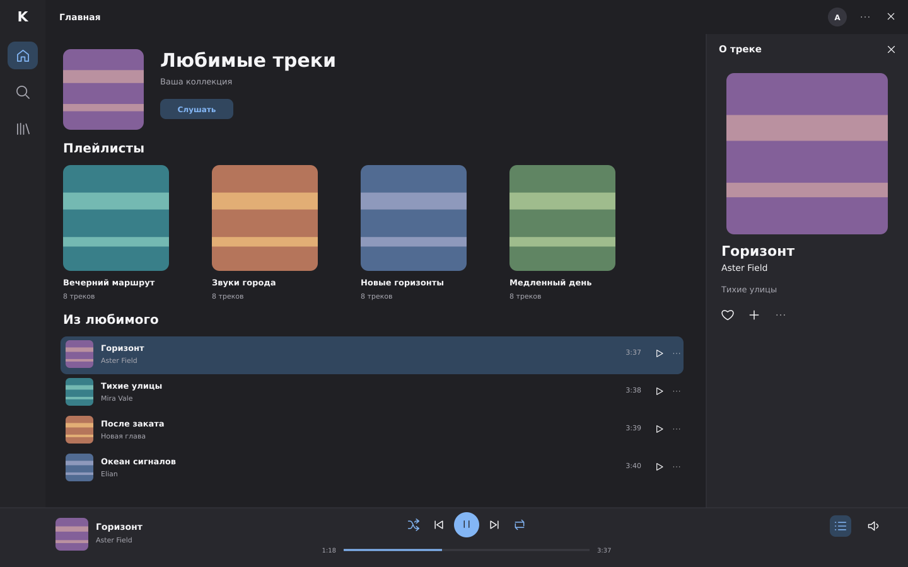
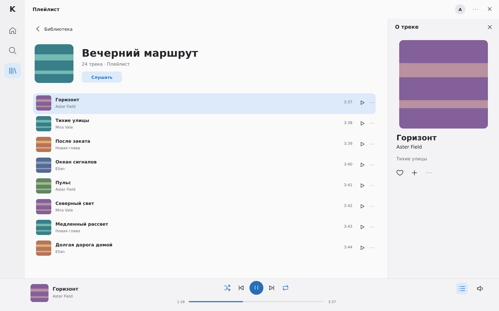
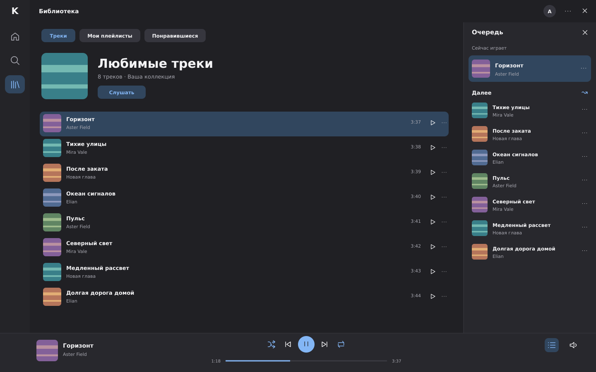
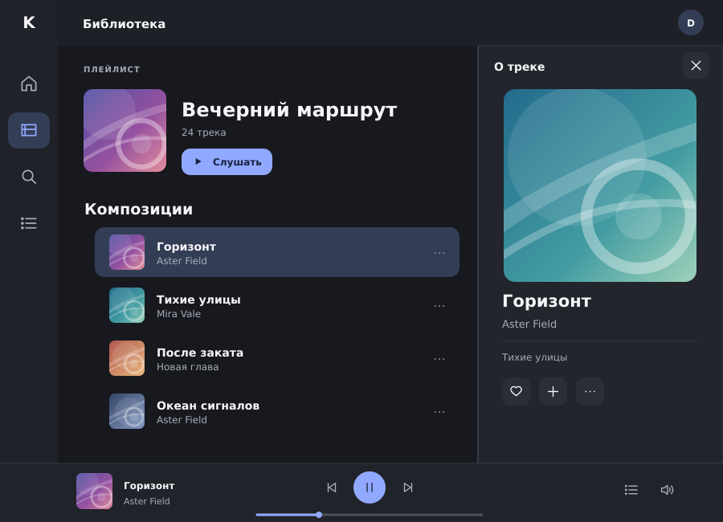
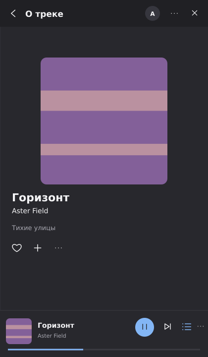
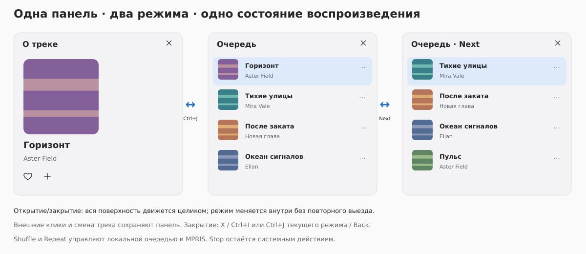

<!-- SPDX-License-Identifier: GPL-3.0-or-later -->

# Karin v0.4 — Complete Music Experience redesign

**Current authority:** the owner's updated [full task](CODEX_TASK.md) and
[implementation specification](DESIGN_SPEC.md), starting at `a9eed45` in existing
Draft PR #15. The owner **did not accept** the previous v0.4 UI/UX. Earlier Native
Music B sketches are superseded where they conflict with this task; they are
not an immutable final design or a new acceptance result.

The new composition is a three-destination rail, real music workspace,
**one universal Track Info / Queue panel**, and a permanent Player Bar with real
Shuffle/Repeat. Queue is opened from the footer/Ctrl+J, not the left navigation.
The whole panel surface moves together; its two modes share the same header,
close, geometry and transition. Outside clicks never dismiss it.

[UX_RESEARCH.md](UX_RESEARCH.md) records current public references, exact source
qualifications, inspected fresh a9 GTK captures and concrete design decisions.
The [implementation review](IMPLEMENTATION_REVIEW.md) records actual runtime
images/tests separately and preserves historical evidence.

## Revised original composition sketches

These are **illustrative original vectors, not GTK screenshots, implementation
proof or owner-approved final pixels**. Actual implementation needs its own fresh
visual/animation review and owner Fedora acceptance. Typography, spacing and
control grouping express the target, while native GTK theme metrics win over
literal reproduction of SVG icons or colors.

### Wide dark — music first, Track Info open

### Wide light — library and Track Info

### Wide dark — the same panel in Queue mode

### Medium — useful main area and nonmodal Queue

### Compact — explicit information view and usable footer

### State continuity

## Rules that outrank an illustration

- One panel has explicit `Closed | TrackInfo | Queue` state. Opening, changing
  modes and following actual queue occurrences never create a second player.
- Opening/closing moves background, border, header, art, text and controls as one
  surface. Static open SVGs cannot prove animation; inspect transition frames.
- Mode switches do not replay the slide. Resize, navigation and outside input
  preserve open mode; compact has explicit Back and a title matching its view.
- Current cover always shows information without closing an already-open pane.
  Explicit Details never plays; the next real occurrence change resumes following.
- Shuffle/Repeat are typed local policies shared with MPRIS, not decorative
  buttons. Stop is absent from the visible music footer but remains in system API.
- Only genuine supported collections/actions enter ordinary UI. The example
  names and striped covers are synthetic original composition samples, not
  release catalog data. Omit unsupported features rather than copying a reference.
- Use Libadwaita theming, accessibility, reduced motion and real native allocation.
  No hard-coded mock palette is an application theme specification.

## Evidence and permissions

Published Yandex/Cassette assets were inspected for research and were not copied
into these files or the application. All SVG geometry, simple illustrative
symbols and abstract art here are original Karin material, GPL-3.0-or-later.
No private desktop image, account, credential, real service cover or music file
is included. Public reference inspection does not establish service access or
permission to redistribute someone else's art.

Only fresh real GTK screenshots and executed functional checks can demonstrate
this implementation. Cloud/Xvfb does not establish Fedora/KDE/Wayland/PipeWire,
current Flatpak, physical media keys or real audible service acceptance. Keep
PR #15 Draft for the final owner review; no merge without explicit authorization.
