<!-- SPDX-License-Identifier: GPL-3.0-or-later -->

# Final v0.4 collection refinement — exact C14 GTK evidence

These are **69 untouched native GTK PNGs** from source-frozen **C14** and the
archived Karin comparison revision. All metadata is synthetic; covers are
original generated test art and media is local/generated. There is no owner
account, private reference screenshot, desktop, token or service music.

**Fresh-process first-footer smoothness remains unaccepted.** The first actual
mouse Play has **900,018 μs / 850,017 μs** adjacent native frame gaps at 1× / 2×,
with one intermediate each. Cause is unknown. Lifecycle/zero-minimum-width and
initialized-panel passes are distinct from cold smoothness or Fedora acceptance.
The historical 116,669 μs observation and failed checkpoints remain recorded.

## Source, capture method and executed scope

| Item | Exact evidence |
| --- | --- |
| Comparison production | `2e3ae41a8480b8f5f437f739c02cb925af69e884` |
| Before harness | One additional 850×750 test case in the before harness; [patch](metadata/before/geometry-adapter.patch), [archive/Git proof](metadata/before/archive-provenance.json), [audit](metadata/before/e-baseline-proof.json) |
| Current test-executable SHA-256 | `c927b8e1dfa405398c8c2dc68ca402d3cd899e7867f08cbfc2aa08bf54331bb5` |
| Current 111-entry source-manifest SHA-256 | `3faefc3e5d8e69ce475e148ffef92cecb5ccbaf6631ac14661993cbbf1db7bf4`; [all hashes](metadata/current/source.json) |
| Current native execution | Six ordinary-source stages passed with fatal GTK warnings enabled: fresh-profile startup at 1×/2×, static capture at 1×/2× and strict panel motion at 1×/2×; [ledger](metadata/current/native-execution.json), [hardened exact-source audit](metadata/current/e-final-proof.json) |
| Full static output | 260 originals: 108 matrix cases + 152 state supplements; all 108 before/current pairs match actual GTK content allocation and physical PNG dimensions |
| Full initialized panel output | 240 selected native frames / 48 trajectories, five distinct native indices/times each; all 478 moving raw records audited |
| Hidden-player cross-axis lifecycle | Inner child, native Revealer and outer host have released horizontal minimum/natural requests at startup and fully closed Stop; real Play/pause/Stop retain existing controls and 240 ms lifecycle |
| Selected gallery | Seven equal-size/role comparisons, 21 current supplements, 10 initialized panel frames, 18 fresh-start/Stop/paused originals and six genuine-input photos; [all original hashes](provenance.json) |

This fingerprint identifies a **test executable** compiled from source based on
`2e3ae41`. It is not the release application's checksum or a claim that the
comparison revision contains these changes. The
[recorded regular checks](metadata/current/regular-result.json) passed on stable
Rust 1.99.1 and exact Rust 1.98.1: formatting, strict Clippy, builds and library
tests in default (379), all-feature (387) and minimal-feature (365) configurations,
plus four CLI tests for each configuration and compiler. Locked offline MSRV
release builds, 15 terminal diagnostics, 40 silent GStreamer checks, generated-WAV
transport and GTK smoke checks also passed. The license inventory remains
unchanged: 207 lockfile packages, including 178 for Linux.

The complete local C14 native functional set also **passes 56/56**: all 28
selectors at both scales, with no warnings or failures. The
[verified summary](metadata/current/functional-summary.json) and
[full ledger](metadata/current/functional-results.jsonl) retain the exact source,
binary and all unique selector/scale pairs with log hashes. Summed process time
is 857.43 seconds. These functional fixtures use Cairo; the main visual/motion
stages below record `GskGLRenderer` separately.

Two navigating WebKit fixtures remain unsupported locally and require hosted CI:
`webkit_auth_interactive_navigation_frames_and_first_rejection` and
`webkit_auth_local_startup_cookie_isolation_and_cancel`. Their absence is explicit,
not a sandbox-disabled PASS. The ordinary local release checksum does not validate
a downloaded Fedora archive. **At documentation freeze, hosted CI and downloaded
archive validation remain pending**; their eventual exact-revision outcomes are
in [PR #15](https://github.com/tracerxbrhd/karin/pull/15/checks).

The recorded renderer is `GskGLRenderer`; test-only `LP_NUM_THREADS=2` is explicit.
**Static PNGs are X11 window captures under full redraw. Motion/raw-footer PNGs
render retained native after-paint root scene nodes**, with ordinary GTK damage
(`GSK_DEBUG` unset). Strict panel proof includes its bounded graphics initialization;
fresh-process startup uses separate profiles with no prior graphics cycle before
Play. No production prewarming, renderer override or USER-CSS control supplies
this evidence. Full native-node pixels are not direct ordinary framebuffer-damage,
KDE/Wayland or PipeWire performance proof.

## Equal-size Karin before/current comparisons

Requested window/PNG sizes include the decoration border. For example, the
850×750 request produces an 850×750 PNG at 1× but an 840×740 GTK content
allocation; the same actual allocation is verified on both sides. See every
pair's actual logical size, scale and original hash in [provenance](provenance.json).
The before images are Karin, **not** the private Cassette screenshots.

| Requested size and state | Before, exact 2e3 production | Current, C14 |
| --- | --- | --- |
| 420×720, dark, Liked | 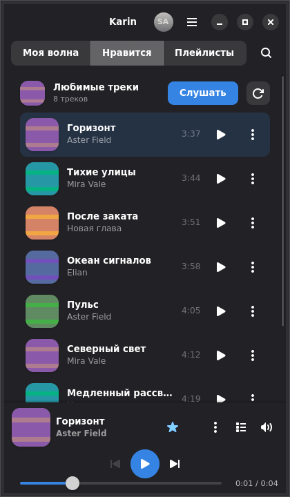 | 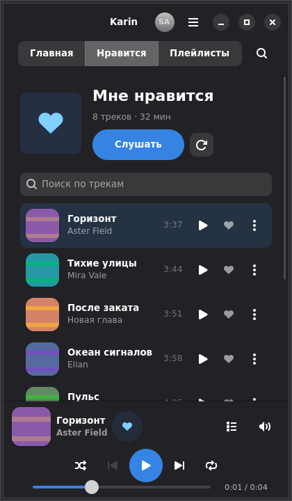 |
| 850×750, light, Liked | 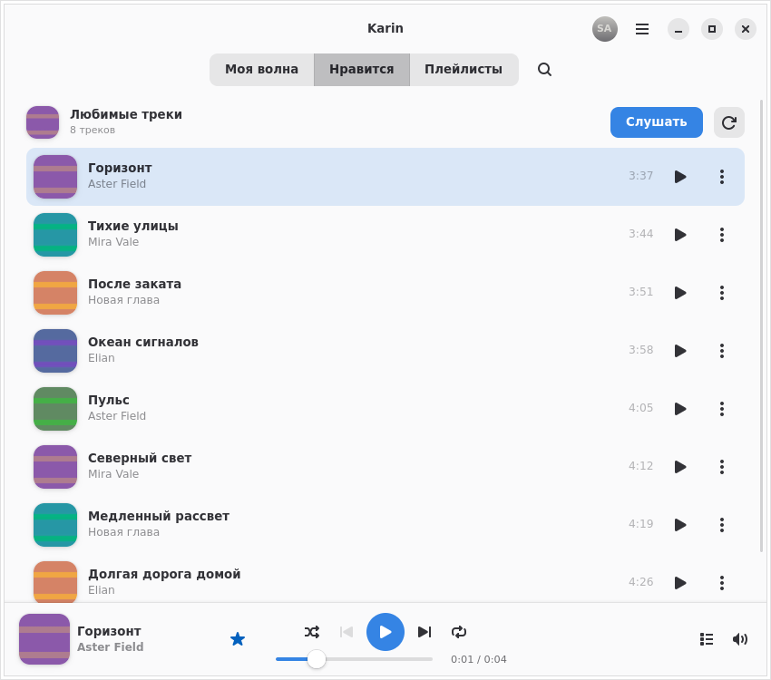 | 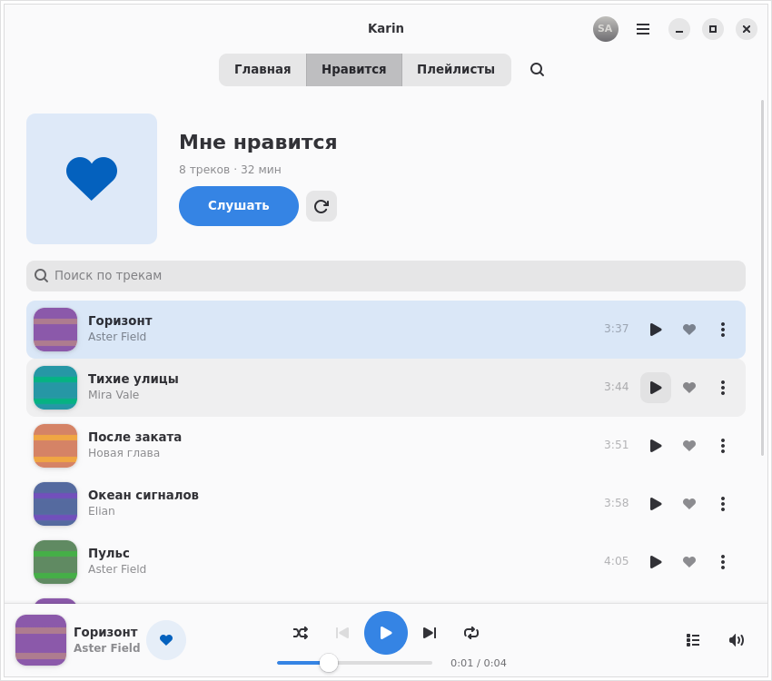 |
| 1440×900, dark, Liked | 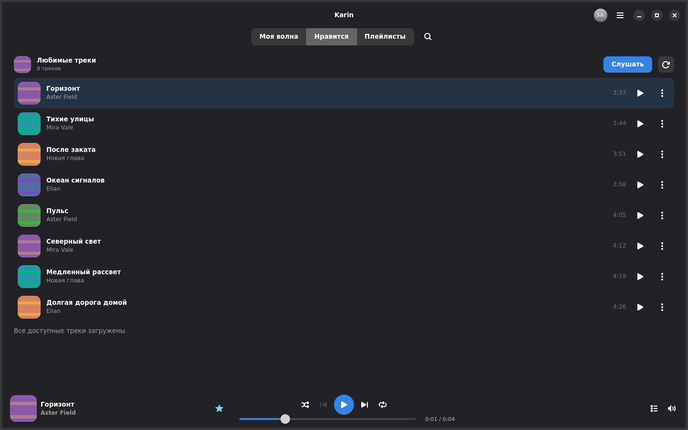 | 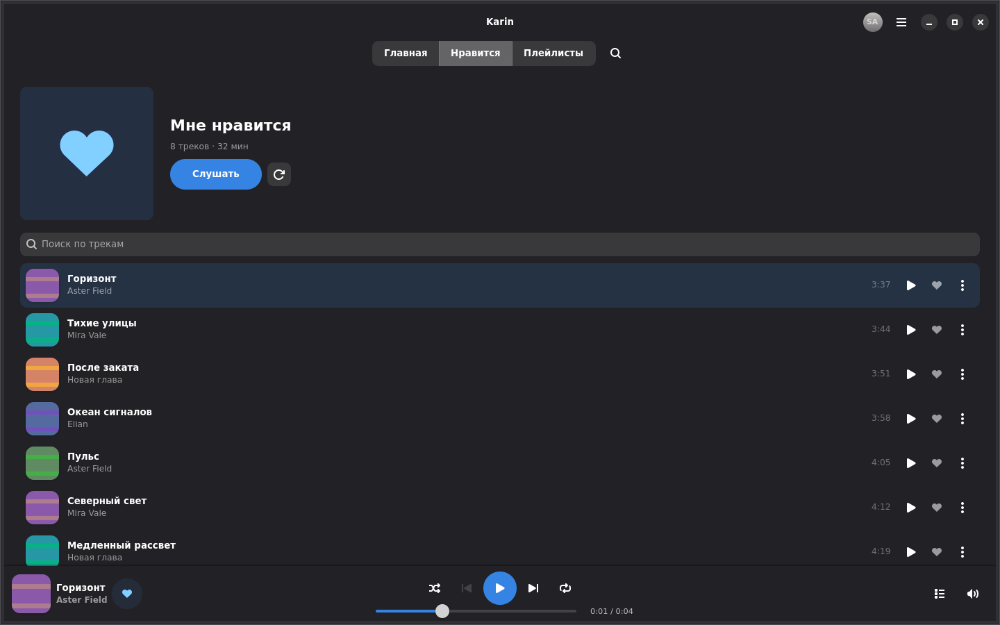 |
| 1650×930, light, Liked | 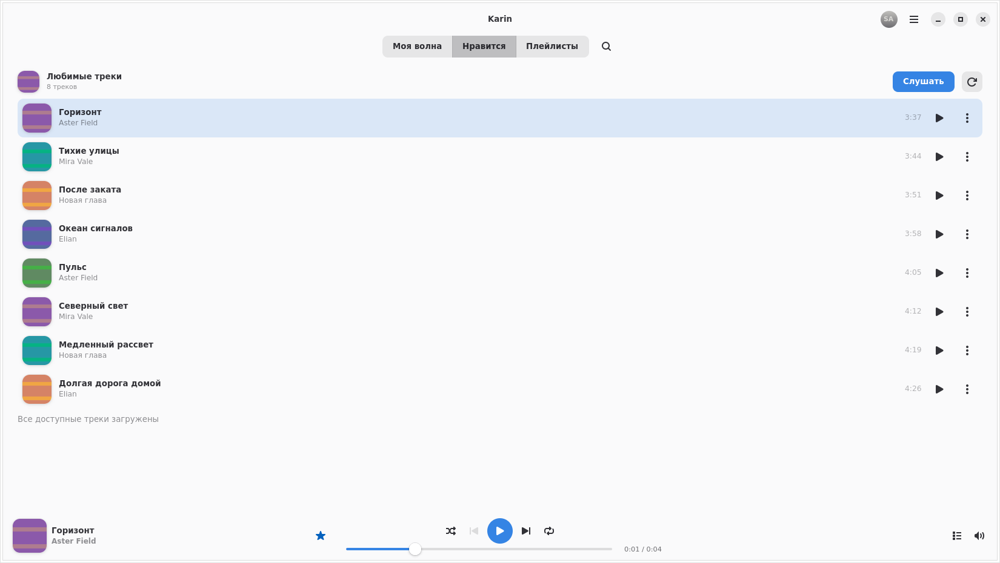 | 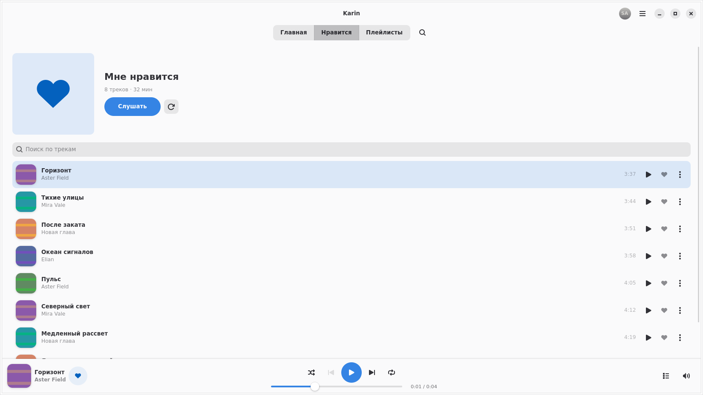 |
| 1440×900, light, Playlists | 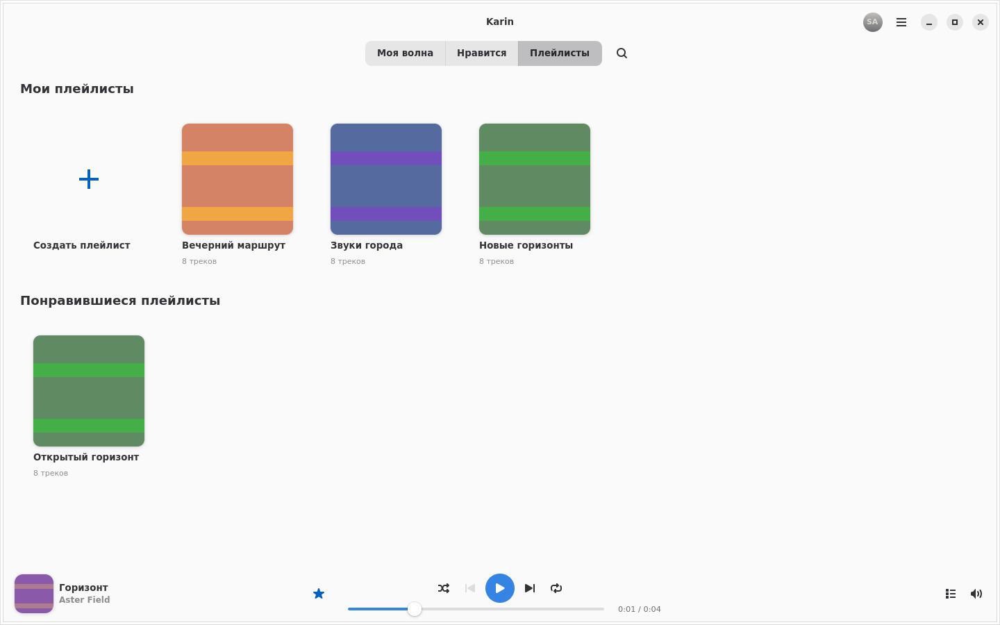 | 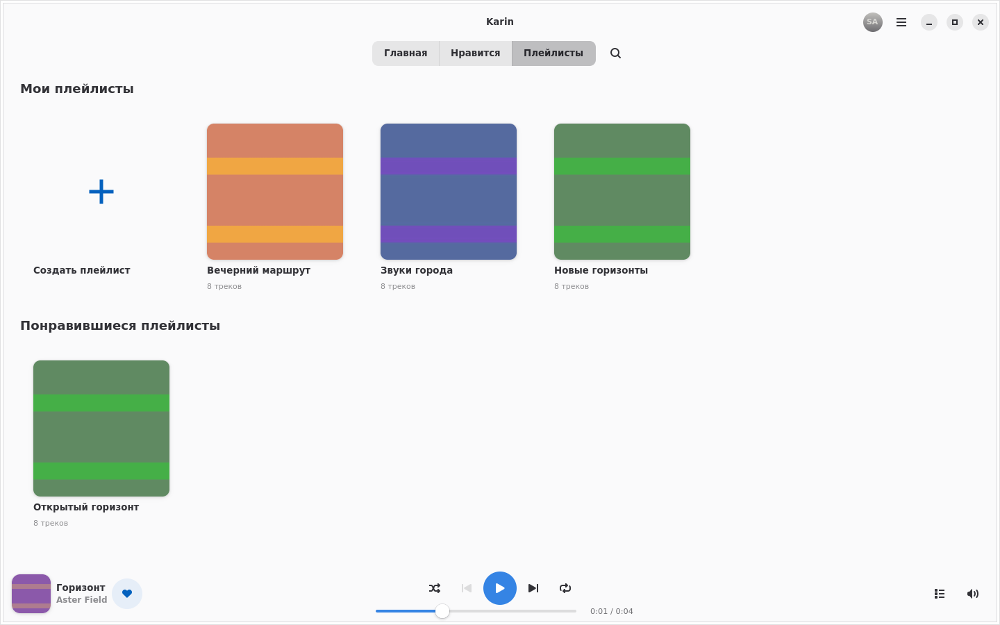 |
| 1440×900, dark, first destination: Wave becomes Home | 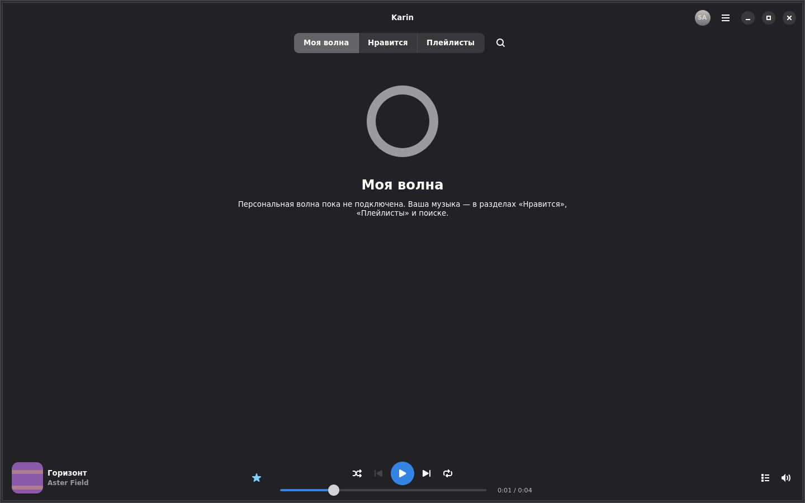 | 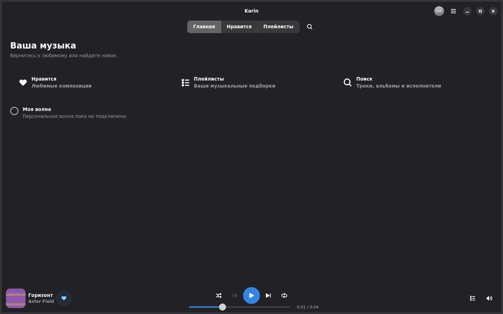 |
| 850×750 at 2×, dark, Liked | 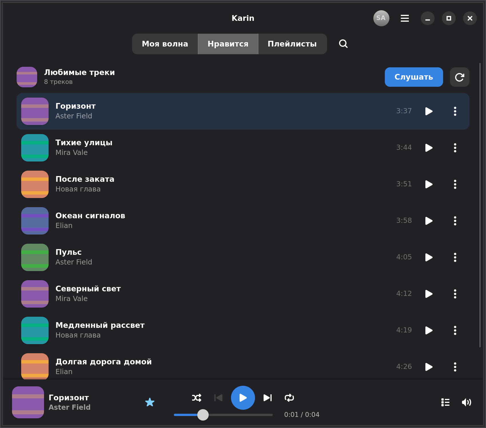 | 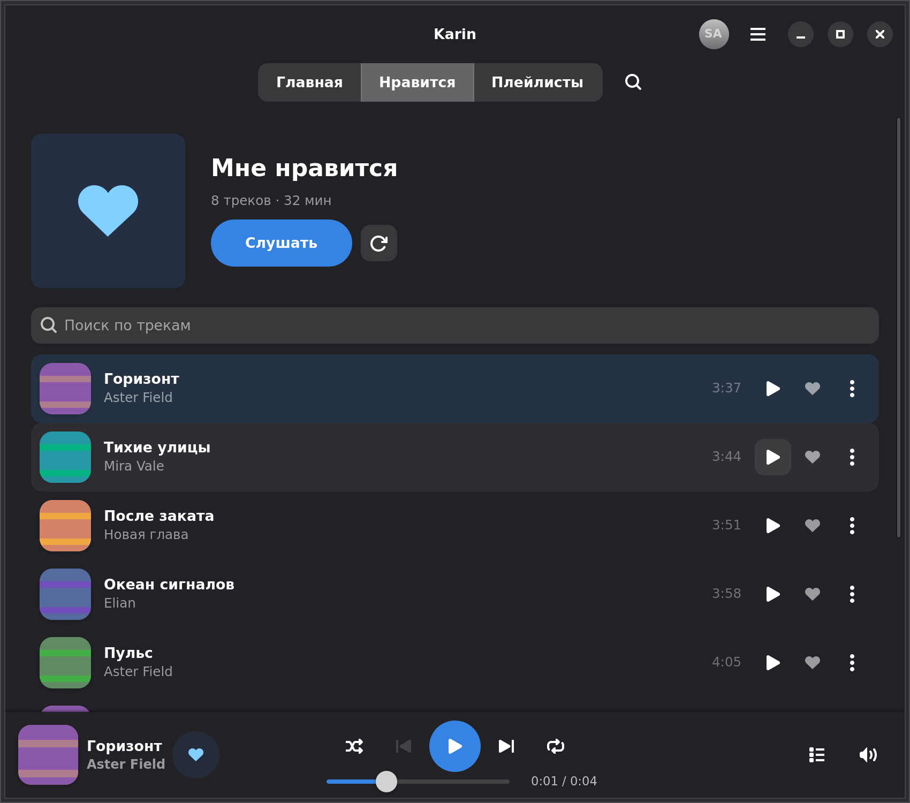 |

The larger original heart hero groups collection title, complete/loaded facts
and real actions. Local search and quiet 64-pixel rows replace the former tiny
summary. Playlist covers grow without stretching a sparse item. Home supplies
real existing routes and a modest unavailable Wave section; it is intentionally
a basic starting page, not a working recommendation feed.

## Collections, filtering and native transport

| Actual current state | Untouched original |
| --- | --- |
| Liked filter, 850×750 dark | [Open](current/static-scale1/surface-liked-filter-reference-scale1-dark.png) |
| Liked, no matches in a complete fixture collection | [Open](current/static-scale1/surface-liked-filter-empty-scale1-light.png) |
| Liked filter, compact light at 2× | [Open](current/static-scale2/surface-liked-filter-compact-scale2-light.png) |
| Opened playlist filter, 850×750 light | [Open](current/static-scale1/surface-playlist-filter-reference-scale1-light.png) |
| Opened playlist filter, compact dark at 2× | [Open](current/static-scale2/surface-playlist-filter-compact-scale2-dark.png) |
| Playlist grid, 850×750 light | [Open](current/static-scale1/surface-playlists-tab-reference-scale1-light.png) |
| Compact playlist grid, two real columns at 2× | [Open](current/static-scale2/surface-playlists-tab-compact-scale2-dark.png) |
| Home, compact light | [Open](current/static-scale1/surface-home-compact-scale1-light.png) |
| Home, reference size dark at 2× | [Open](current/static-scale2/surface-home-reference-scale2-dark.png) |
| Hidden idle footer, wide dark | [Open](current/static-scale1/surface-player-hidden-wide-scale1-dark.png) |
| Hidden idle footer, compact light at 2× | [Open](current/static-scale2/surface-player-hidden-compact-scale2-light.png) |
| Actual resolved local media retained while paused | [Open](current/static-scale1/surface-player-visible-paused-scale1-light.png) |
| Shuffle and literal Repeat One | [Open](current/static-scale1/surface-player-shuffle-repeat-one-scale1-dark.png) |
| Shuffle and Repeat Queue | [Open](current/static-scale1/surface-player-shuffle-repeat-queue-scale1-light.png) |
| Safe search error and Retry | [Open](current/static-scale1/surface-search-error-retry-scale1-light.png) |
| Visible keyboard focus | [Open](current/static-scale1/surface-keyboard-focus-scale1-dark.png) |

The static filtered captures show the real SearchEntry signal path and visual
composition. The separate source-matched actual-input result below complements
them. Typing issues no MusicService collection/metadata reads or whole-library
drain; existing bounded artwork work may resume for newly visible retained rows.

## Executed C14 local-filter input, partial continuation and Retry

The exact same-source selector
`native_collection_filter_continuation_and_exact_occurrences` passed at **1× in
85.04 seconds**. Its [result/source fingerprint](metadata/current/functional-scale1/collection-filter-result.json)
and [safe synthetic-fixture log](metadata/current/functional-scale1/collection-filter-run.log)
are retained. Genuine typed input, native mouse/keyboard, counted local HTTP,
partial append/Retry, duplicate occurrence and queue-isolation checks supplement
these six untouched originals, each individually opened by A. The matching
selector also passed at **2× in 86.50 seconds**, as recorded in the full ledger;
the complete local functional set passed 56/56. These photos do not establish
hosted CI, live-account or Fedora acceptance.

| Executed fixture state | Light | Dark |
| --- | --- | --- |
| Partial loaded 50, no local match, bounded continuation | [Open](current/functional-scale1/collection-filter-partial-light.png) | [Open](current/functional-scale1/collection-filter-partial-dark.png) |
| Next portion fails, honest scope and Retry | [Open](current/functional-scale1/collection-filter-retry-light.png) | [Open](current/functional-scale1/collection-filter-retry-dark.png) |
| Append admits 100, four Cyrillic matched occurrences | [Open](current/functional-scale1/collection-filter-append-light.png) | [Open](current/functional-scale1/collection-filter-append-dark.png) |

## The same pinned Track Info / Queue surface

| Actual current state | Untouched original |
| --- | --- |
| 900×650, short Info actions remain above footer | [Open](current/static-scale1/matrix-medium-panel-track-scale1-dark.png) |
| 720×650, compact presentation at 2× | [Open](current/static-scale2/matrix-narrow-panel-track-scale2-light.png) |
| Wide musical Info | [Open](current/static-scale1/matrix-wide-panel-track-scale1-dark.png) |
| Owner-wide Queue with pinned source/count/Clear | [Open](current/static-scale1/matrix-owner-wide-panel-queue-scale1-light.png) |
| Long real-shaped metadata, missing art and scrolling at 2× | [Open](current/static-scale2/surface-long-metadata-compact-information-scale2-light.png) |

These five distinct frames show the complete fixed-size surface, not separately
animated artwork. The [original observed geometry](metadata/current/motion-scale1/observed-medium-dark-track-opening-scale1.jsonl)
accompanies the medium Track Info opening. Percentages are measured openness;
they are **not** labels invented for the raw cold-footer sequence below.

| Near 0% | Near 25% | Near 50% | Near 75% | Near 100% |
| --- | --- | --- | --- | --- |
| 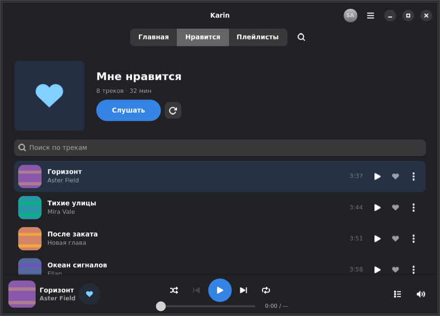 | 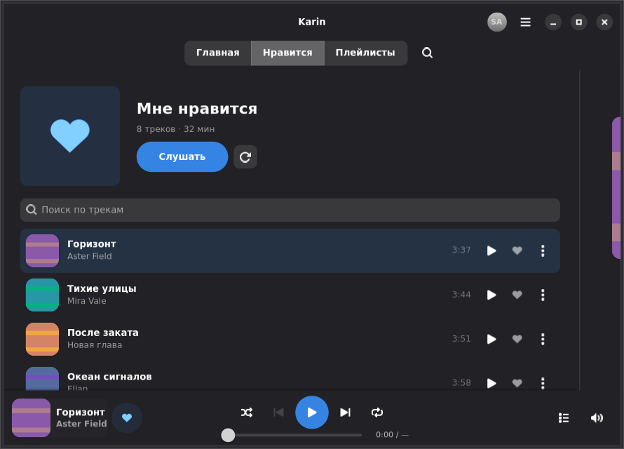 | 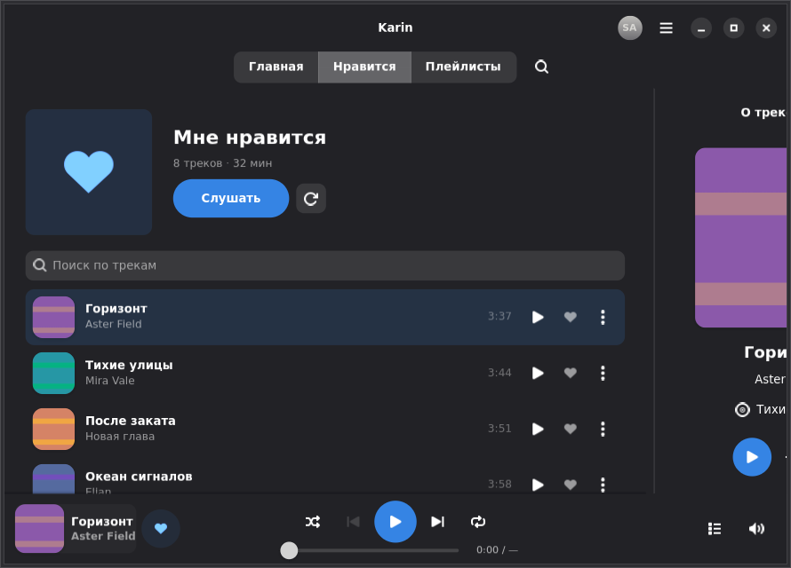 | 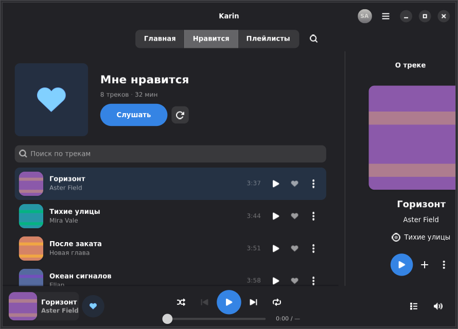 | 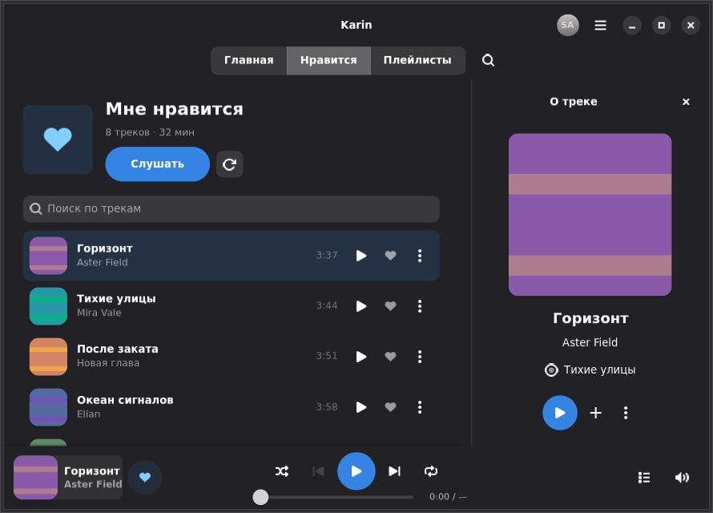 |

Queue closing at compact/light/2× has its own five actual originals and
[observed geometry](metadata/current/motion-scale2/observed-compact-light-queue-closing-scale2.jsonl).
Chronological order is **100 → 75 → 50 → 25 → 0** openness:
[100](current/motion-scale2/animation-compact-light-queue-closing-100-scale2.png),
[75](current/motion-scale2/animation-compact-light-queue-closing-075-scale2.png),
[50](current/motion-scale2/animation-compact-light-queue-closing-050-scale2.png),
[25](current/motion-scale2/animation-compact-light-queue-closing-025-scale2.png),
[0](current/motion-scale2/animation-compact-light-queue-closing-000-scale2.png).

## Fresh-process footer observations: smoothness unaccepted

A separate normal loaded-library process/profile begins with empty queue and no
selected Info. First actual mouse Play uses the ordinary production reveal;
there is no forced post-map close, prior footer/panel cycle, renderer priming,
artificial delay or longer animation.

| Scale | Genuine retained first-Play indices | Intermediate frames | Maximum adjacent native gap | Maximum observer duration |
| --- | --- | --- | --- | --- |
| 1× | [0](current/cold-scale1/footer-startup-first-start-frame000-scale1.png), [3](current/cold-scale1/footer-startup-first-start-frame003-scale1.png), [5](current/cold-scale1/footer-startup-first-start-frame005-scale1.png)| 1 | 900,018 μs | 518 μs |
| 2× | [0](current/cold-scale2/footer-startup-first-start-frame000-scale2.png), [3](current/cold-scale2/footer-startup-first-start-frame003-scale2.png), [5](current/cold-scale2/footer-startup-first-start-frame005-scale2.png)| 1 | 850,017 μs | 282 μs |

The [1×](metadata/current/cold-scale1/footer-startup-first-start-scale1.json) and
[2×](metadata/current/cold-scale2/footer-startup-first-start-scale2.json) raw records
retain every observed native time/allocation/index. Each has **three actual
retained images, not five invented quarter phases**. The stable 64-pixel child and
zero height reversals do not accept the near-one-second cadence or establish its
cause. Stop records at [1×](metadata/current/cold-scale1/footer-startup-explicit-stop-scale1.json)
and [2×](metadata/current/cold-scale2/footer-startup-explicit-stop-scale2.json),
actual saved Stop images and both paused themes/scales are included. The full
artifact separately retains 17 static-fixture first-Play/Stop PNGs; their raw JSON
is copied here with its distinct scope, not relabeled fresh startup.

## Retained failed and intermediate checkpoints

The complete **C12** local native sweep was **48 PASS / 8 nonpassing**, not green.
Its [exact source](metadata/history/candidate-12/source.json),
[56-case ledger](metadata/history/candidate-12/c12-full-native-results.jsonl),
[failure summary](metadata/history/candidate-12/c12-full-native-summary.json) and
individual failed logs are retained. The failures exposed stale test-coordinate/
navigation contracts and a real hidden-footer horizontal request. Its separate
static/initialized proof and regular matrix did not certify that broader suite.
C12 cold gaps were 1,033,354/866,684 μs and remained unaccepted.

**C13** passed [12 targeted regressions](metadata/history/candidate-13/targeted-regressions-results.jsonl)
and its own [six-stage audit](metadata/history/candidate-13/e-final-proof.json),
including released hidden horizontal requests; its cold gaps remained roughly
1.067 / 0.900 s. A later Unicode compatibility-capital issue required NFKC→casefold→NFKC
and a pure regression before **C14**. None of these older images/results is
relabeled final current source. The full former C12 gallery and design-doc
checkpoint remain in the external task archive; only exact C14 originals supply
`current/` here.

## Independent original-image review and remaining acceptance

All **69 published originals** were individually opened across four reviewers,
with every reviewed SHA-256 matching [provenance](provenance.json): **A: 21 / C: 12 /
D: 8 / E: 28**, including freshly reopened baseline images. The
[full coverage record](metadata/current/team-published-image-review.json) lists
every file/reviewer/hash. The [A collection/input](metadata/current/a-collection-image-review.json),
[C transport/panel](metadata/current/c-player-image-review.json),
[D Home/grid](metadata/current/d-home-playlists-image-review.json) and
[E motion/startup](metadata/current/e-motion-startup-image-review.json) reports
retain their observations and limits. No new separate structural P0/P1 was
observed; the known cold temporal FAIL remains. This does not claim all 260 full
static output images were manually reviewed or substitute for native behavior.

A first multi-image forwarded inspection of an unselected 850×750 dark original
appeared clipped; root and A independently reopened the exact unchanged file
alone and confirmed complete title/header controls/tabs/Search. The
[withdrawn-observation record](metadata/current/a-root-chrome-recheck.json)
retains this correction. No source/image edit or rerun resolved it; no GTK defect
is established by that initial display.

Use the [Fedora guide](../../../BUILDING.md#v04-native-music-acceptance-on-fedora)
for ordinary first appearance, live account/Like/library, real audible Music,
PipeWire, KDE controls, physical media keys and current Flatpak. None is accepted
by cloud images. Public-service distribution and unavailable Wave/Dislike/offline
capabilities keep their own documented boundaries. PR #15 remains Draft.
