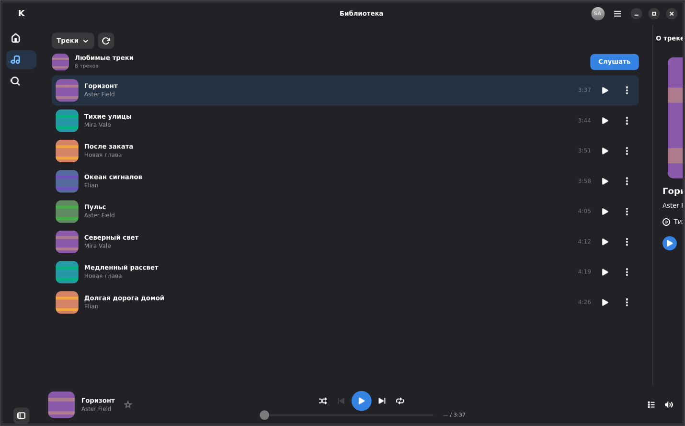
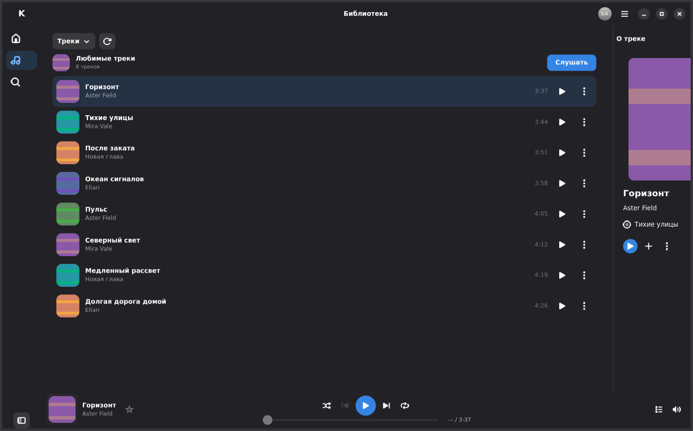
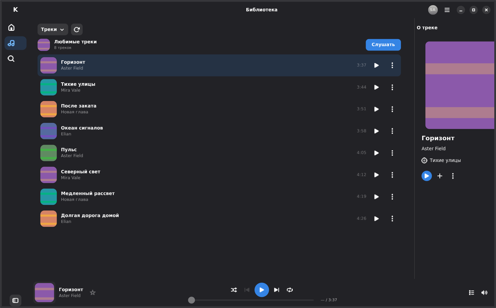
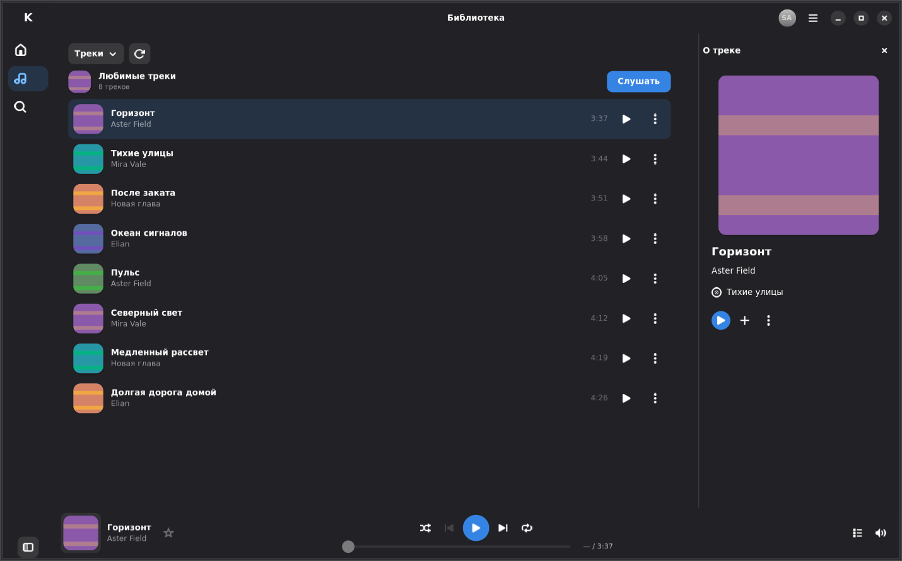
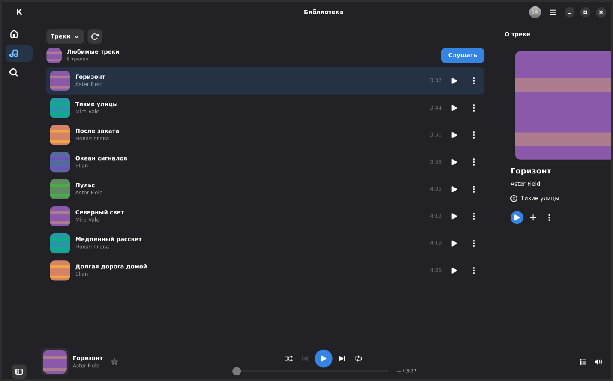
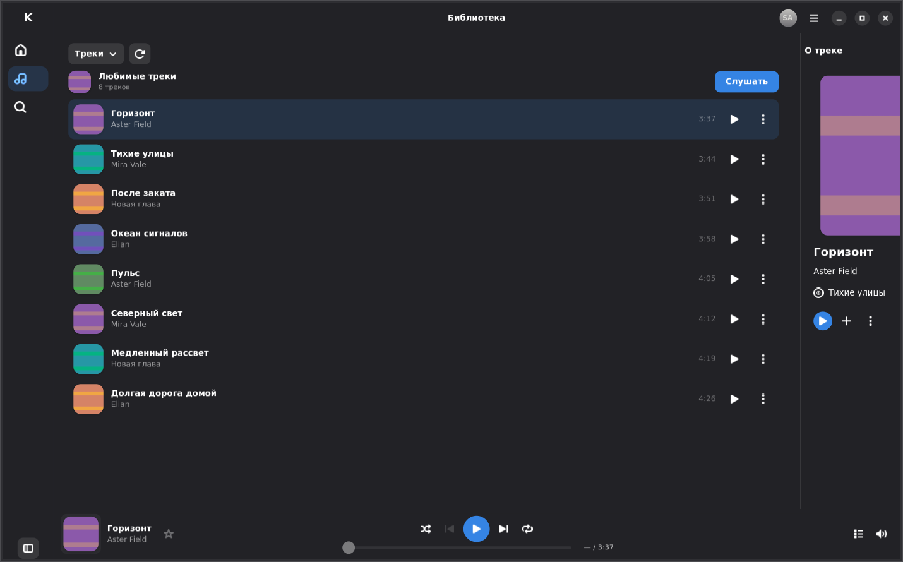
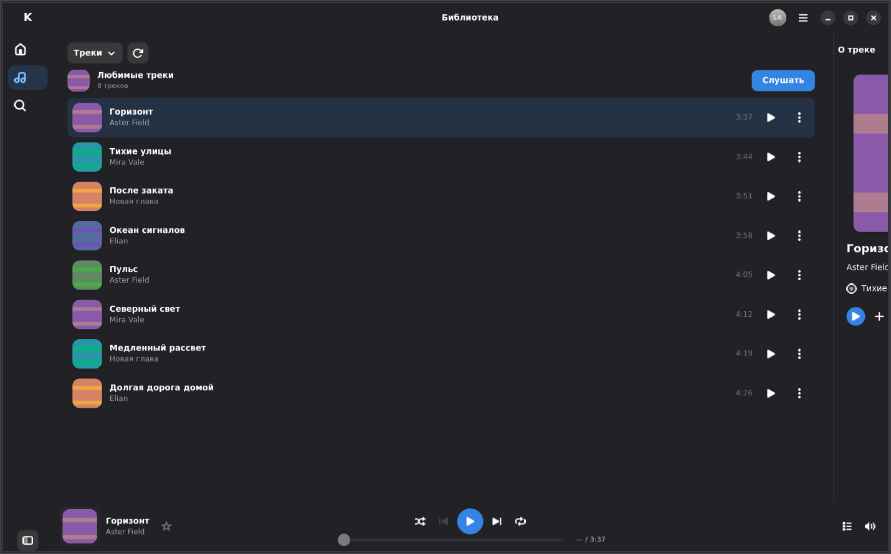
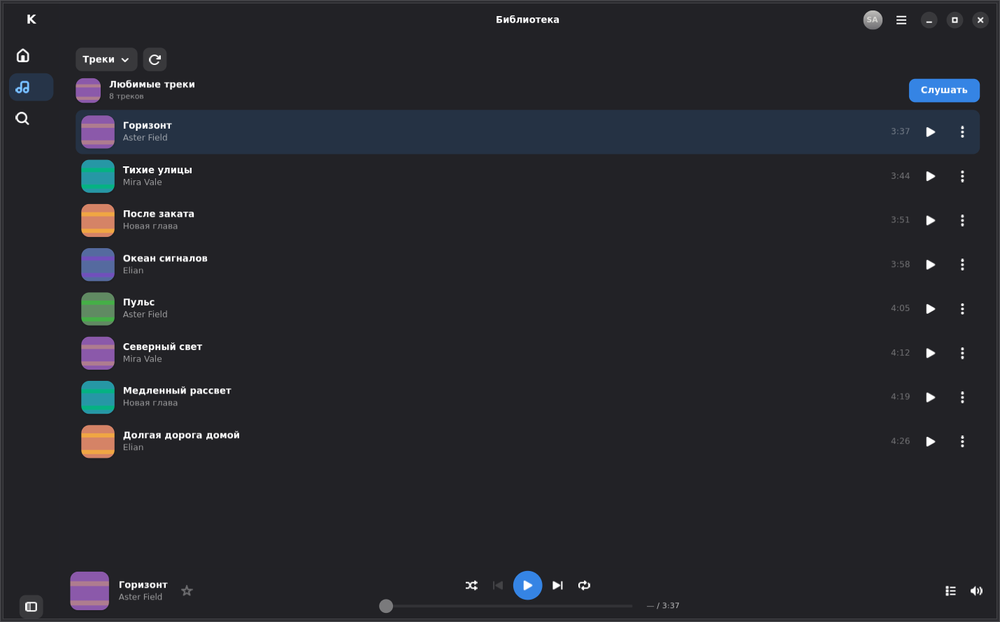
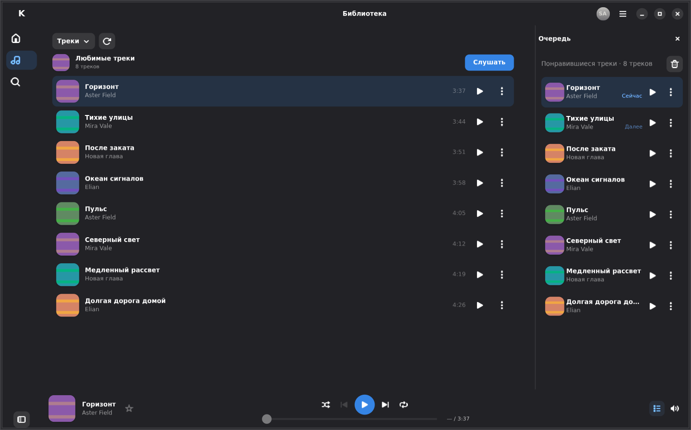

<!-- SPDX-License-Identifier: GPL-3.0-or-later -->

# Normal motion after recorded graphics initialization

These **11 untouched actual GTK images** supplement the retained
[C10 composition gallery](../README.md). They are selected from **240 measured
frames / 48 trajectories** at both scales, using synthetic metadata and original
fixture covers. The application code is unchanged from runtime commit `37379a7`.

The frozen C14 executable SHA-256 is
`04a5d0516cc6b348dd957f858ea6ad13ce17c95fd2a6ce7e7d3cb46635bb1d83`;
[provenance](provenance.json) records its exact Rust/Cargo content. The final
successor harness adds output-scope labels only; painting and strict motion
assertions are unchanged. [SHA256SUMS](SHA256SUMS) covers every original PNG.

## What is, and is not, measured

The test first records one real native open/close cycle for each size/theme/mode.
While fully open, six bounded offscreen native GSK renders initialize partially
clipped materials from the **actual mapped panel**. Those setup renders change
neither UI progress nor the animation clock, save no PNG and are explicitly
marked `animation_proof: false`. The cold opening's raw observations remain
separate; an [example](initialization-observation.jsonl) is included.

Only **subsequent real mouse gestures** supply the images below. They use the
unchanged normal **240 ms** Libadwaita animation, five different rendered frame
times and indices, and the original progress/geometry tolerances. No conditional
retry, reduced motion, stretched duration, manual progress or initialization
texture supplies an evidence frame. Independent review matched every selected
record to its raw measured after-paint observation and inspected all 240 images.

This is **graphics-initialized motion evidence**. Cold first-use latency is
**not accepted**: earlier headless NGL/Vulkan experiments missed required phases
during long first-paint cycles, with no missing snapshots or renderer fallback.
The application has no graphics prewarming. This fixture preparation does not
fix or certify the first opening on Fedora; that fresh-start check remains
mandatory. See [VALIDATION](../../../../VALIDATION.md#v04-complete-music-experience-redesign).

## Opening and closing

Labels are approximate **openness**, not elapsed time. Original frame times,
progress, mapped children and allocations are in [geometry.json](geometry.json).

| Opening 0% | ≈25% | ≈50% | ≈75% | 100% |
| --- | --- | --- | --- | --- |
|  |  |  |  |  |

| Closing 100% | ≈75% | ≈50% | ≈25% | 0% |
| --- | --- | --- | --- | --- |
|  |  |  |  |  |

| Track Info | Queue in the same surface |
| --- | --- |
|  |  |

Environment: GTK 4.18.6, Libadwaita 1.7.6, actual `GskGLRenderer` requested as NGL,
Mesa software rendering, isolated Xvfb/Openbox. No real account, service artwork,
credential or music recording is included. Original fixture material uses
GPL-3.0-or-later. This is not Fedora/KDE/Wayland, physical GPU/audio or Flatpak
acceptance.
