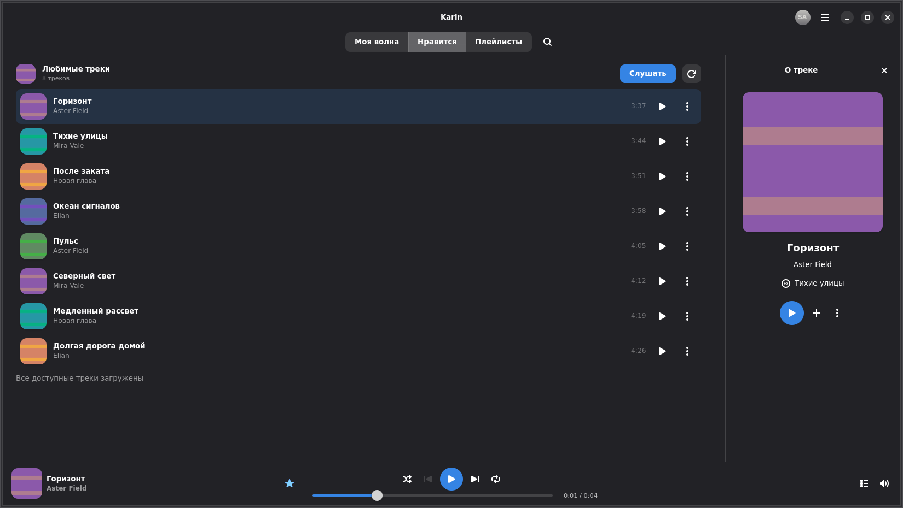
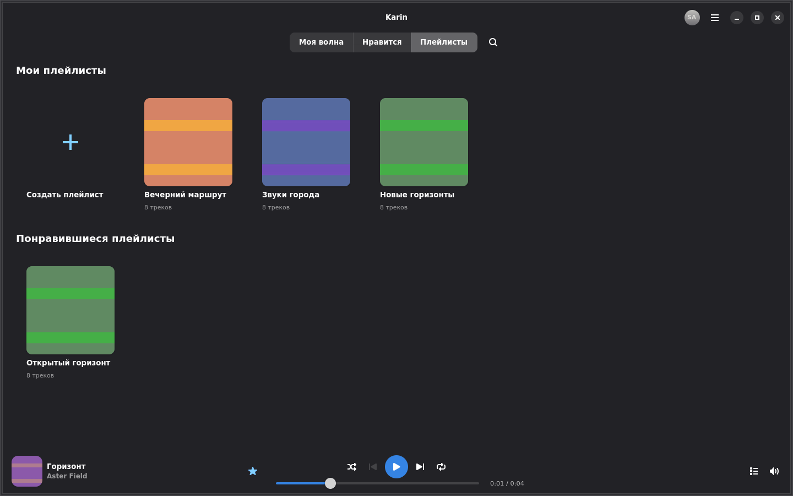

<!-- SPDX-License-Identifier: GPL-3.0-or-later -->

# v0.4 refinement: real GTK evidence

This gallery continues the existing Draft PR #15 from `a70bbf7`. PNGs are
unmodified originals from the running native GTK application: synthetic
loopback MusicService metadata, original generated raster covers and short
generated media through the existing playback worker. They contain no owner's
account, desktop, service artwork, signed resource URL or copyrighted music.
The private Cassette reference is not redistributed.

[Provenance](provenance.json) and [frozen source](source.json) identify the test
executable and every Rust/Cargo source hash. [Quality summary](quality-summary.json)
records executed checks and limits. Full capture sets are retained in the
source-matched GitHub Actions artifacts linked in PR #15.

## Composition

The selected captures supplement 204 static cases: 96 matrix images plus 108
populated/state supplements across light/dark and 1×/2×. The matrix covers
420×720, 720×650, 900×650, 1280×800, 1440×900, 1650×930, 1920×1080 and true
Openbox maximization, each with Closed/TrackInfo/Queue. All 96 before/current
matrix pairs have equal physical dimensions; content/playback states are
recorded separately and are not claimed identical across the two old/new harnesses.

| Scenario | Untouched current capture |
| --- | --- |
| Idle footer absent | [Wide dark](current/surface-player-hidden-wide-scale1-dark.png), [compact light](current/surface-player-hidden-compact-scale1-light.png) |
| Active/pause footer | [Wide dark](current/surface-player-visible-paused-scale1-dark.png) |
| Pinned musical Info | [Owner-wide dark](current/matrix-owner-wide-panel-track-scale1-dark.png), [2×](current/matrix-owner-wide-panel-track-scale2-dark.png) |
| Same surface, Queue | [Owner-wide light](current/matrix-owner-wide-panel-queue-scale1-light.png), [maximized dark](current/matrix-maximized-panel-queue-scale1-dark.png) |
| Short-window actions | [720×650 light 2×](current/matrix-narrow-panel-track-scale2-light.png), [900×650 dark](current/matrix-medium-panel-track-scale1-dark.png) |
| Compact Info | [Dark](current/matrix-compact-panel-track-scale1-dark.png), [light 2×](current/matrix-compact-panel-track-scale2-light.png) |
| Liked / explicit Wave placeholder | [Liked dark](current/surface-liked-tab-scale1-dark.png), [Wave light](current/surface-wave-placeholder-scale1-light.png) |
| Owned and liked playlists | [Dark](current/surface-playlists-tab-scale1-dark.png), [light 2×](current/surface-playlists-tab-scale2-light.png) |
| Unified Search / error Retry | [Light search](current/surface-unified-search-scale1-light.png), [dark Retry](current/surface-search-error-retry-scale1-dark.png) |
| Stop hides footer | [Dark](current/surface-player-hidden-after-stop-scale1-dark.png) |
| Long/missing/unavailable / keyboard | [Track states](current/surface-long-metadata-missing-art-unavailable-partial-scale1-dark.png), [visible focus](current/surface-keyboard-focus-scale1-light.png) |

The archived before images use **unmodified a70 production and test source**,
rebuilt into an isolated target. They are not new acceptance:
[wide](before/matrix-owner-wide-panel-closed-scale1-dark.png),
[wide Info](before/matrix-owner-wide-panel-track-scale1-dark.png),
[medium Info](before/matrix-medium-panel-track-scale1-dark.png),
[compact Info](before/matrix-compact-panel-track-scale1-dark.png).

## Actual Player Bar appearance and disappearance

The raw first Play/Stop observations use the normal native **SlideUp, 240 ms**.
The first Play is actual input on a track row and actual generated-media worker
playback, not queue selection or an artificial showing of the footer. Each
selected PNG comes from its recorded real after-paint render node.

Frame labels below are **native frame indices and allocated heights**, not
animation-time quarters. Selection uses the nearest observed allocated height;
there is no interpolation, compositing, retiming or synthetic frame generation.
Both scales retain the raw observations and actual selected indices in
`geometry/footer-*-scale*.json`. Pause retains the bar; explicit Stop hides it.

The fresh-profile first start at 1× has **three intermediate observations and
four distinct selected PNGs**; nearest-height selection reused one frame rather
than inventing a fifth. A 116,669 μs native paint gap accompanied height 16→73.
The 2× first start has five intermediate observations; Stop has 13/9 at 1×/2×.
All observed heights are monotone, with a stable 64-pixel natural child.
These raw records prove native reveal/hide and the repaired height reversal;
they **do not establish smooth cold first appearance**. Its internal cause and
target-Fedora behavior require separate checks. There are 19 actual footer PNGs.

### Actual footer, 1×

| Transition | Native frames (allocated logical height) |
| --- | --- |
| first-start | [frame 0: 0px](footer/footer-first-start-frame000-scale1.png) → [frame 4: 16px](footer/footer-first-start-frame004-scale1.png) → [frame 5: 73px](footer/footer-first-start-frame005-scale1.png) → [frame 8: 80px](footer/footer-first-start-frame008-scale1.png) |
| explicit-stop | [frame 0: 80px](footer/footer-explicit-stop-frame000-scale1.png) → [frame 2: 65px](footer/footer-explicit-stop-frame002-scale1.png) → [frame 4: 31px](footer/footer-explicit-stop-frame004-scale1.png) → [frame 5: 23px](footer/footer-explicit-stop-frame005-scale1.png) → [frame 16: 0px](footer/footer-explicit-stop-frame016-scale1.png) |

### Actual footer, 2×

| Transition | Native frames (allocated logical height) |
| --- | --- |
| first-start | [frame 0: 0px](footer/footer-first-start-frame000-scale2.png) → [frame 4: 29px](footer/footer-first-start-frame004-scale2.png) → [frame 5: 41px](footer/footer-first-start-frame005-scale2.png) → [frame 6: 70px](footer/footer-first-start-frame006-scale2.png) → [frame 13: 80px](footer/footer-first-start-frame013-scale2.png) |
| explicit-stop | [frame 0: 80px](footer/footer-explicit-stop-frame000-scale2.png) → [frame 2: 65px](footer/footer-explicit-stop-frame002-scale2.png) → [frame 3: 40px](footer/footer-explicit-stop-frame003-scale2.png) → [frame 5: 16px](footer/footer-explicit-stop-frame005-scale2.png) → [frame 12: 0px](footer/footer-explicit-stop-frame012-scale2.png) |

## Whole right-panel surface

The full strict set has 48 trajectories / 240 distinct selected native frames.
Actual renderer, mapped child identities, frame times/indices and geometry are
recorded in `geometry/panel-motion-scale*.jsonl`; selected trajectories also keep
their raw `observed-*` after-paint data. Opening is displayed by openness
0→25→50→75→100; chronological closing is 100→75→50→25→0. The phase filenames
denote requested openness and the records retain actual progress.

| Actual normal trajectory | Measured openness frames, chronological order |
| --- | --- |
| wide-dark-track-opening, 1× | [0%](motion/animation-wide-dark-track-opening-000-scale1.png) → [25%](motion/animation-wide-dark-track-opening-025-scale1.png) → [50%](motion/animation-wide-dark-track-opening-050-scale1.png) → [75%](motion/animation-wide-dark-track-opening-075-scale1.png) → [100%](motion/animation-wide-dark-track-opening-100-scale1.png) |
| wide-dark-track-closing, 1× | [100%](motion/animation-wide-dark-track-closing-100-scale1.png) → [75%](motion/animation-wide-dark-track-closing-075-scale1.png) → [50%](motion/animation-wide-dark-track-closing-050-scale1.png) → [25%](motion/animation-wide-dark-track-closing-025-scale1.png) → [0%](motion/animation-wide-dark-track-closing-000-scale1.png) |
| compact-light-queue-opening, 2× | [0%](motion/animation-compact-light-queue-opening-000-scale2.png) → [25%](motion/animation-compact-light-queue-opening-025-scale2.png) → [50%](motion/animation-compact-light-queue-opening-050-scale2.png) → [75%](motion/animation-compact-light-queue-opening-075-scale2.png) → [100%](motion/animation-compact-light-queue-opening-100-scale2.png) |
| compact-light-queue-closing, 2× | [100%](motion/animation-compact-light-queue-closing-100-scale2.png) → [75%](motion/animation-compact-light-queue-closing-075-scale2.png) → [50%](motion/animation-compact-light-queue-closing-050-scale2.png) → [25%](motion/animation-compact-light-queue-closing-025-scale2.png) → [0%](motion/animation-compact-light-queue-closing-000-scale2.png) |

Motion uses isolated Xvfb/Openbox, native NGL/full-redraw and an explicit
`LP_NUM_THREADS=2` software-Mesa worker bound. The ordinary **240 ms**, strict
five-distinct-frame/progress/rigid-geometry guards and graphics-initialization
sequence remain unchanged from a70. This is a test-environment setting, never a
production renderer/timing override. Initialization is recorded separately and
does not supply proof PNGs or mutate UI progress/clock. Reduced motion is tested
separately.

Earlier default-environment a70 and C7 2× missing-phase failures remain recorded
in [VALIDATION.md](../../../VALIDATION.md); the controlled LP2 observations do
not erase them or establish their driver cause. This proof is explicitly
**graphics-initialized**, not a cold first-use performance PASS. Fedora/KDE/
Wayland, physical GPU/HiDPI, real Music/Like/KDE keys and the current full Flatpak
need owner-local acceptance. PR #15 remains Draft.

## Continuous loading and input

The independent functional fixtures exercise actual wheel/keyboard/mouse
activation, bounded viewport prefill, sparse unscrollable results, tail failure
and Retry, stable row/scroll identity, exact duplicate occurrences and preserved
live queue. They also hold concurrent playlist reads while Liked/confirmed Like
complete, then admit the original refresh without stranded indicators. No
screenshot alone proves those asynchronous contracts; the [append/Retry](continuous/search-continuous-append-retry-dark.png) and
[sparse-wheel](continuous/search-continuous-sparse-wheel-light.png) originals
accompany the executed selector results and geometry proof.

Only the explicitly requested Wave landing is an unimplemented placeholder.
Like uses existing real membership/write/confirmation; unconfirmed Dislike,
related tracks and offline music are not decorative working-looking controls.
The visible feed is bounded to 2,000 positions/100 pages and a new Play snapshots
an aligned 500-position context; these are honest partial boundaries.
