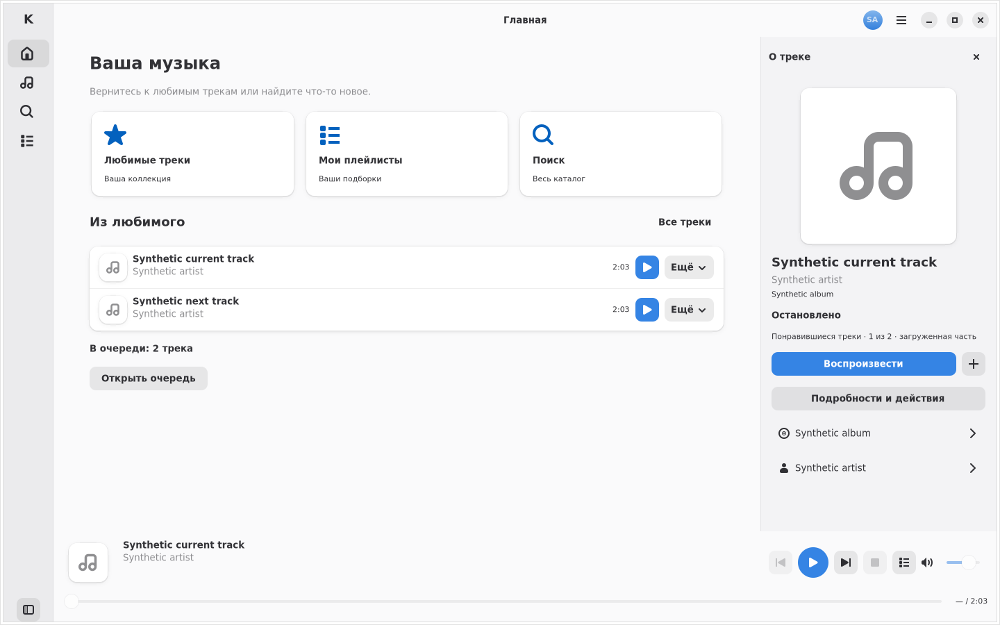

<!-- SPDX-License-Identifier: GPL-3.0-or-later -->

# v0.3 native GTK review

Captured on 2026-10-31 using GTK/Libadwaita under Xvfb and Openbox. Component
images use runtime `44b00a3f98e05704cb5a5240a382e3b9dbb01fbd`; refreshed
`workspace-shell-*` images use final runtime
`57ab96d7c7d3a64a5b0aaa72ac18cc65c3c0b020`. The per-file source revision is
recorded in [captures.json](captures.json).
These are unretouched synthetic fixture windows: no real account,
provider response, service artwork, secret or desktop screenshot is included.
They are cloud layout evidence, not Fedora Wayland, KWallet/Secret Portal or
audible Music acceptance. See [validation](../../VALIDATION.md#v03-execution-record)
and the [UI quality gate](../../UI_QUALITY_GATE.md).

The complete local capture matrix also exercised scale 2 and actual
WM-maximized windows. Selected images below retain their original filenames
and pixel dimensions; [SHA256SUMS](SHA256SUMS) identifies the published PNGs.
Structural and actual input/lifecycle tests accompany
them; an image alone does not establish action behavior or persistence.

| Window/state | Size | Screenshot |
| --- | --- | --- |
| Wide current track, light | 1440×900 | [Open](workspace-shell-wide-current-light.png) |
| Wide current track, dark | 1440×900 | [Open](workspace-shell-wide-current-dark.png) |
| Wide independently selected track, light | 1440×900 | [Open](workspace-shell-wide-selected-light.png) |
| Compact explicit track overlay, dark | 420×720 | [Open](workspace-shell-compact-manual-info-dark.png) |
| Medium explicit track overlay, light | 900×650 | [Open](workspace-shell-medium-manual-info-light.png) |
| Openbox-maximized shell, light | 1920×1080 | [Open](workspace-shell-maximized-light.png) |
| Inline cache-clear failure, light | 420×720 | [Open](preferences-seamless-compact-operation-error-light.png) |
| Inline preference-save failure, dark | 420×720 | [Open](preferences-seamless-compact-save-error-dark.png) |
| Playlist creation with unknown write outcome, dark | 900×650 | [Open](playlist-create-uncertain-dark.png) |
| Compact playlist tiles and title wrapping, light | 420×720 | [Open](workspace-playlist-grid-compact-light.png) |
| Detail's saved/stale label after unrelated background reply, light | 900×650 | [Open](cache-detail-stale-after-background-library-light.png) |
| Six complete search rows, light | 900×650 | [Open](search-normalized-dense-medium-light.png) |
| Six complete search rows, dark | 900×650 | [Open](search-normalized-dense-medium-dark.png) |
| Wide current track, dark, 2× | 2880×1800 | [Open](hidpi/workspace-shell-wide-current-dark.png) |
| Compact explicit overlay, light, 2× | 840×1440 | [Open](hidpi/workspace-shell-compact-manual-info-light.png) |
| Openbox-maximized shell, light, 2× | 3840×2160 | [Open](hidpi/workspace-shell-maximized-light.png) |
| Inline cache-clear failure, dark, 2× | 840×1440 | [Open](hidpi/preferences-seamless-compact-operation-error-dark.png) |

The compact pane scrolls inside the area above the retained player bar; content
below the viewport remains reachable. The wide pane clearly separates a selected
track from the current player. Long playlist tile metadata may use two-line
ellipsis with full tooltip/accessibility/detail text; headings and errors remain
fully readable.

Review found and corrected muted playlist error text, a preferences outcome
that could scroll away, and spacing retained by an unrevealed cache banner.
Fresh images and input tests checked those changes, preserving the six-complete-
track-row density threshold at 900×650. Missing-cover icons demonstrate fallback
layout; these images do not accept real-provider cover appearance or every
large-library composition.

An initial hosted geometry check at `1ffed2b` misclassified Libadwaita 1.5's
mapped, translated closed wide pane as clipping. The follow-up helper uses the
native sidebar visibility state at every width; it retains open-pane checks and
adds closed-content-width/resize assertions, with local 1×/2× reruns passing.
The published image revisions remain those in `captures.json`; final hosted
verification of that helper is tracked in the Draft PR checks/artifacts.

Two earlier GTK measurement/allocation warnings were traced to an unavailable
pane participating in breakpoint layout. Final runtime `57ab96d` excludes it;
the exact-1.98.1 offline release passed GTK smoke with
`G_DEBUG=fatal-warnings` and no warnings. This is recorded separately from visual
review. The [single Fedora procedure](../../BUILDING.md#v03-seamless-experience-acceptance-on-fedora)
remains pending for the new protected session, actual music and current Flatpak.
